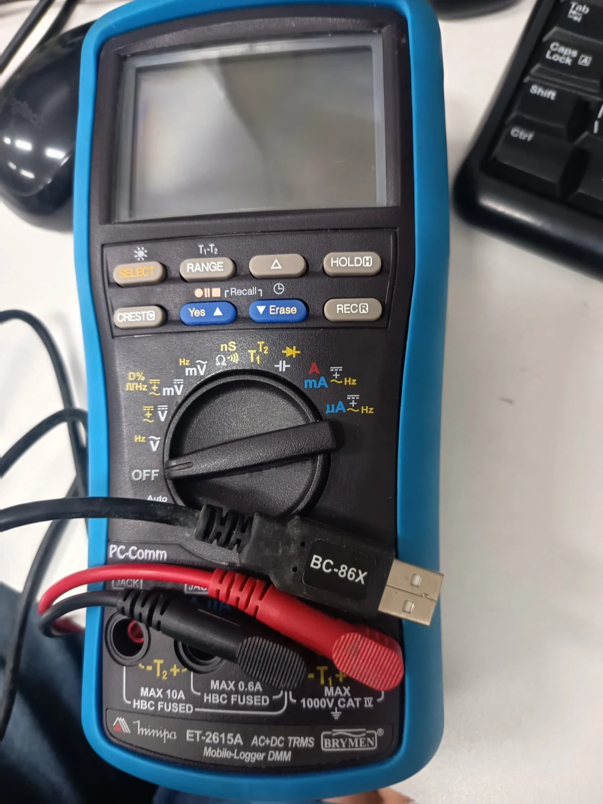

# Brymen DMM REST

<p align="center"></p>

Port para .NET 10 do *Bs82-52x Data Recording System V6.0.0.9*, o software Windows da Brymen que lê
os multímetros das famílias BM52x e BM82x pelo cabo óptico USB **BC-86X** (kit **BU-86X**). Dois
medidores foram validados no hardware:

- **Brymen BM525s**, vendido no Brasil como **Minipa ET-2615A**: família BM52x, com datalogger;
- **Minipa ET-2517A**: família BM82x, sem datalogger.

A família é detectada sozinha na 1ª leitura ([Medidores suportados](#medidores-suportados)).

O resultado é um serviço com API REST que roda em **Linux arm64** (Raspberry Pi), **Linux x64** e,
para desenvolvimento, **Windows**. Ele oferece:

- leitura em tempo real, em JSON, em fluxo Server-Sent Events ou por SignalR (cada nova leitura do
  multímetro é enviada aos clientes conectados);
- gravação equivalente ao Graphical Recorder e à Data List, com exportação CSV no formato do original;
- comparador Hi/Lo;
- importação da memória do datalogger (BM52x);
- painel web mínimo.

Para usar o medidor em outro programa .NET (8 ou mais novo), sem a API, há a biblioteca
[`Brymen.Dmm`](src/Brymen.Dmm/README.md), num pacote NuGet único e sem dependências
([Biblioteca .NET (NuGet)](#biblioteca-net-nuget)).

Não há dependências nativas de terceiros. No Linux o acesso ao cabo é feito pelo `hidraw` com a
`libc`; no Windows, pela `hid.dll`.

> Este projeto não é afiliado à Brymen nem à Minipa. Veja o [aviso](#aviso-legal) no final.

## Conteúdo

- [Hardware suportado](#hardware-suportado)
  - [Medidores suportados](#medidores-suportados)
  - [Família e pedidos descartados](#família-e-pedidos-descartados)
- [Arquitetura](#arquitetura)
- [Como o REA foi usado](#como-o-rea-foi-usado)
- [Pré-requisitos](#pré-requisitos)
- [Executar no Windows](#executar-no-windows)
- [Executar no Linux](#executar-no-linux)
- [Modo simulado](#modo-simulado)
- [Biblioteca .NET (NuGet)](#biblioteca-net-nuget)
- [API REST](#api-rest)
- [Tempo real via SignalR](#tempo-real-via-signalr)
- [Configuração](#configuração)
- [Deploy com systemd e udev (Raspberry Pi e x64)](#deploy-com-systemd-e-udev-raspberry-pi-e-x64)
- [Docker](#docker)
- [Segurança](#segurança)
- [Testes](#testes)
- [Solução de problemas](#solução-de-problemas)
- [Limitações e questões em aberto](#limitações-e-questões-em-aberto)
- [Aviso legal](#aviso-legal)

## Hardware suportado

| Item | Detalhe |
|---|---|
| Multímetros | Família **BM52x** (Model ID `52h`, com datalogger): Brymen **BM525s**, que é o mesmo aparelho do **Minipa ET-2615A**. Família **BM82x** (Model ID `82h`, sem datalogger): **Minipa ET-2517A**. As duas usam o mesmo cabo e o mesmo mapa de LCD. |
| Cabo | **BC-86X**, óptico (infravermelho) para USB, vendido no kit **BU-86X**. |
| USB | HID genérico, VID **0x0820**, PID **0x0001**, bcdDevice 0x8603, usage page 0xFF00. Fabricante `Brymen`, produto `Superior DMM`. Não precisa de driver no Windows nem no Linux. |
| Protocolo | Comando `00 fam cc` no relatório de saída, em que `fam` é o código da família (`52` ou `82`). O `66` lê o tempo real (27 bytes): `52 66` no BM52x e `82 66` no BM82x. O BM525s também responde ao `82 66`, com o mesmo quadro, e o ET-2517A não responde ao `52 66`. Os comandos `52 88`, `52 89` e `52 8A` leem a memória do datalogger do BM52x (36 bytes por bloco); o BM82x não tem memória. |
| Testado | BM525s no Windows 11 e num Orange Pi 5 (Linux arm64); ET-2517A no Windows. Capturas reais em [`docs/protocol/captures/`](docs/protocol/captures/). |

### Medidores suportados

| Medidor | Família (Model ID) | Datalogger | Situação |
|---|---|---|---|
| Brymen **BM525s** = **Minipa ET-2615A** | BM52x (`52h`) | sim | **Validado** no Windows 11 e num Orange Pi 5 (Linux arm64): tempo real, importação da memória, API e biblioteca ([relatório de validação](docs/validation-report.md)). |
| **Minipa ET-2517A** | BM82x (`82h`) | não | **Validado** no Windows: identificação, `82 66`, decodificação de todos os quadros de uma varredura pelas funções do medidor e medição dos pedidos descartados ([§8 da especificação](docs/protocol/bm52x-usb-protocol.md#8-família-bm82x-model-id-0x82-e-o-minipa-et-2517a)). |
| Brymen BM521s | BM52x (`52h`, não confirmado por captura) | sim | Provável, **não validado**. |
| Brymen BM821s, BM822s, BM827s e BM829s | BM82x (`82h`) | não | Prováveis, **não validados**. O ET-2517A deve ser o BM827s com a marca Minipa (mesmas funções, especificações e dimensões, e o logotipo Brymen no manual), o que não foi confirmado. |
| Brymen BM520 e BM820 (sem o “s”) | BM52x e BM82x, pelos títulos dos protocolos da Brymen | BM820: não; BM520: não confirmado | Não confirmados nem validados. |

- O Model ID identifica a família, e não o modelo: pela USB, um ET-2517A não se distingue de um BM829s. A biblioteca e
  a API expõem a família, com uma descrição que cita os modelos validados (`Minipa ET-2615A (Brymen BM525s, BM52x)` e
  `Minipa ET-2517A (Brymen BM827s, BM82x)`).
- Rebrands possíveis, **não validados**: Greenlee DM-810A, DM-820A e DM-830A (parecidos com os BM82x) e DML-430A
  (parecido com o BM525s), com o kit USB DMSC-9U, que pode não usar o mesmo protocolo HID.
- A série BM860s (BM867s, BM869s) usa o mesmo kit BU-86X, mas outro protocolo e outro software: **não é suportada**.
- A versão 0.2.0 foi validada com o **ET-2517A real** no Windows
  ([§11 do relatório](docs/validation-report.md#11-minipa-et-2517a-família-bm82x)): testes de hardware, 3 min de
  leitura a 200 ms e 1 min a 500 ms sem `W7012`, `E9016` nem reabertura do cabo, API (`model` BM82x, SSE, SignalR,
  `E9014` e painel) e pacotes. Nessa sessão o medidor não descartou nenhum pedido, e o reenvio só foi exercitado com
  descartes injetados no host. Faltam o BM525s real com a 0.2.0 (o `82 66` da detecção e a importação) e a 0.2.0 num
  Linux real ([CHANGELOG](CHANGELOG.md#não-validado)).

### Família e pedidos descartados

- **Detecção.** A 1ª consulta depois de abrir o cabo envia `82 66`, que as duas famílias aceitam, e já é uma leitura:
  os bytes 20 a 23 do quadro (o Model ID) dão a família. Sem nenhum relatório, ela tenta o `52 66`. Depois, o BM52x é
  lido com `52 66` e o BM82x com `82 66`. Um medidor trocado no cabo é detectado de novo pelo Model ID da outra
  família, ou depois de 3 consultas seguidas sem resposta. A família também pode ser fixada (`Meter:Family` na API,
  `BrymenMeterOptions.Family` na biblioteca).
- **Pedidos descartados.** O ET-2517A descarta uma parte dos pedidos de tempo real, tanto mais quanto maior o intervalo
  entre as consultas, e esperar mais não adianta: o pedido se perde, e só reenviar resolve.

  | Intervalo entre consultas | 0 ms | 100 ms | 200 ms | 300 ms | 500 ms |
  |---|---|---|---|---|---|
  | Pedidos sem resposta (de 40) | 0 | 2 | 11 | 11 | 19 |

  O BM525s nunca mostrou isso: 5 leituras/s, sem lacunas, por minutos.
- **Reenvio.** No BM82x, cada consulta reenvia o mesmo pedido, sem fechar o cabo, depois de 300 ms sem o 1º relatório
  (`Meter:RealTimeResendTimeout`), até 2 s (`Meter:RealTimeResendBudget`). Só quando esse orçamento acaba a consulta é
  uma falha (`W7012`); as perdas recuperadas não geram erro e ficam contadas em `realTimeStatistics` de
  `GET /api/v1/meter`.
- **Datalogger.** Só o BM52x tem. Num BM82x, a importação é recusada com `E9014` (409), sem nenhum comando de memória:
  na hora com o polling rodando (ou com `Meter:Family` fixa), e depois de uma consulta de tempo real que confirma a
  família quando o último quadro tem mais de 2 s (o medidor pode ter sido trocado no cabo).

Os detalhes estão na [§8 da especificação](docs/protocol/bm52x-usb-protocol.md#8-família-bm82x-model-id-0x82-e-o-minipa-et-2517a)
e no [guia da biblioteca](docs/library.md#famílias-bm52x-e-bm82x).

## Arquitetura

A especificação completa está em [`docs/architecture.md`](docs/architecture.md).

```text
BM525s ou ──IR── BC-86X ──USB HID── Brymen.Dmm.Hid       hidraw (Linux) / hid.dll (Windows), Bu86xLink
ET-2517A                                  │ quadros de 27 bytes (tempo real) e 36 bytes (memória)
                                    Brymen.Dmm.Protocol  RTD → DmmReading (família pelo Model ID); blocos → LoggerMemory
                                          │
                                    Brymen.Dmm           BrymenMeter, MeterConnection (família, 1º 66 lento,
                                          │              reenvio do BM82x), LoggerMemoryReader (NuGet, net8.0/net10.0)
                                    Brymen.Dmm.Api       polling, aquisição, comparador, importação,
                                                         CSV, SSE, SignalR, OpenAPI, health checks, painel
```

| Projeto | Responsabilidade |
|---|---|
| `src/Brymen.Dmm.Protocol` | Decodificação pura, sem E/S: quadro RTD de 27 bytes das duas famílias → `DmmReading` (com a família do Model ID, `MeterFamily`); blocos de memória de 36 bytes → `MemoryBlock`; imagem da memória → `LoggerMemory`. |
| `src/Brymen.Dmm.Hid` | Transporte HID multiplataforma (`IHidDeviceProvider` / `IHidDevice`) para Linux (hidraw) e Windows (hid.dll com E/S sobreposta), medidores simulados (o BM525s e o ET-2517A, com as capturas reais, a injeção de falhas e o descarte de pedidos) e enquadramento do BC-86X (`Bu86xLink`, com o reenvio de pedidos). |
| `src/Brymen.Dmm` | Biblioteca para outros projetos .NET (pacote NuGet `Brymen.Dmm`, `net8.0` e `net10.0`): `BrymenMeter` (leitura avulsa, contínua e por eventos, reconexão, importação da memória), `MeterConnection` (abertura do cabo, detecção da família, timeout do 1º `66` lento e reenvio do BM82x) e `LoggerMemoryReader` (algoritmo robusto da memória), usados também pela API. |
| `src/Brymen.Dmm.Api` | ASP.NET Core minimal API: polling, aquisição, comparador, importação do datalogger, export CSV, SSE, hub SignalR (`/hubs/meter`), OpenAPI, health checks e o painel em `wwwroot/`. |
| `tests/*` | xUnit: vetores do protocolo, enquadramento HID, testes de integração da API com o dispositivo simulado e, opcionais, testes com o cabo real e com um cabo virtual pelo `/dev/uhid`. |
| `samples/Brymen.Dmm.SignalRClient` | Cliente de console do hub SignalR ([Tempo real via SignalR](#tempo-real-via-signalr)). |
| `samples/Brymen.Dmm.ConsoleSample`, `samples/Brymen.Dmm.WorkerSample` | Exemplos que consomem os pacotes NuGet ([Biblioteca .NET (NuGet)](#biblioteca-net-nuget)). |
| `deploy/` | Regra udev, unit systemd, scripts de instalação e de publish (linux-arm64/x64). O `Dockerfile` e o `docker-compose.yml` ficam na raiz. |

Documentos de referência:

- [`docs/protocol/bm52x-usb-protocol.md`](docs/protocol/bm52x-usb-protocol.md): protocolo USB, verificado
  por revisão adversarial e no hardware real, com [`test-vectors.json`](docs/protocol/test-vectors.json)
  e as [capturas](docs/protocol/captures/); a §8 trata da família BM82x e do ET-2517A, com os scripts de captura em
  [`docs/protocol/tools/`](docs/protocol/tools/);
- [`docs/re/bs8252x-reverse-engineering.md`](docs/re/bs8252x-reverse-engineering.md): comportamento do
  software original (formatos CSV e `.g53`, timeouts, comparador, importação, mensagens);
- [`docs/validation-report.md`](docs/validation-report.md): validação da integração (build, testes, tamanhos
  dos pacotes e testes de ponta a ponta com o BM525s real no Windows e num Orange Pi 5);
- [`CHANGELOG.md`](CHANGELOG.md): as mudanças de cada versão.

## Como o REA foi usado

O comportamento do original foi levantado por **engenharia reversa estática**: nem o `.exe` nem o
cabo foram executados nessa etapa. A ferramenta principal foi o **REA (Reverse Engineer Anything)
6.7.0**. Resumo (detalhes, comandos exatos e resultados na
[§3 do relatório de RE](docs/re/bs8252x-reverse-engineering.md#3-como-o-rea-foi-usado)):

- `rea inspect-artifact` e `inspect-managed-artifact` classificaram o binário como PE32 nativo, sem
  metadados .NET. As strings e o linker mostraram que é um programa C++Builder 5 com VCL.
- `rea inspect-pe-resources` extraiu os 116 recursos: os formulários VCL (RCDATA), a string table com
  as mensagens W/E, os ícones e o VERSIONINFO.
- `rea inspect-with-objdump`, com o `llvm-objdump` apontado por `REA_OBJDUMP_COMMAND`, deu os
  cabeçalhos, as seções e a desmontagem. O REA trunca a saída em 16 MiB.
- Os provedores de análise profunda (Ghidra, IDA, Hopper, Rizin) não estavam disponíveis, então
  `analyze`, `function` e `decompile` não puderam ser usados. Por isso a análise foi completada com o
  `llvm-objdump` e o `dumpbin` diretamente e com scripts Python próprios: decodificação dos
  formulários, string table, varredura das VMTs da VCL, resolução de switches e reimplementação da
  decodificação, conferida com as capturas.

O resultado são os 27 módulos do programa, 147 handlers de UI com endereço e o caminho completo
da E/S HID (timeouts, retentativas, `82 66` × `52 66`). Saíram dali também os formatos de arquivo
(CSV, `.g53`, `.TMP`, `BTCDL.ini`), o comparador e as mensagens. Uma
[revisão adversarial independente](docs/re/bs8252x-reverse-engineering.md#16-revisão-adversarial-independente)
conferiu os pontos críticos na desmontagem. As listas de requisitos de paridade (P0/P1/P2) da §13
guiaram esta port.

## Pré-requisitos

- **.NET SDK 10.0** (10.0.100 ou mais novo da linha 10.0, conforme o [`global.json`](global.json)), para
  compilar, testar e publicar. Qualquer banda serve, inclusive o pacote `dotnet-sdk-10.0` do Ubuntu (10.0.1xx).
- **Windows 10/11** (x64) para desenvolvimento: o cabo usa o driver HID do sistema.
- **Linux arm64 ou x64** com glibc, kernel com `hidraw` (`CONFIG_HIDRAW`) e, para o serviço, systemd.
  No Raspberry Pi use um sistema **64 bits**: `dpkg --print-architecture` deve mostrar `arm64`. O
  `uname -m` não serve para isso: ele mostra o kernel, que é `aarch64` também no Raspberry Pi OS de 32 bits
  (armhf) do Pi 4/400 e do Pi 5. O armv7/armhf de 32 bits não é publicado.
- No alvo de um publish **self-contained** não é preciso instalar o .NET.
- Para a imagem de contêiner (opcional): Docker com **buildx** (BuildKit). Sem ele, o builder legado compila a imagem
  da arquitetura da própria máquina ([Docker](#docker)).

## Executar no Windows

```powershell
dotnet run --project src/Brymen.Dmm.Api
```

- Painel: <http://localhost:5080/>. Documento OpenAPI: <http://localhost:5080/openapi/v1.json>.
  O endereço vem da chave `Urls` (padrão `http://0.0.0.0:5080`); confira a linha `Now listening on`
  no console.
- O cabo aparece no Gerenciador de Dispositivos como "Dispositivo compatível com HID"
  (`VID_0820&PID_0001`). Não instale driver.
- Feche o software original antes: dois programas consultando o mesmo cabo misturam as respostas.

## Executar no Linux

1. Instale a regra udev, para usar o cabo sem root:

   ```bash
   sudo groupadd --system brymen-dmm             # o grupo citado na regra precisa existir
   sudo install -m 0644 deploy/linux/99-brymen-bu86x.rules /etc/udev/rules.d/
   sudo udevadm control --reload
   # reaplica as regras só ao hidraw do cabo (ou desligue e religue o cabo)
   for n in /sys/class/hidraw/hidraw*; do
       grep -qix 'HID_ID=0003:00000820:00000001' "$n/device/uevent" &&
           sudo udevadm trigger --action=change --subsystem-match=hidraw --sysname-match="${n##*/}"
   done
   ls -l /dev/brymen-bu86x                       # symlink para /dev/hidrawN
   ```

   O laço acha o cabo pelo `HID_ID` do dispositivo HID (barramento USB, VID 0820, PID 0001). Sem ele, um
   `udevadm trigger --subsystem-match=hidraw` mandaria um `change` a todos os hidraw da máquina, e as regras dos
   outros dispositivos HID rodariam de novo.

   A regra dá acesso ao usuário da sessão local (`uaccess`). Numa sessão SSH, entre no grupo:
   `sudo usermod -aG brymen-dmm "$USER"` e abra uma nova sessão.

2. Rode a API:

   ```bash
   dotnet run --project src/Brymen.Dmm.Api
   # opcional: fixar o dispositivo
   Meter__DevicePath=/dev/brymen-bu86x dotnet run --project src/Brymen.Dmm.Api
   ```

Para rodar como serviço, veja [Deploy com systemd e udev](#deploy-com-systemd-e-udev-raspberry-pi-e-x64).

## Modo simulado

Com `Meter:Transport` = `Simulated`, a API usa um medidor simulado que reproduz as capturas reais, embutidas no
executável. `Meter:SimulatedModel` escolhe qual:

- `Bm525s` (padrão): o `52 66` e o `82 66` percorrem em ciclo os quadros de
  [`rtd-acv.txt`](docs/protocol/captures/rtd-acv.txt) (ACV com Hz no display secundário), e a importação lê
  [`memory-dump-1.txt`](docs/protocol/captures/memory-dump-1.txt), com 1 sessão e 375 amostras;
- `Et2517a`: o `82 66` percorre os 43 quadros reais da varredura do ET-2517A
  ([`et2517a-sweep-2026-10-23.txt`](docs/protocol/captures/et2517a-sweep-2026-10-23.txt): ACV, DCV, Hz, continuidade,
  temperatura, diodo, faixa manual e REC), sem datalogger e com o descarte de pedidos medido no medidor real; os
  reenvios aparecem em `realTimeStatistics` de `GET /api/v1/meter`.

Funciona em qualquer sistema e sem o cabo, e é o modo usado nos testes de integração. Os medidores simulados são o
`SimulatedBm52xMeter.FromCaptures()` e o `SimulatedBm52xMeter.FromEt2517aCaptures()` da biblioteca `Brymen.Dmm.Hid`,
com injeção de falhas por comando (`FaultInjector`) e, no BM525s, o `8A` que, logo depois do `88`, avança como um `89`,
como no medidor real.

```bash
Meter__Transport=Simulated dotnet run --project src/Brymen.Dmm.Api
Meter__Transport=Simulated Meter__SimulatedModel=Et2517a dotnet run --project src/Brymen.Dmm.Api
```

```powershell
$env:Meter__Transport = 'Simulated'; dotnet run --project src/Brymen.Dmm.Api
# ou, pela linha de comando:
dotnet run --project src/Brymen.Dmm.Api -- --Meter:Transport=Simulated --Meter:SimulatedModel=Et2517a
```

Com `Auto` (o padrão), o serviço usa o HID da plataforma e só recorre ao simulado quando a plataforma
não tem transporte HID. Num Linux ou Windows sem o cabo, `Auto` **não** cai no simulado: a API
responde 503 (`E9015`) até o cabo aparecer.

## Biblioteca .NET (NuGet)

Para integrar o medidor em outros projetos .NET 8 ou mais novos, sem a API, há dois pacotes, com alvos `net8.0` e
`net10.0`:

- [`Brymen.Dmm`](src/Brymen.Dmm/README.md): o `BrymenMeter` (leitura avulsa, contínua ou por eventos, com reconexão
  automática, detecção da família e reenvio dos pedidos descartados pelo BM82x, e importação do datalogger do BM52x com
  o mesmo algoritmo da API) e os medidores simulados. Um pacote único, sem dependências, que leva dentro o
  `Brymen.Dmm.Protocol` e o `Brymen.Dmm.Hid`.
- [`Brymen.Dmm.Extensions.Hosting`](src/Brymen.Dmm.Extensions.Hosting/README.md) (opcional): `AddBrymenMeter` para o
  Generic Host, com um serviço hospedado e o `IBrymenMeterAccessor`.

```csharp
await using var meter = await BrymenMeter.OpenAsync();      // E9015 sem o cabo; OpenSimulatedAsync() sem hardware
await foreach (var r in meter.ReadContinuouslyAsync())      // a cada 200 ms, com reconexão automática
    Console.WriteLine($"{r.Family} {r.Main?.Text} {r.Main?.UnitSymbol}");   // Bm52x ou Bm82x, pelo Model ID
```

```bash
dotnet pack src/Brymen.Dmm -c Release -o artifacts/packages                      # Brymen.Dmm.<versão>.nupkg e .snupkg
dotnet pack src/Brymen.Dmm.Extensions.Hosting -c Release -o artifacts/packages
dotnet run --project samples/Brymen.Dmm.ConsoleSample -- --simulated --count 10   # consome o pacote do feed local
dotnet run --project samples/Brymen.Dmm.ConsoleSample -- --simulated et2517a --count 10
```

O guia completo, com a API pública, threads, erros e códigos, ciclo de vida, trimming/AOT, Linux e Windows e o
empacotamento, está em [`docs/library.md`](docs/library.md). Os exemplos
[`ConsoleSample`](samples/Brymen.Dmm.ConsoleSample/README.md) e [`WorkerSample`](samples/Brymen.Dmm.WorkerSample/README.md)
consomem os pacotes do feed local `artifacts/packages`. Os pacotes são MIT, e as mudanças de cada versão estão no
[CHANGELOG](CHANGELOG.md).

## API REST

Base: `http://<host>:5080`. O esquema exato de cada requisição e resposta está em
`GET /openapi/v1.json`.

| Método | Rota | Descrição | Original |
|---|---|---|---|
| `GET` | `/` | Painel web mínimo, com o medidor detectado no título | Digital/Analog Meter |
| `GET` | `/api/v1/meter` | Estado do link (`unlinked`, `connecting`, `connected`, `reconnecting`...), do cabo, último erro, medidor detectado (`model`) e contadores do tempo real (`realTimeStatistics`) | — |
| `PUT` | `/api/v1/meter/link` | `{ "enabled": true }` liga o polling (uma consulta de tempo real a cada `Meter:PollInterval`: `82 66` na detecção, depois `52 66` no BM52x e `82 66` no BM82x); `false` desliga | Link/Unlink |
| `GET` | `/api/v1/readings/latest` | Última leitura: displays, anunciadores e resultado do comparador. `409` com `E9002` com o link desativado (`503` com `E9015` se o Link falhou por falta do cabo) e com `CONFLICT` durante a importação | Digital Meter |
| `GET` | `/api/v1/readings/stream` | Server-Sent Events, um evento `reading` por leitura e um `heartbeat` a cada 15 s | Digital/Analog Meter |
| — | `/hubs/meter` | Hub SignalR: eventos `reading`, `status` e `acquisitionSample` ([detalhes](#tempo-real-via-signalr)) | Digital/Analog Meter |
| `GET` | `/api/v1/acquisition` | Estado da gravação: modo, amostras, capacidade, backup e Max/Min (por unidade e acoplamento: recomeçam quando a função do medidor muda) | Graphical Recorder / Data List |
| `GET`, `PUT` | `/api/v1/acquisition/settings` | Modo `fullSpeed` (toda leitura), `interval` (N s inteiros) ou `manual`; o `PUT` responde `409` com a gravação em andamento | Interval / Customization... |
| `POST` | `/api/v1/acquisition/start`, `/stop` | Inicia (exige link: `409` com `E9002`) e para a gravação | Start/Stop |
| `POST` | `/api/v1/acquisition/samples` | Uma amostra manual (modo `manual`, gravação iniciada); `409` durante a importação | Manual |
| `GET` | `/api/v1/acquisition/samples` | Amostras do buffer, paginadas (`offset`, `limit`) | Data List |
| `GET` | `/api/v1/acquisition/samples.csv` | Export CSV com o cabeçalho do original; `?format=extended` acrescenta colunas ISO-8601 e SI | Export → Text/Data |
| `DELETE` | `/api/v1/acquisition/samples` | Apaga o buffer | Clear |
| `GET` | `/api/v1/comparator` | Limites Hi/Lo e alarme | Comparator |
| `PUT` | `/api/v1/comparator` | Altera e persiste os limites (`settings.json`); campos ausentes ficam como estão | Comparator |
| `POST` | `/api/v1/logger/imports` | Inicia a importação do datalogger: `202 Accepted` + `Location`; `409` se outra estiver em andamento (`CONFLICT`) ou num medidor sem datalogger (`E9014`, família BM82x) | Import data from DMM |
| `GET` | `/api/v1/logger/imports` | Importações guardadas (as `Logger:ImportRetention` mais novas) | — |
| `GET`, `DELETE` | `/api/v1/logger/imports/{id}` | Progresso (`running`, `completed`, `failed`, `canceled`); `DELETE` cancela ou apaga | — |
| `GET` | `/api/v1/logger/imports/{id}/image` | Imagem bruta da memória (blocos de 24 bytes) | — |
| `GET` | `/api/v1/logger/imports/{id}/sessions` | Sessões importadas (`.../sessions/{n}` para uma só, `n` a partir de 1) | Data List |
| `GET` | `/api/v1/logger/imports/{id}/sessions/{n}/samples` | Amostras de uma sessão (JSON, paginado) | Data List |
| `GET` | `/api/v1/logger/imports/{id}/sessions/{n}/samples.csv` | Amostras de uma sessão (CSV); `MainData`/`Sub Data` com 4 dígitos e zeros à esquerda, como o original (`02.87`) | Export |
| `GET` | `/health/live` | Processo no ar | — |
| `GET` | `/health/ready` | Pronto quando o cabo está aberto ou o transporte é simulado | — |
| `GET` | `/openapi/v1.json` | Documento OpenAPI | — |

As rotas da imagem e das sessões respondem `409` (`CONFLICT`) enquanto a importação está em andamento ou
se ela não terminou com sucesso. A lista completa de respostas por rota está em
[`docs/architecture.md`](docs/architecture.md#rotas).

**Painel.** O título do painel em `/` mostra o medidor detectado (`Minipa ET-2517A (Brymen BM827s, BM82x)`, por exemplo; “Brymen DMM”
antes da 1ª leitura), com a família, o Model ID e os reenvios do tempo real na dica. Num medidor sem datalogger, o botão
“Importar do medidor” some, e uma nota avisa que não há memória para importar.

**Erros.** As falhas voltam como `ProblemDetails` (RFC 9457), com o código em `code`: o do software
original (W/E) ou um código da API. Cabo ausente responde **503**.

```json
{ "status": 503, "title": "Cabo adaptador USB não encontrado", "detail": "Cabo adaptador USB não encontrado.", "code": "E9015" }
```

| Código | Significado | HTTP |
|---|---|---|
| `E9015` | Cabo USB não encontrado | 503 |
| `E9016` | Tempo esgotado na transmissão (3ª falha seguida do tempo real ou importação) | 503 |
| `E9017` | Medidor desligado, desconectado ou sem datalogger | 503 |
| `E9014` | Medidor sem datalogger (família BM82x, como o ET-2517A): a importação é recusada sem nenhum comando de memória e sem criar importação. Código da biblioteca, não do original | 409 |
| `W7012` | Nenhum dado recebido (tempo real; no BM82x, depois de esgotados os reenvios) | 503 |
| `W8011` | Quadro inválido recebido do medidor | 503 |
| `E9002` | Link desativado (gravação ou leitura sem link) | 409 |
| `E9003` | Falha ao criar ou gravar o arquivo de backup (aparece em `backupError` de `GET /api/v1/acquisition`) | — |
| `E9007`, `E9008`, `W7010` | Valor inválido, limite inaceitável, Hi ≤ Lo | 400 |
| `W8000` | Bateria do multímetro fraca (anunciador `LOW_BATTERY` da leitura) | — |
| `FORBIDDEN` | `POST`, `PUT`, `DELETE` ou WebSocket do hub vindos de uma página de outra origem ([Segurança](#segurança)) | 403 |
| `NOT_FOUND` | Rota, importação ou sessão inexistente | 404 |
| `METHOD_NOT_ALLOWED` | Rota existente com outro método HTTP | 405 |
| `VALIDATION` | Corpo ou parâmetro inválido (JSON malformado, `offset`, `limit`, `format`) | 400 |
| `CONFLICT` | Não permitido no estado atual: importação ou gravação em andamento, buffer cheio | 409 |
| `INTERNAL` | Erro interno; a resposta não traz detalhes da exceção | 500 |

### Exemplos com curl

```bash
H=http://localhost:5080

# Estado, medidor detectado e link
curl -s "$H/api/v1/meter"
curl -s -X PUT "$H/api/v1/meter/link" -H 'Content-Type: application/json' -d '{"enabled":true}'

# Última leitura e fluxo SSE (-N desliga o buffer do curl)
curl -s "$H/api/v1/readings/latest"
curl -N "$H/api/v1/readings/stream"
# event: reading
# id: 42
# data: {"sequence":42,"timestamp":"…","main":{"text":"0.287","value":0.287,"unit":"V","mode":"AC",…},"secondary":{"text":"0.000","unit":"Hz",…},"flags":["AUTO",…],"comparator":null,"rawHex":"…"}
```

O fluxo SSE começa pela última leitura conhecida e manda um evento `heartbeat`, sem leitura, a cada
`Sse:HeartbeatInterval` (15 s), para que proxies não fechem a conexão ociosa durante uma importação ou uma
falha do cabo. Ele termina quando o serviço é encerrado.

**Medidor detectado.** `GET /api/v1/meter` traz, em `model`, a família que o Model ID do tempo real identifica (`null`
antes da 1ª leitura e depois de 3 consultas seguidas sem resposta), e, em `realTimeStatistics`, os contadores do tempo
real desde a partida do serviço. Com o ET-2517A simulado (`Meter:SimulatedModel=Et2517a`):

```json
{
  "linkEnabled": true, "state": "connected", "transport": "simulated", "...": "...",
  "model": { "family": "BM82x", "modelId": "0x82", "name": "Minipa ET-2517A (Brymen BM827s, BM82x)", "supportsDataLogger": false },
  "realTimeStatistics": { "queries": 27, "requests": 33, "resends": 6, "lostRequests": 6, "recoveredQueries": 4, "failedQueries": 0 }
}
```

`family` é `BM52x` ou `BM82x`; `modelId`, `0x52` ou `0x82` (o mesmo código do pedido de tempo real); `name` cita os
modelos validados da família; e `supportsDataLogger = false` quer dizer que a importação responde 409 com `E9014`. Os
contadores são os da biblioteca ([`RealTimeStatistics`](docs/library.md#pedidos-descartados-e-reenvio)): consultas,
pedidos enviados, reenvios, pedidos perdidos, consultas recuperadas por reenvio e consultas sem resposta (cada uma, um
`W7012`). O evento SignalR `status` também sai quando a família muda.

Gravação (Graphical Recorder) e exportação CSV:

```bash
curl -s -X PUT "$H/api/v1/acquisition/settings" -H 'Content-Type: application/json' \
     -d '{"mode":"interval","intervalSeconds":5}'          # ou "fullSpeed" / "manual"
curl -s -X POST "$H/api/v1/acquisition/start"
curl -s "$H/api/v1/acquisition"                            # estado, amostras, Max/Min
curl -s -X POST "$H/api/v1/acquisition/samples"            # só no modo manual
curl -s "$H/api/v1/acquisition/samples?offset=0&limit=100"
curl -s -X POST "$H/api/v1/acquisition/stop"
curl -s -o gravacao.csv "$H/api/v1/acquisition/samples.csv"
curl -s "$H/api/v1/acquisition/samples.csv?format=extended"
curl -s -X DELETE "$H/api/v1/acquisition/samples"
```

O CSV segue o original: separador vírgula, linhas CRLF, `#item` a partir de 1, `Time` no formato
`%3d:%02d:%02d.%1d` do tempo decorrido, dados como aparecem no display e `Ohm` no lugar de Ω:

```text
#item,Time,MainData,MainUnit,MainFunc,Sub Data,SubUnit,SubFunc
1,  0:00:00.0,0.287,V,AC,0.000,Hz,
2,  0:00:05.0,0.156,V,AC,0.000,Hz,
```

O formato estendido acrescenta `Timestamp,MainSiValue,SubSiValue,Flags,Comparator`. Durante a
gravação, cada amostra também vai para o backup `~BDMDLn.csv` em `<DataDirectory>/backup`.

Algumas divergências do original são deliberadas ([detalhes](docs/architecture.md#divergências-deliberadas-em-relação-ao-original)):

- `Time` é o **tempo decorrido** desde a 1ª amostra, e não a hora do relógio, que num Raspberry Pi sem RTC
  salta quando o NTP acerta o relógio; a hora absoluta fica em `Timestamp`;
- `fullSpeed` grava **toda leitura** do polling (a cada `Meter:PollInterval`, 200 ms por padrão), e não um
  timer de 500 ms; para o ritmo do original, use `Meter__PollInterval=00:00:00.500`;
- na **3ª falha seguida** do tempo real, o erro é `E9016` e o serviço continua tentando a cada
  `Meter:ReconnectDelay`; o original mostrava "No data received." e desfazia o link. No BM82x, uma falha é uma
  consulta com os reenvios esgotados, e não um pedido perdido;
- o original consulta o tempo real com `82 66` nas duas famílias, espera até 4 s e fecha e reabre o cabo quando o
  pedido se perde; a port usa `52 66` no BM52x depois da detecção e, no BM82x, reenvia o pedido a cada 300 ms sem
  fechar o cabo;
- num BM82x, a importação é recusada com `E9014`, e não com o `E9017` do original.

Comparador. Os limites valem para o valor SI do display principal (`0.5` = 0,5 V, não 0,5 mV);
`v > Hi` dá `High`, `v < Lo` dá `Low` e o resto é `Pass`:

```bash
curl -s "$H/api/v1/comparator"
curl -s -X PUT "$H/api/v1/comparator" -H 'Content-Type: application/json' \
     -d '{"enabled":true,"high":0.5,"low":0.1,"alarm":false}'
```

Importação do datalogger (só BM52x). O polling fica pausado enquanto ela dura, e `GET /api/v1/readings/latest`
responde `409` (`CONFLICT`). A leitura espera 200 ms depois do `88`, recupera uma falha do `88` com outro
`88` e só usa o `8A` depois de um `89` (§2.7 e §4.11 da especificação). No BM525s real, a importação de 2272
bytes leva cerca de 11 s. Depois dela, o medidor leva cerca de 2 s para responder ao primeiro `52 66`, que vem com
os displays em traços (`-.---`, `value` nulo); o polling espera até 3 s por essa resposta, sem acusar erro. Num
medidor da família BM82x (`model.supportsDataLogger = false`), o `POST` responde `409` com `E9014`, sem criar
importação nem enviar comando de memória: na hora com o polling rodando, e com a família ainda desconhecida (link
desativado desde a partida, por exemplo) ou conhecida há mais de 2 s, depois de uma consulta de tempo real que a
confirma (um BM525s posto no lugar do ET-2517A é importado normalmente):

```bash
loc=$(curl -s -D - -o /dev/null -X POST "$H/api/v1/logger/imports" | tr -d '\r' | sed -n 's/^[Ll]ocation: //p')
curl -s "$H$loc"                                           # progresso; repita até "completed"
curl -s "$H$loc/sessions"
curl -s "$H$loc/sessions/1/samples?limit=1000"
curl -s -o sessao1.csv "$H$loc/sessions/1/samples.csv"
curl -s -o memoria.bin "$H$loc/image"
```

## Tempo real via SignalR

O hub SignalR **envia cada nova leitura do multímetro** a todos os clientes conectados, sem que eles
precisem consultar a API. A fonte é a mesma do SSE: o hub não faz polling extra no cabo.

- Endpoint: **`/hubs/meter`** (ex.: `http://raspberrypi.local:5080/hubs/meter`), protocolo JSON, com os
  mesmos nomes de campo (camelCase) e enums das rotas REST.
- Sem autenticação, como o resto da API ([Segurança](#segurança)).

| Evento (servidor → cliente) | Conteúdo | Quando |
|---|---|---|
| `reading` | O mesmo JSON de `GET /api/v1/readings/latest` | A cada leitura decodificada (cada quadro de tempo real válido), para todos os clientes |
| `status` | O mesmo JSON de `GET /api/v1/meter` | Quando o link, o cabo ou o medidor muda: conectado, desconectado, erro (com `lastError.code`), início e fim da importação, família detectada (`model`) |
| `acquisitionSample` | Uma amostra, como os itens de `GET /api/v1/acquisition/samples` | A cada amostra gravada pelo Graphical Recorder |

| Método (cliente → servidor) | Retorno |
|---|---|
| `GetLatest()` | A última leitura, ou `null` quando `GET /api/v1/readings/latest` responderia erro (link desativado, importação, falha) |
| `GetStatus()` | O estado do medidor |

O hub não reenvia o que o cliente perdeu enquanto estava desconectado. Chame `GetStatus()` e `GetLatest()`
depois de conectar e de cada reconexão; um salto no campo `sequence` indica leituras perdidas. Se os clientes
não acompanharem o ritmo, o servidor descarta as leituras mais antigas da fila (e registra a contagem no log)
em vez de atrasar o polling.

### Cliente C#

Pacote NuGet `Microsoft.AspNetCore.SignalR.Client`:

```csharp
using Microsoft.AspNetCore.SignalR.Client;

await using var connection = new HubConnectionBuilder()
    .WithUrl("http://localhost:5080/hubs/meter")
    .WithAutomaticReconnect()
    .Build();

connection.On<Reading>("reading", r =>
    Console.WriteLine($"#{r.Sequence} {r.Main?.Text} {r.Main?.UnitSymbol} {r.Main?.Mode} | {r.Secondary?.Text} {r.Secondary?.UnitSymbol}"));
connection.On<Status>("status", s => Console.WriteLine($"medidor: {s.State} {s.Model?.Name} {s.LastError?.Code}"));
connection.Reconnected += async _ => Console.WriteLine($"reconectado; última: {(await connection.InvokeAsync<Reading?>("GetLatest"))?.Sequence}");

await connection.StartAsync();
Console.WriteLine($"medidor: {(await connection.InvokeAsync<Status>("GetStatus")).State}");
Console.ReadLine();

// Só os campos usados; os demais são ignorados na desserialização.
record Display(string Text, double? Value, string UnitSymbol, string Mode);
record Reading(long Sequence, DateTimeOffset Timestamp, Display? Main, Display? Secondary, string[] Flags);
record MeterError(string Code, string Message);
record Model(string Family, string ModelId, string Name, bool SupportsDataLogger);
record Status(bool LinkEnabled, string State, MeterError? LastError, bool Importing, Model? Model);
```

O projeto [`samples/Brymen.Dmm.SignalRClient`](samples/Brymen.Dmm.SignalRClient) é um cliente de console
pronto, que mostra as leituras e as mudanças de estado:

```bash
dotnet run --project samples/Brymen.Dmm.SignalRClient -- http://localhost:5080
```

O argumento é o endereço da API (o do hub, `.../hubs/meter`, também serve); sem argumento, o exemplo usa
`http://localhost:5080`.

### Cliente JavaScript

Pacote npm `@microsoft/signalr` (`npm install @microsoft/signalr`):

```js
import * as signalR from '@microsoft/signalr';

const connection = new signalR.HubConnectionBuilder()
  .withUrl('/hubs/meter')          // de outra origem: 'http://raspberrypi.local:5080/hubs/meter' + CORS
  .withAutomaticReconnect()
  .build();

connection.on('reading', r => console.log(r.sequence, r.main?.text, r.main?.unitSymbol, r.secondary?.text));
connection.on('status', s => console.log('medidor:', s.state, s.model?.name ?? '', s.lastError?.code ?? ''));
connection.on('acquisitionSample', s => console.log('amostra', s.item, s.time, s.main?.text));
connection.onreconnected(async () => console.log('última:', await connection.invoke('GetLatest')));

await connection.start();
console.log('medidor:', await connection.invoke('GetStatus'));
```

### CORS

Uma página servida pela própria API (mesma origem) não precisa de CORS. Para um cliente **browser** em
outra origem (outro host ou outra porta), libere a origem em `Cors:AllowedOrigins`. A política usa
`AllowCredentials`, que o cliente JavaScript do SignalR exige, e por isso não aceita `*`: liste cada origem
com esquema, host e porta.

```bash
Cors__AllowedOrigins__0=http://192.168.0.10:8080 Cors__AllowedOrigins__1=http://localhost:5173 \
  dotnet run --project src/Brymen.Dmm.Api
```

CORS só orienta o browser sobre a leitura das respostas; não é controle de acesso e não barra clientes fora
dele (C#, `curl`). As requisições que alteram o estado e o WebSocket do hub vindos de uma página de outra
origem são recusados pela API (403 `FORBIDDEN`), a não ser que a origem esteja em `Cors:AllowedOrigins`
([Segurança](#segurança)).

## Configuração

A configuração vem do `appsettings.json`, de variáveis de ambiente (`:` vira `__`, como em
`Meter__Transport`) e da linha de comando (`--Meter:Transport=Simulated`).

O `appsettings.json` e o `wwwroot/` são lidos da raiz de conteúdo, que é o **diretório atual** e não a
pasta do executável. O `dotnet run --project` usa a pasta do projeto, e a unit systemd define
`ASPNETCORE_CONTENTROOT=/opt/brymen-dmm`. Ao rodar o executável publicado à mão, entre na pasta dele
ou defina `ASPNETCORE_CONTENTROOT`. Sem isso, o `appsettings.json` é ignorado: a API escuta em
`http://localhost:5000`, e o `/` do painel dá 404 (o `/index.html` e os outros arquivos do `wwwroot/` ainda
respondem).

```jsonc
{
  "Urls": "http://0.0.0.0:5080",
  "Meter": {
    "Transport": "Auto",          // Auto | Hid | Simulated
    "DevicePath": null,           // ex.: "/dev/hidraw0"; null = primeiro VID 0820/PID 0001
    "AutoLink": true,             // abre e começa o polling ao iniciar
    "Family": "Auto",             // Auto | Bm52x | Bm82x
    "PollInterval": "00:00:00.200",
    "ReportTimeout": "00:00:01",
    "RealTimeResendTimeout": "00:00:00.300",
    "RealTimeResendBudget": "00:00:02",
    "ReconnectDelay": "00:00:02",
    "SimulatedModel": "Bm525s"    // Bm525s | Et2517a (só com Transport = Simulated)
  },
  "Acquisition": { "MaxSamples": 1000000, "BackupDirectory": null, "BackupRetention": 20 },
  "Logger": { "ImportRetention": 10 },
  "SignalR": { "EnableDetailedErrors": false, "KeepAliveInterval": "00:00:15" },
  "Sse": { "HeartbeatInterval": "00:00:15" },
  "Cors": { "AllowedOrigins": [] },  // ex.: [ "http://192.168.0.10:8080" ]
  "DataDirectory": null,          // padrão: <ContentRoot>/data
  "AllowedHosts": "*"             // ex.: "raspberrypi.local;192.168.0.10;localhost"
}
```

| Chave | Variável de ambiente | Padrão | Descrição |
|---|---|---|---|
| `Urls` | `Urls` | `http://0.0.0.0:5080` | Endereços de escuta do Kestrel |
| `AllowedHosts` | `AllowedHosts` | `*` | Nomes e IPs aceitos no cabeçalho `Host`, separados por `;` (proteção contra DNS rebinding, [Segurança](#segurança)) |
| `Meter:Transport` | `Meter__Transport` | `Auto` | `Auto`, `Hid` ou `Simulated` |
| `Meter:DevicePath` | `Meter__DevicePath` | `null` | `/dev/hidrawN`, `/dev/brymen-bu86x` ou o caminho HID do Windows; `null` usa o primeiro VID 0820/PID 0001 |
| `Meter:AutoLink` | `Meter__AutoLink` | `true` | Abre o cabo e inicia o polling na partida |
| `Meter:Family` | `Meter__Family` | `Auto` | `Auto` detecta a família na 1ª leitura (`82 66`); `Bm52x` (sempre `52 66`, como a versão 0.1.0) e `Bm82x` (sempre `82 66`) a fixam, e um medidor da outra família dá `W8011` ([Família e pedidos descartados](#família-e-pedidos-descartados)) |
| `Meter:PollInterval` | `Meter__PollInterval` | `00:00:00.200` | Intervalo entre o início de duas consultas de tempo real (o original não faz pausa); no ET-2517A, um intervalo menor perde menos pedidos |
| `Meter:ReportTimeout` | `Meter__ReportTimeout` | `00:00:01` | Espera máxima por relatório HID |
| `Meter:RealTimeResendTimeout` | `Meter__RealTimeResendTimeout` | `00:00:00.300` | BM82x e detecção: espera pelo 1º relatório antes de reenviar o mesmo pedido, sem fechar o cabo (10 ms a 30 s) |
| `Meter:RealTimeResendBudget` | `Meter__RealTimeResendBudget` | `00:00:02` | BM82x e detecção: tempo total de uma consulta com os reenvios; só quando ele acaba a consulta é `W7012` (10 ms a 1 min) |
| `Meter:ReconnectDelay` | `Meter__ReconnectDelay` | `00:00:02` | Espera antes de reabrir o cabo após uma falha |
| `Meter:SimulatedLatency` | `Meter__SimulatedLatency` | `00:00:00.020` | Latência das respostas do transporte simulado |
| `Meter:SimulatedModel` | `Meter__SimulatedModel` | `Bm525s` | Medidor do transporte simulado: `Bm525s` (com datalogger) ou `Et2517a` (sem datalogger, com o descarte de pedidos do real) ([Modo simulado](#modo-simulado)) |
| `Acquisition:MaxSamples` | `Acquisition__MaxSamples` | `1000000` | Capacidade do buffer; ao enchê-lo, a gravação para |
| `Acquisition:BackupDirectory` | `Acquisition__BackupDirectory` | `null` | Backup contínuo em CSV (equivale ao `~BDMDLn.TMP`); `null` = `<DataDirectory>/backup` |
| `Acquisition:BackupEnabled` | `Acquisition__BackupEnabled` | `true` | Grava cada amostra também no backup |
| `Acquisition:BackupRetention` | `Acquisition__BackupRetention` | `20` | Quantos backups `~BDMDLn.csv` ficam na pasta (1 a 100000); ao criar um novo, os de número menor são apagados |
| `Logger:ImportRetention` | `Logger__ImportRetention` | `10` | Quantas importações terminadas ficam guardadas, na memória e em `imports/` (1 a 1000); ao terminar uma nova, e na partida, as mais antigas são apagadas |
| `SignalR:EnableDetailedErrors` | `SignalR__EnableDetailedErrors` | `false` | Envia ao cliente a mensagem das exceções do hub (só para diagnóstico) |
| `SignalR:KeepAliveInterval` | `SignalR__KeepAliveInterval` | `00:00:15` | Intervalo do ping do hub (1 s a 10 min); o `serverTimeout` do cliente (30 s por padrão) deve ser pelo menos o dobro |
| `Sse:HeartbeatInterval` | `Sse__HeartbeatInterval` | `00:00:15` | Intervalo do evento `heartbeat` do SSE |
| `Cors:AllowedOrigins` | `Cors__AllowedOrigins__0`, `__1`... | vazio | Origens de clientes browser liberadas, com `AllowCredentials` ([CORS](#cors)); vazio desliga o CORS |
| `DataDirectory` | `DataDirectory` | `null` | Pasta de dados; `null` = `<ContentRoot>/data` |

O `DataDirectory` guarda o `settings.json` com os limites do comparador (equivale ao `BTCDL.ini`),
as imagens brutas das importações (`imports/`) e o backup da gravação (`backup/`). Cada gravação iniciada
cria um backup novo, `~BDMDL<n>.csv`, no formato CSV estendido (com o timestamp de cada amostra).

**Precedência**, da maior para a menor: linha de comando, variáveis de ambiente sem prefixo,
`appsettings.{Ambiente}.json`, `appsettings.json` e, por último, as variáveis `ASPNETCORE_*` e
`DOTNET_*`. Por isso a chave `Urls` do `appsettings.json` vence `ASPNETCORE_URLS`; para trocar a porta
pelo ambiente, use `Urls`.

### Memória e `Acquisition:MaxSamples`

O buffer da gravação fica na memória. Medido em x64 (arm64 tem o mesmo layout de objetos), cada amostra
ocupa cerca de **130 bytes** com os dois displays estáveis, **280 bytes** quando o principal muda a cada
leitura e **430 bytes** quando os dois mudam. Com o padrão de 1 000 000 de amostras, isso vai de 120 a
410 MiB, só de buffer.

Em placas com **512 MB de RAM** (Raspberry Pi Zero 2 W, Pi 3 A+), reduza o limite, por exemplo para
`Acquisition__MaxSamples=200000` (no pior caso, cerca de 85 MiB; em `fullSpeed` com o `PollInterval` padrão,
cerca de 11 h de gravação). Quando o buffer enche, a gravação para; o backup em disco tem as amostras da
gravação. Para gravações mais longas, use o modo `interval` ou exporte e limpe o buffer de tempos em tempos
(`DELETE /api/v1/acquisition/samples` continua a gravação num backup novo).

## Deploy com systemd e udev (Raspberry Pi e x64)

O deploy usa um pacote self-contained, single-file e trimmed. No alvo não é preciso instalar o .NET.

| Arquivo | Função |
|---|---|
| [`deploy/publish.ps1`](deploy/publish.ps1), [`deploy/publish.sh`](deploy/publish.sh) | `dotnet publish` para `linux-arm64` e `linux-x64` e empacotamento em `tar.gz` |
| [`deploy/linux/install.sh`](deploy/linux/install.sh) | Instala ou atualiza (idempotente) |
| [`deploy/linux/uninstall.sh`](deploy/linux/uninstall.sh) | Remove; `--purge` apaga também os dados e o usuário |
| [`deploy/linux/99-brymen-bu86x.rules`](deploy/linux/99-brymen-bu86x.rules) | Regra udev: grupo `brymen-dmm`, modo 0660, `uaccess` e symlink `/dev/brymen-bu86x` |
| [`deploy/linux/brymen-dmm.service`](deploy/linux/brymen-dmm.service) | Unit `Type=notify` (`UseSystemd`) com endurecimento |
| [`deploy/linux/brymen-dmm.env`](deploy/linux/brymen-dmm.env) | Modelo de `/etc/brymen-dmm/brymen-dmm.env` (ajustes locais) |

### 1. Publicar (na máquina de desenvolvimento)

```powershell
./deploy/publish.ps1                          # linux-arm64 e linux-x64
./deploy/publish.ps1 -Rid linux-arm64         # só o Raspberry Pi
./deploy/publish.ps1 -Rid linux-x64 -FrameworkDependent
```

```bash
./deploy/publish.sh                           # linux-arm64 e linux-x64
./deploy/publish.sh --rid linux-arm64
./deploy/publish.sh --rid linux-x64 --framework-dependent
```

O publish vai para `artifacts/publish/<rid>/` e o pacote para
`artifacts/brymen-dmm-<versão>-<rid>.tar.gz`. A versão vem do `<Version>` do `Directory.Build.props`.
O pacote contém o executável `Brymen.Dmm.Api`, o `appsettings.json`, o `wwwroot/`, este README e a
pasta `deploy/linux/`.

O executável self-contained leva o runtime **10.0.13** do .NET e do ASP.NET Core mesmo com um SDK que traga um
mais antigo (o 10.0.401 traz o 10.0.12): o `Microsoft.AspNetCore.SignalR.Common` 10.0.12 tem o aviso de segurança
GHSA-334f-vvp4-7g6p. Os
runtime packs 10.0.13 vêm do NuGet no restore (target `UsePatchedRuntimePacks` do `Brymen.Dmm.Api.csproj`); com
um SDK que já traga o 10.0.13 ou mais novo, vale o runtime do SDK. O modo framework-dependent usa o runtime
instalado no alvo: mantenha-o atualizado.

O modo framework-dependent acrescenta o sufixo `-fd` aos nomes e não faz trimming. Ele exige o
ASP.NET Core Runtime 10 instalado globalmente no alvo, pelo pacote da distribuição ou em
`/usr/share/dotnet`. Em outro lugar, defina `DOTNET_ROOT` em `/etc/brymen-dmm/brymen-dmm.env`. Um
runtime em `$HOME` fica invisível para o serviço por causa do `ProtectHome`.

### 2. Instalar no Raspberry Pi (arm64)

```bash
scp artifacts/brymen-dmm-0.2.0-linux-arm64.tar.gz pi@raspberrypi.local:
ssh pi@raspberrypi.local
tar -xzf brymen-dmm-0.2.0-linux-arm64.tar.gz
sudo bash brymen-dmm-0.2.0-linux-arm64/deploy/linux/install.sh brymen-dmm-0.2.0-linux-arm64
```

O `install.sh` também aceita o próprio `.tar.gz`. A partir de um clone do repositório, rode
`sudo bash deploy/linux/install.sh artifacts/brymen-dmm-0.2.0-linux-arm64.tar.gz`. Ele:

1. confere se o executável é ELF e se o sistema tem o interpretador dele (`/lib/ld-linux-aarch64.so.1` ou
   `/lib64/ld-linux-x86-64.so.2`), o que evita instalar o pacote x64 no Pi ou o arm64 num Raspberry Pi OS de
   32 bits, onde o kernel é arm64 mas o userland é armhf;
2. cria o grupo e o usuário de sistema `brymen-dmm`, sem shell, com home em `/var/lib/brymen-dmm`;
3. copia a aplicação para `/opt/brymen-dmm` por troca atômica de pasta, com o `uninstall.sh` junto;
4. instala a regra udev em `/etc/udev/rules.d/`, recarrega o udev e reaplica as regras só aos hidraw do BC-86X
   (pelo `HID_ID` `0003:00000820:00000001`); os outros hidraw da máquina não recebem evento;
5. instala `/etc/modules-load.d/brymen-dmm.conf`, que carrega o módulo `hid` no boot, e o carrega na hora. O
   `DeviceAllow=char-hidraw` da unit só é resolvido na partida do serviço, pela lista de `/proc/devices`; no Debian
   e no Ubuntu o hidraw vem no módulo `hid`, e sem ele carregado o hidraw ficaria negado (`EPERM`) até reiniciar o
   serviço. Com o HID embutido no kernel (Raspberry Pi OS), não muda nada;
6. instala a unit em `/etc/systemd/system/` e cria `/etc/brymen-dmm/brymen-dmm.env` se ele não existir;
7. faz `daemon-reload`, habilita e (re)inicia o serviço. Com `--no-start`, só habilita.

### 3. Instalar em x64

Igual ao Raspberry Pi, com o pacote `linux-x64`:

```bash
sudo bash brymen-dmm-0.2.0-linux-x64/deploy/linux/install.sh brymen-dmm-0.2.0-linux-x64
```

### 4. Verificar

```bash
systemctl status brymen-dmm
journalctl -u brymen-dmm -f
ls -l /dev/brymen-bu86x                          # symlink -> hidrawN
ls -lL /dev/brymen-bu86x                         # crw-rw---- root brymen-dmm
curl -s http://localhost:5080/health/ready
curl -s http://localhost:5080/api/v1/meter
```

### 5. Ajustar, atualizar e remover

- **Ajustes**: edite `/etc/brymen-dmm/brymen-dmm.env` (por exemplo, `Meter__Transport=Simulated` ou
  `Meter__PollInterval=00:00:00.500`) e rode `sudo systemctl restart brymen-dmm`. O arquivo não é
  sobrescrito nas atualizações. Num Pi com 512 MB de RAM, defina também `Acquisition__MaxSamples=200000`
  ([Memória e `Acquisition:MaxSamples`](#memória-e-acquisitionmaxsamples)).
- **Atualizar**: rode o `install.sh` com o pacote novo. Os dados em `/var/lib/brymen-dmm` são mantidos.
- **Remover**: `sudo bash /opt/brymen-dmm/uninstall.sh` remove o serviço, a regra, o
  `/etc/modules-load.d/brymen-dmm.conf` e `/opt/brymen-dmm`.
  Com `--purge`, apaga também `/var/lib/brymen-dmm`, `/etc/brymen-dmm` e o usuário.

Como fica o serviço:

- roda como `brymen-dmm`, com `WorkingDirectory` e `DataDirectory` em `/var/lib/brymen-dmm`
  (`StateDirectory=`);
- escuta em `http://0.0.0.0:5080`, sem autenticação ([Segurança](#segurança)), e usa
  `Meter__DevicePath=/dev/brymen-bu86x`;
- tem `Restart=on-failure`;
- tem `NoNewPrivileges`, `ProtectSystem=strict`, `ProtectHome`, `PrivateTmp`,
  `DevicePolicy=closed` com `DeviceAllow=char-hidraw rw`, `RestrictAddressFamilies` e afins.

## Docker

O [`Dockerfile`](Dockerfile) gera uma imagem multi-arquitetura (`linux/amd64` e `linux/arm64`):

- o build roda na arquitetura de quem compila e publica para a arquitetura alvo com
  `dotnet publish -a $TARGETARCH`, self-contained e trimmed. O estágio final não tem `RUN`, então
  o build cross-arch não precisa de emulação (QEMU);
- o runtime é a `mcr.microsoft.com/dotnet/runtime-deps:10.0`, com o usuário não-root `app`;
- expõe `5080`, tem `HEALTHCHECK` em `/health/live` e `VOLUME /data` (`DataDirectory=/data`).

```bash
# multi-arquitetura, enviando para um registry
docker buildx build --platform linux/amd64,linux/arm64 -t registry.example/brymen-dmm:0.2.0 --push .
# uma arquitetura, carregando no Docker local
docker buildx build --platform linux/arm64 -t brymen-dmm:0.2.0 --load .
# Docker sem o plugin buildx (builder legado), num Raspberry Pi ou Orange Pi de 64 bits
DOCKER_BUILDKIT=0 docker build --build-arg BUILDPLATFORM=linux/arm64 --build-arg TARGETARCH=arm64 -t brymen-dmm:0.2.0 .
```

O builder legado não define o `BUILDPLATFORM` nem o `TARGETARCH`, que o BuildKit preenche sozinho: passe os dois com
a arquitetura da máquina (`linux/arm64` e `arm64` num sistema arm64, `linux/amd64` e `amd64` num PC x64). Use-o só para
a arquitetura da própria máquina; para outra, e para imagens multi-arquitetura, use o `buildx`. O `Dockerfile` declara o
`ARG BUILDPLATFORM` antes do 1º `FROM`, sem valor padrão: o builder legado só substitui num `FROM` os `ARG` declarados
ali, e no BuildKit um valor padrão tomaria o lugar do valor automático.

O contêiner não-root só abre o hidraw se o host tiver a regra udev, com o grupo `brymen-dmm` e o modo
0660, e se o contêiner receber o **gid** desse grupo. Instale só a regra no host
([Executar no Linux](#executar-no-linux), passo 1).

Defina `Meter__DevicePath` com o caminho do nó **dentro** do contêiner. Ele pode ter o mesmo nome do host
ou outro: um caminho que não aparece na enumeração do sysfs (que mostra os nomes do host,
`/dev/hidrawN`) é aberto direto, e a API confere o VID/PID pelo ioctl `HIDIOCGRAWINFO`. Outro dispositivo
nesse caminho é recusado com `E9015`.

```bash
HIDRAW=$(readlink -f /dev/brymen-bu86x)          # ex.: /dev/hidraw0
docker run -d --name brymen-dmm -p 5080:5080 --stop-timeout 45 \
  --device "$HIDRAW:$HIDRAW" \
  --group-add "$(getent group brymen-dmm | cut -d: -f3)" \
  -e Meter__DevicePath="$HIDRAW" \
  -v brymen-dmm-data:/data \
  brymen-dmm:0.2.0

# o mesmo cabo com um nome fixo no contêiner, independente do hidrawN do host
docker run -d --name brymen-dmm -p 5080:5080 --stop-timeout 45 \
  --device "$(readlink -f /dev/brymen-bu86x):/dev/bu86x" \
  --group-add "$(getent group brymen-dmm | cut -d: -f3)" \
  -e Meter__DevicePath=/dev/bu86x \
  -v brymen-dmm-data:/data \
  brymen-dmm:0.2.0

# sem o cabo
docker run -d --name brymen-dmm-sim -p 5081:5080 -e Meter__Transport=Simulated brymen-dmm:0.2.0
```

Com o [`docker-compose.yml`](docker-compose.yml):

```bash
echo "BRYMEN_DMM_GID=$(getent group brymen-dmm | cut -d: -f3)" > .env
echo "BRYMEN_DMM_HIDRAW=$(readlink -f /dev/brymen-bu86x)" >> .env
docker compose up -d --build                                              # com o cabo, porta 5080
docker compose --profile simulated up -d --build brymen-dmm-simulated     # simulado, porta 5081
```

Observações:

- o nó do dispositivo é criado quando o contêiner sobe. Se o cabo for religado como outro
  `/dev/hidrawN`, atualize o caminho e recrie o contêiner;
- o Docker Desktop no Windows e no macOS não repassa dispositivos HID USB ao contêiner; nesses
  sistemas use o perfil `simulated` ou rode a API nativamente;
- a porta do `HEALTHCHECK` é fixa em 5080. Se mudar `Urls` na imagem, ajuste o Dockerfile;
- no `SIGTERM`, os fluxos SSE e as conexões SignalR terminam logo no início do desligamento, mas outras
  requisições em andamento (uma exportação CSV grande, por exemplo) e uma importação ainda têm alguns
  segundos para terminar. O compose usa `stop_grace_period: 45s`; com `docker run`/`docker stop`, use
  `--stop-timeout 45` ou `-t 45`, como nos exemplos acima, para o Docker não matar o processo aos 10 s.

## Segurança

A API REST e o hub SignalR **não têm autenticação nem TLS**: quem alcança a porta 5080 lê o medidor,
liga e desliga o link, inicia importações e apaga gravações. O serviço escuta em `0.0.0.0` por padrão.

- Em rede confiável, restrinja a porta no firewall do host à máquina ou à sub-rede que usa a API, por
  exemplo com o `ufw`:

  ```bash
  sudo ufw allow from 192.168.0.0/24 to any port 5080 proto tcp
  sudo ufw deny 5080/tcp
  ```

  Ou escute só no loopback (`Urls=http://127.0.0.1:5080`) e publique pelo proxy.
- Fora dela, use um **proxy reverso com autenticação e TLS** (nginx, Caddy, Traefik, YARP) na frente da
  API. O proxy precisa repassar WebSockets em `/hubs/meter` (cabeçalhos `Upgrade` e `Connection`) e não
  pode guardar em buffer o SSE de `/api/v1/readings/stream` nem o fallback do SignalR.
- O CORS (`Cors:AllowedOrigins`) não é controle de acesso: só diz ao browser quais páginas de outra origem
  podem **ler** as respostas. Ele não impede o envio: um `POST` sem corpo (como `/api/v1/acquisition/start`)
  e o WebSocket do hub chegam ao servidor vindos de qualquer página. Por isso a API recusa com 403
  (`FORBIDDEN`) os `POST`, `PUT` e `DELETE` e o upgrade para WebSocket que venham de uma página de outra
  origem (cabeçalhos `Sec-Fetch-Site` e `Origin`), a não ser que a origem esteja em `Cors:AllowedOrigins`.
  Clientes fora do browser (`curl`, C#), que não mandam `Origin`, e o painel da própria API passam. Atrás de
  um proxy que reescreve o `Host`, browsers antigos sem `Sec-Fetch-Site` precisam da origem pública em
  `Cors:AllowedOrigins`.
- Essa verificação não protege contra **DNS rebinding**, em que uma página de fora passa a ter a mesma origem
  da API. Restrinja `AllowedHosts` aos nomes e IPs usados para chegar ao serviço, por exemplo
  `AllowedHosts=raspberrypi.local;192.168.0.10;localhost` em `/etc/brymen-dmm/brymen-dmm.env`; um `Host`
  fora da lista recebe 400.

## Testes

```bash
dotnet test BrymenDmm.slnx                       # tudo, sem hardware (usa o transporte simulado)
dotnet test tests/Brymen.Dmm.Protocol.Tests      # vetores do protocolo e capturas reais
dotnet test tests/Brymen.Dmm.Hid.Tests           # enquadramento do BC-86X e transporte HID
dotnet test tests/Brymen.Dmm.Tests               # biblioteca Brymen.Dmm, em net10.0 e net8.0
dotnet test tests/Brymen.Dmm.Extensions.Hosting.Tests   # AddBrymenMeter e o serviço hospedado, em net10.0 e net8.0
dotnet test tests/Brymen.Dmm.Api.Tests           # integração da API com o dispositivo simulado
```

Alguns testes são opcionais e ficam pulados (com o motivo) quando a variável não está definida:

| Testes | Arquivo | Variável | Onde rodam |
|---|---|---|---|
| Cabo real (`HardwareTests`) | `tests/Brymen.Dmm.Hid.Tests/HardwareTests.cs` e `tests/Brymen.Dmm.Tests/HardwareTests.cs` | `BRYMEN_HW_TESTS=1` | **Linux** (hidraw) e **Windows** (hid.dll) |
| Cabo virtual pelo `/dev/uhid` (`LinuxUhidTests`) | `LinuxUhidTests.cs` | `BRYMEN_UHID_TESTS=1` | Linux, como root, com `CONFIG_UHID` e `CONFIG_HIDRAW` |

**Cabo real.** Ligue o cabo e o medidor com a porta óptica encaixada e feche o software original e a API,
que disputariam o cabo. No Linux o usuário precisa de acesso ao hidraw (regra udev e grupo
`brymen-dmm`, como em [Executar no Linux](#executar-no-linux)), e um teste a mais,
`CableIsFoundAndOpenedByPathWithoutSysfs`, abre o cabo pelo caminho sem o sysfs, identificando-o pelo
`HIDIOCGRAWINFO`, como num contêiner com o nó renomeado.

```bash
BRYMEN_HW_TESTS=1 dotnet test tests/Brymen.Dmm.Hid.Tests --filter "FullyQualifiedName~HardwareTests"
```

```powershell
$env:BRYMEN_HW_TESTS = '1'; dotnet test tests/Brymen.Dmm.Hid.Tests --filter "FullyQualifiedName~HardwareTests"
```

Os de `tests/Brymen.Dmm.Tests` abrem o `BrymenMeter`, leem, leem continuamente por 3 s, usam o modo por eventos e
importam a memória, comparando-a com [`memory-dump-1.txt`](docs/protocol/captures/memory-dump-1.txt) (a memória do
medidor precisa ser a da captura). Com a variável definida, o projeto roda os alvos net10.0 e net8.0 um depois do
outro; rode um projeto de cada vez, porque os dois disputariam o cabo:

```powershell
$env:BRYMEN_HW_TESTS = '1'; dotnet test tests/Brymen.Dmm.Tests --filter "FullyQualifiedName~HardwareTests"
```

Os testes de hardware só usam os comandos de leitura documentados (`52 66`, `82 66`, `52 88`, `52 89` e
`52 8A`); a leitura não altera a memória do medidor. Eles servem para os dois medidores: cada um detecta a família pelo
`82 66` (Model ID `52h` ou `82h`) e reenvia o pedido sem resposta, como a biblioteca. Com o BM525s, a importação é
comparada com a memória da captura. Com o ET-2517A, que não tem datalogger, ela tem de falhar com `E9014` sem nenhum
`88`/`89`/`8A`, e o `52 66` tem de ficar sem resposta. Há também um teste de 10 s a 500 ms que confere que uma perda
recuperável não reabre o cabo. Os testes de sempre (sem variável) cobrem as duas famílias com os medidores simulados,
inclusive o ET-2517A com o descarte de pedidos medido.

**Cabo virtual (uhid).** Sem o cabo, os testes criam um BC-86X virtual pelo `/dev/uhid` do kernel e
exercitam o hidraw de verdade: `open`/`poll`/`read`/`write` da libc, relatórios sem report ID, timeouts e
remoção a quente. O `/dev/uhid` e o hidraw criado são do root, então rode com `sudo -E`. Compile antes
como o seu usuário, para que o `sudo` não deixe arquivos do root em `bin/` e `obj/`:

```bash
dotnet build tests/Brymen.Dmm.Hid.Tests
sudo -E BRYMEN_UHID_TESTS=1 dotnet test tests/Brymen.Dmm.Hid.Tests --no-build --filter "FullyQualifiedName~LinuxUhidTests"
```

Se o `sudo` não achar o `dotnet` (o `secure_path` ignora o `PATH` do usuário), use
`sudo -E env "PATH=$PATH" BRYMEN_UHID_TESTS=1 dotnet test ...`.

## Solução de problemas

### Permissão negada no `/dev/hidrawN` (EACCES)

- Confira a regra e o dono: `ls -lL /dev/brymen-bu86x` (o `-L` segue o symlink até o hidraw) deve
  mostrar `crw-rw---- root brymen-dmm`, com um `+` no fim do modo quando o `uaccess` deu ACL a um
  usuário da sessão local. Se o symlink não existir, a regra não casou. Se o hidraw mostrar
  `root root`, o grupo não existia quando a regra rodou:
  crie-o (`sudo groupadd --system brymen-dmm`) e reaplique a regra ao hidraw do cabo, com o laço do passo 1
  de [Executar no Linux](#executar-no-linux) ou desligando e religando o cabo.
- Veja se a regra casou: `udevadm info --name=/dev/hidraw0` (procure `DEVLINKS=/dev/brymen-bu86x` e
  `TAGS=:uaccess:`) e `udevadm test "$(udevadm info --query=path --name=/dev/hidraw0)"`.
- Fora da sessão local (SSH, cron), o `uaccess` não vale: o usuário precisa estar no grupo
  `brymen-dmm` (`id` mostra os grupos; depois do `usermod -aG`, abra uma nova sessão).
- No serviço, `DeviceAllow=char-hidraw` exige o hidraw em `/proc/devices` (`grep hidraw /proc/devices`)
  **quando o serviço inicia**: a lista é resolvida só na partida. Um `EPERM` (e não `EACCES`) na abertura é esse
  caso. Confira `/etc/modules-load.d/brymen-dmm.conf` (instalado pelo `install.sh`) e rode
  `sudo systemctl restart brymen-dmm`.

### E9015 "Cabo adaptador USB não encontrado" (HTTP 503)

- O cabo é o dispositivo USB; o multímetro não. Confira a enumeração:
  - Linux: `lsusb | grep -i 0820` e `grep -H HID_ID /sys/class/hidraw/*/device/uevent`, que deve
    mostrar `HID_ID=0003:00000820:00000001`;
  - Windows: Gerenciador de Dispositivos, "Dispositivo compatível com HID" com `VID_0820&PID_0001`.
- Se `Meter:DevicePath` estiver definido, confira o caminho (no serviço é `/dev/brymen-bu86x`, que só
  existe com o cabo ligado e a regra instalada).
- No Docker, confira `devices:` e se `Meter__DevicePath` é o caminho do nó **no contêiner**. Um nó que não
  é o BC-86X (VID/PID lidos pelo `HIDIOCGRAWINFO`) é recusado. Sem permissão no nó (gid do `--group-add`
  errado), o `E9015` traz no `detail` (e em `lastError.message` de `GET /api/v1/meter`) o erro da abertura,
  com a dica da regra udev; ele também aparece uma vez no log do contêiner.
- Feche o software original ou outra instância da API, que disputam o cabo.

### Medidor desligado ou em APO

O cabo continua enumerado com o medidor desligado, mas nada responde:

- no tempo real, o resultado é `W7012` (nenhum dado recebido; no BM82x e na detecção da família, depois de 2 s de
  reenvios), e o serviço tenta de novo a cada `Meter:ReconnectDelay`. Depois de 3 consultas seguidas sem resposta, a
  família volta a ser desconhecida (`model: null`) e é detectada de novo quando o medidor responder;
- na importação, o resultado é `E9016` (tempo esgotado) ou `E9017` (medidor desligado ou sem
  datalogger).

Ligue o medidor, encaixe o cabo na porta óptica e, em gravações longas, desative o desligamento
automático (APO) conforme o manual do medidor. O que o cabo devolve com o medidor desligado ainda
não foi caracterizado, no BM525s nem no ET-2517A ([questões 9 e 17](#limitações-e-questões-em-aberto)).

### Muitos reenvios ou `W7012` com o ET-2517A

O ET-2517A descarta pedidos de tempo real, e os reenvios são o normal ([Família e pedidos descartados](#família-e-pedidos-descartados)):
eles aparecem em `realTimeStatistics.resends` de `GET /api/v1/meter`, e não como erro. Se ainda houver `W7012`:

- reduza o `Meter:PollInterval` (por exemplo, `00:00:00.100`): quanto menor o intervalo, menos pedidos se perdem (a
  0 ms, nenhum em 40);
- aumente o `Meter:RealTimeResendBudget` (por exemplo, `00:00:03`), para mais reenvios por consulta;
- confira o encaixe do cabo na porta óptica e se o medidor não entrou em APO.

### Linux sem `/dev/hidraw*`

- O kernel precisa de `CONFIG_HIDRAW`: `grep HIDRAW /boot/config-$(uname -r)` ou
  `zgrep HIDRAW /proc/config.gz`. Debian, Ubuntu e Raspberry Pi OS já trazem.
- O driver HID USB precisa estar carregado: `lsmod | grep -E 'usbhid|hid_generic'`. Se faltar,
  rode `sudo modprobe -a usbhid hid_generic` (sem o `-a`, o segundo nome vira parâmetro do primeiro).
- Confira as mensagens ao ligar o cabo: `sudo dmesg -w` deve mostrar uma linha com `hidrawN` e
  `Brymen Superior DMM`.
- No WSL2 o USB precisa ser anexado com o `usbipd-win`. Sem isso, use o modo simulado.

### O serviço não sobe

- `journalctl -u brymen-dmm -e`. `Exec format error` indica pacote da arquitetura errada. `status=203/EXEC`
  com `No such file or directory` num executável que existe indica um userland de 32 bits (Raspberry Pi OS
  armhf com kernel arm64): o interpretador `/lib/ld-linux-aarch64.so.1` não existe. Instale o sistema de
  64 bits.
- Com `Type=notify`, o systemd espera o `READY=1` por até 60 s. Se o serviço ficar em `activating`
  e cair por timeout, confira se algum drop-in (`systemctl cat brymen-dmm`) define `ProtectProc=`.
  O `UseSystemd` só reconhece o systemd lendo `/proc/<ppid>/comm`, e esse ajuste esconde ou bloqueia
  o `/proc/1`.
- Porta ocupada: altere `Urls` em `/etc/brymen-dmm/brymen-dmm.env`.

## Limitações e questões em aberto

Questões em aberto do protocolo ([§6 da especificação](docs/protocol/bm52x-usb-protocol.md#6-questões-em-aberto)):

1. O padrão exato do LCD em overload (`0.L`, ` 0L `, posição do ponto) e se o sinal acende no OL.
   Faltam capturas em Ω com as pontas abertas e em V acima da faixa.
2. Temperatura: casas decimais na memória e formato no tempo real. Faltam capturas em °C/°F.
3. O significado de `b18`, do nibble baixo de `b24` e dos símbolos @, [H], [C] e [R].
4. Por que o original rejeita quadros com @ aceso e quais valores aceita no byte 23.
5. O significado de Model_Id = 00 × 01.
6. O mapeamento de endereços para as páginas A2/A3, com mais de 64 KiB de log.
7. O encadeamento real com várias sessões e com display simples de 3 bytes: o dump real tem só uma
   sessão dual.
8. O comportamento do hidraw (8 bytes por `read()`, `write()` com o report ID 0) ainda precisa ser
   confirmado com o cabo real em arm64 e x64. As capturas são do Windows; os testes `HardwareTests`
   (cabo real) e `LinuxUhidTests` (cabo virtual) servem para essa conferência ([Testes](#testes)).
9. Se o cabo responde, e com o quê, com o medidor desligado ou fora do modo de comunicação.
10. Se o ponteiro da memória avança num `89` cuja resposta se perdeu. Isso decide se a recuperação
    com `8A` é segura.
11. Por que o primeiro `66` depois do último bloco da memória leva cerca de 2 s e volta em traços, e se a
    demora cresce com memórias maiores. A espera de 3 s da port cobre o dump de 2272 bytes medido.
12. Por que o ET-2517A descarta pedidos de tempo real, e por que a taxa cresce com o intervalo entre as consultas.
13. Se, com o orçamento de 2 s, ainda sobra algum pedido sem resposta. Com 4 tentativas (cerca de 1,2 s), 1 a 5 de
    40 consultas falharam; o orçamento de 2 s não foi medido no hardware.
14. O que o BM525s faz com um `66` reenviado enquanto ainda prepara a resposta lenta do 1º `66` depois da memória.
    Por isso a port não reenvia nessa espera.
15. O que o LCD do ET-2517A mostra quando o secundário vem só com o ponto, em faixa manual de ACV.
16. Se algum BM52x ignora o `82 66` (o `52 66` de reserva da detecção cobre esse caso) e se outros BM82x devolvem
    outros valores no Model ID.
17. Se o ET-2517A responde ao `82 66` em APO, em modo de configuração ou com o seletor em OFF.

Do ET-2517A também faltam capturas do modo EF (detecção de campo elétrico): o mapa de bytes não tem um bit para ele, e
não se sabe se o `E.F.` e os traços de intensidade chegam nos dígitos. A barra gráfica não é transmitida.

Do software original ([§14 do relatório de RE](docs/re/bs8252x-reverse-engineering.md#14-questões-em-aberto)):

- o original consulta o tempo real com `82 66` nas duas famílias. A port usa o `82 66` na detecção e no BM82x, e o
  `52 66` no BM525s depois da detecção, o comando validado no hardware; no BM525s os dois devolvem quadros idênticos
  ([`cmd-sequences-2026-10-22.txt`](docs/protocol/captures/cmd-sequences-2026-10-22.txt), §2.7 e §8.1 da
  especificação);
- não foram analisados o formato `.slr`, os layouts legados `.g51`/`.g52` e a tabela exata do
  multiplicador do Analog Meter.

Limitações da port:

- só os comandos `66` (com `52` ou `82`), `88`, `89` e `8A` (com `52`) são enviados;
- a família vem do Model ID, que não distingue os modelos de uma família (um ET-2517A de um BM829s, por exemplo);
- o backup contínuo é CSV, e não o `~BDMDLn.TMP` binário; não há leitura nem gravação de `.g53`, nem
  importação do `BTCDL.ini`;
- o painel web é mínimo e não reproduz a interface do original (gráficos do ProEssentials,
  mostrador analógico e mostrador do comparador);
- o alarme do comparador é exposto como estado na API; o servidor não emite bipes;
- não há suporte à porta serial (`iPort`) nem à série BM860s (outro protocolo, no mesmo kit BU-86X);
- a API e o hub SignalR não têm autenticação nem TLS. Exponha-os só em rede confiável, com firewall, ou
  atrás de um proxy reverso com autenticação ([Segurança](#segurança)).

## Aviso legal

Brymen é marca da Brymen Technology Corporation, e Minipa é marca da Minipa. BM525s, BM82x, BC-86X, BU-86X,
ET-2615A e ET-2517A são designações de produtos dessas empresas, e Greenlee é marca da sua dona; os modelos citados
como possivelmente compatíveis não foram testados. O software *Bs82-52x Data Recording System* e
os documentos de protocolo citados pertencem à Brymen:

- `10000count-professional-dual-display-mobile-logging-DMMs-protocol.pdf`;
- `10000count-professional-dual-display-DMMs-protocol.pdf`;
- `Memory-Read-Allocation-Decoder.pdf`.

Esses documentos e o software servem só como referência e não são redistribuídos por este
repositório.

Este projeto é independente e não é afiliado, endossado nem suportado pela Brymen ou pela Minipa. A
engenharia reversa foi estática e teve como único objetivo a interoperabilidade com o hardware.
O software é fornecido "como está", sem garantia de qualquer tipo. Use por sua conta e risco,
principalmente em medições que envolvam segurança elétrica.

## Licença

[MIT](LICENSE), para o código deste repositório. Os documentos e o software da Brymen citados acima não fazem parte
dela.
