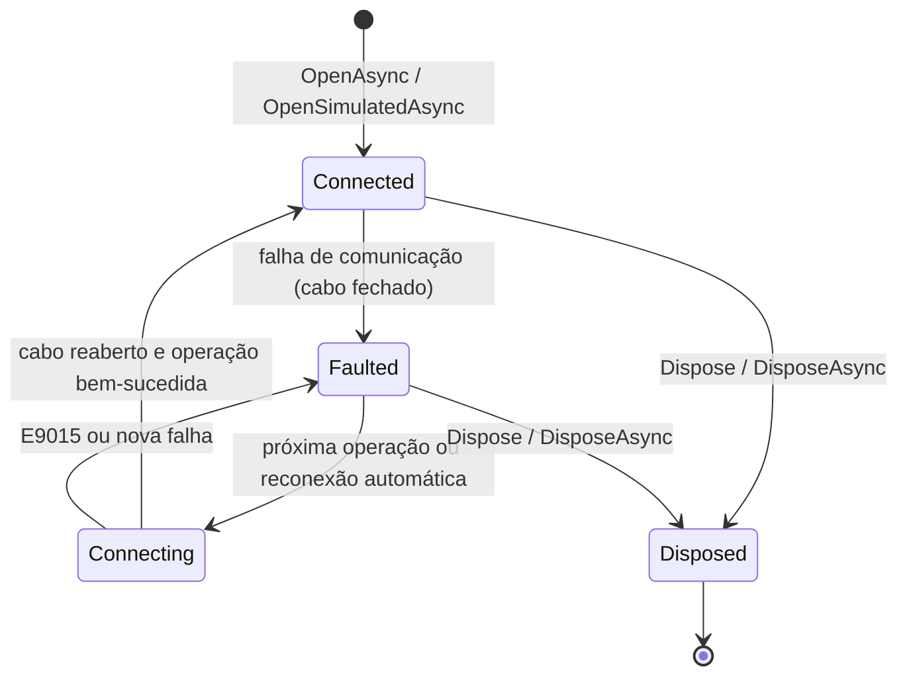

# Biblioteca Brymen.Dmm

Guia da biblioteca .NET para o multímetro **Brymen BM525s** (= **Minipa ET-2615A**) e outros BM52x com datalogger,
pelo cabo óptico USB **BC-86X** (kit **BU-86X**, HID VID `0820h`, PID `0001h`). É o mesmo código que a API REST deste
repositório usa, empacotado para outros projetos .NET.

O [README do pacote](../src/Brymen.Dmm/README.md) traz os exemplos curtos; este guia cobre a API pública, o modelo de
threads, os erros, o ciclo de vida, trimming/AOT, as plataformas e o empacotamento.

## Conteúdo

- [Pacotes](#pacotes)
- [Instalação](#instalação)
- [Plataformas e alvos](#plataformas-e-alvos)
- [Início rápido](#início-rápido)
- [API pública](#api-pública)
- [Ciclo de vida e estados](#ciclo-de-vida-e-estados)
- [Threads, concorrência e eventos](#threads-concorrência-e-eventos)
- [Erros e códigos](#erros-e-códigos)
- [Tempos de espera e comportamento do hardware](#tempos-de-espera-e-comportamento-do-hardware)
- [Memória do datalogger](#memória-do-datalogger)
- [Integração com o Generic Host](#integração-com-o-generic-host)
- [Simulação e testes](#simulação-e-testes)
- [Trimming e Native AOT](#trimming-e-native-aot)
- [Linux (x64 e arm64)](#linux-x64-e-arm64)
- [Windows](#windows)
- [Empacotamento num único nupkg](#empacotamento-num-único-nupkg)
- [Exemplos](#exemplos)
- [Pendências](#pendências)

## Pacotes

| Pacote | Projeto | Conteúdo | Dependências |
|---|---|---|---|
| `Brymen.Dmm` | [`src/Brymen.Dmm`](../src/Brymen.Dmm) | `BrymenMeter`, `MeterConnection`, `LoggerMemoryReader`, opções e erros; dentro do mesmo pacote, `Brymen.Dmm.Protocol.dll` (decodificação dos quadros e da memória) e `Brymen.Dmm.Hid.dll` (transporte HID, `Bu86xLink` e o medidor simulado) | nenhuma |
| `Brymen.Dmm.Extensions.Hosting` | [`src/Brymen.Dmm.Extensions.Hosting`](../src/Brymen.Dmm.Extensions.Hosting) | `AddBrymenMeter`, o serviço hospedado e o `IBrymenMeterAccessor` (opcional) | `Brymen.Dmm` e `Microsoft.Extensions.Hosting.Abstractions`, `Options`, `Configuration.Binder` e `Logging.Abstractions` (a partir da 8.0.0 no alvo `net8.0` e da 10.0.0 no `net10.0`) |

Os dois têm a versão do [`Directory.Build.props`](../Directory.Build.props) (hoje `0.1.0`), documentação XML em todos os
membros públicos e símbolos num `.snupkg`.

| Namespace | Assembly | Tipos principais |
|---|---|---|
| `Brymen.Dmm` | `Brymen.Dmm.dll` | `BrymenMeter`, `IBrymenMeter`, `BrymenMeterOptions`, `LoggerReadOptions`, `MeterState`, `MeterStateChangedEventArgs`, `BrymenErrorCodes`, `BrymenMeterError`, `BrymenMeterException`, `MeterConnection`, `LoggerMemoryReader`, `ILoggerMemoryTransport`, `MeterCommandResult`, `LoggerReadProgress`, `LoggerMemoryImage` |
| `Brymen.Dmm.Protocol` | `Brymen.Dmm.Protocol.dll` | `DmmReading`, `DisplayReading`, `DmmFlags`, `DmmFlagNames`, `MeasurementMode`, `LoggerMemory`, `LoggerSession`, `LoggerSample`, `LoggerValue`, `LoggerHeader`, `Bm52xRealtime`, `Bm52xMemory`, `Bm52xCommands`, `Bm52xFrameException` |
| `Brymen.Dmm.Hid` | `Brymen.Dmm.Hid.dll` | `HidDeviceInfo`, `IHidDevice`, `IHidDeviceProvider`, `IHidDevicePathProbe`, `HidDeviceProviders`, `HidException`, `Bu86xLink`, `Bu86xLinkOptions`, `Bu86xTimeoutException`, `Bu86xShortReportException`, `SimulatedBm52xMeter`, `SimulatedFault`, `SimulatedHidDevice`, `SimulatedHidWrite`, `SimulatedHidDeviceProvider`; os transportes `LinuxHidrawDeviceProvider`/`LinuxHidrawDevice` e `WindowsHidDeviceProvider`/`WindowsHidDevice` |
| `Brymen.Dmm.Extensions.Hosting` | `Brymen.Dmm.Extensions.Hosting.dll` | `BrymenMeterServiceCollectionExtensions`, `IBrymenMeterAccessor` |

O resto é interno: o parser do report descriptor (`HidReportDescriptor`, `HidReportLayout`) e os ganchos de teste do
`LinuxHidrawDeviceProvider` (a árvore sysfs falsa), que mudariam a superfície binária dos pacotes. As interfaces públicas
(`IBrymenMeter`, `IBrymenMeterAccessor`, `IHidDevice`, `IHidDeviceProvider`) ganham membros novos só com implementação
padrão, para não quebrar quem as implementa ou simula.

## Instalação

Os pacotes ainda não estão num feed público. Gere-os na raiz do repositório:

```bash
dotnet pack src/Brymen.Dmm -c Release -o artifacts/packages
dotnet pack src/Brymen.Dmm.Extensions.Hosting -c Release -o artifacts/packages   # opcional
```

e aponte o projeto consumidor para a pasta com um `nuget.config` (o de [`samples/nuget.config`](../samples/nuget.config)
é um modelo):

```xml
<configuration>
  <packageSources>
    <clear />
    <add key="brymen-local" value="C:\caminho\para\artifacts\packages" />
    <add key="nuget.org" value="https://api.nuget.org/v3/index.json" />
  </packageSources>
  <packageSourceMapping>
    <packageSource key="brymen-local"><package pattern="Brymen.Dmm" /><package pattern="Brymen.Dmm.*" /></packageSource>
    <packageSource key="nuget.org"><package pattern="*" /></packageSource>
  </packageSourceMapping>
</configuration>
```

```bash
dotnet add package Brymen.Dmm --version 0.1.0
dotnet add package Brymen.Dmm.Extensions.Hosting --version 0.1.0   # para o Generic Host
```

O mapeamento de origens garante que os pacotes `Brymen.Dmm*` venham só da pasta local, e evita o erro `NU1301` quando a
pasta ainda não existe num projeto que não a usa. O NuGet não extrai de novo uma versão que já está no cache global
(`~/.nuget/packages`): para testar uma mudança na biblioteca, gere outra versão (`-p:Version=0.1.0-dev.2`) ou apague a
pasta da versão no cache.

## Plataformas e alvos

| | Situação |
|---|---|
| Alvos | `net8.0` (LTS) e `net10.0`, com o mesmo comportamento. A única diferença é o `System.Threading.Lock`, que só existe a partir do .NET 9: no `net8.0`, `Lock` é um apelido de `object` (`Using` com `Alias` no `Directory.Build.props`), e o `lock` usa o `Monitor`. |
| C# do consumidor | Dois membros do simulador usam `params IEnumerable<T>` (C# 13): `new SimulatedHidDeviceProvider(params IEnumerable<SimulatedHidDevice> devices)` e `SimulatedBm52xMeter.SetRealTimeFrames(params IEnumerable<byte[]> frames)`. Num projeto `net8.0`, que usa o C# 12 por padrão, eles não aceitam a forma expandida: passe uma coleção, como `new SimulatedHidDeviceProvider([device])`. |
| Windows | `hid.dll`, sem driver. Validado com o BM525s real no Windows 11 x64, nos dois alvos. |
| Linux | `hidraw` pela libc, com glibc, em x64 e arm64 (Raspberry Pi com sistema de 64 bits). A biblioteca ainda não rodou num Linux real com o cabo; o transporte hidraw é coberto pelos testes do `Brymen.Dmm.Hid` (inclusive com um cabo virtual pelo `/dev/uhid`). |
| Outros sistemas | Sem transporte HID: `BrymenMeter.OpenAsync` sem `DeviceProvider` lança `PlatformNotSupportedException`. O medidor simulado e um `IHidDeviceProvider` próprio funcionam. |
| Medidores | BM525s testado. Outros BM52x com datalogger (família `52h`) devem funcionar; a série BM82x não é suportada. |

## Início rápido

```csharp
using Brymen.Dmm;
using Brymen.Dmm.Protocol;

await using var meter = await BrymenMeter.OpenAsync();          // ou OpenSimulatedAsync(), sem hardware

DmmReading reading = await meter.ReadAsync();                   // um 52 66
Console.WriteLine($"{reading.Main?.Text} {reading.Main?.UnitSymbol}");

int count = 0;
await foreach (var r in meter.ReadContinuouslyAsync(TimeSpan.FromMilliseconds(500)))
{
    Console.WriteLine(r.Main?.Text);
    if (++count == 10)
        break;                                                  // 10 leituras, a cada 500 ms
}

LoggerMemory memory = await meter.ReadLoggerMemoryAsync();     // a memória do datalogger
```

Com um `CancellationToken` em `ReadContinuouslyAsync`, o cancelamento termina a enumeração com
`OperationCanceledException`: trate-o (`catch (OperationCanceledException) when (cts.IsCancellationRequested)`), senão o
código depois do `await foreach` não roda.

## API pública

As assinaturas abaixo são as do código; os detalhes de cada membro estão na documentação XML, que o IntelliSense mostra.

### `BrymenMeter`

`public sealed class BrymenMeter : IBrymenMeter, IAsyncDisposable, IDisposable`, thread-safe. Representa um cabo aberto
e o medidor atrás dele, e é o dono dele: o descarte fecha o cabo. As operações assíncronas nunca fazem a E/S na thread de
quem chama ([Threads](#threads-concorrência-e-eventos)).

| Membro | Descrição |
|---|---|
| `static Task<BrymenMeter> OpenAsync(BrymenMeterOptions? options = null, CancellationToken cancellationToken = default)` | Procura o cabo (`DevicePath` ou o primeiro VID 0820h/PID 0001h) e o abre. A procura e a abertura são síncronas, e a tarefa já volta concluída. `E9015` sem o cabo; `ArgumentException` com uma opção fora da faixa; `PlatformNotSupportedException` sem transporte HID. As opções são copiadas. |
| `static Task<BrymenMeter> OpenSimulatedAsync(SimulatedBm52xMeter? meter = null, BrymenMeterOptions? options = null, CancellationToken cancellationToken = default)` | Abre um BC-86X simulado (`SimulatedLatency` por resposta) ligado a `meter` (padrão: `SimulatedBm52xMeter.FromCaptures()`). `DeviceProvider` e `DevicePath` das opções são ignorados. |
| `static IReadOnlyList<HidDeviceInfo> FindDevices(IHidDeviceProvider? provider = null)` | Os cabos conectados, na ordem da enumeração. |
| `const int MaxConsecutiveFailures = 3` | Falhas seguidas toleradas na leitura contínua (a 3ª é persistente). |
| `static readonly TimeSpan SimulatedLatency` | 20 ms, a latência do cabo simulado de `OpenSimulatedAsync`. |
| `HidDeviceInfo Device` | O cabo aberto (atualizado a cada reabertura). |
| `MeterState State` | O estado atual ([Ciclo de vida](#ciclo-de-vida-e-estados)). |
| `BrymenMeterError? LastError` | A última falha; continua depois da recuperação. |
| `bool IsRunning` | Se o laço de `Start` está rodando. |
| `Task<DmmReading> ReadAsync(CancellationToken cancellationToken = default)` | Um `52 66` decodificado, sem nova tentativa. |
| `IAsyncEnumerable<DmmReading> ReadContinuouslyAsync(TimeSpan? interval = null, CancellationToken cancellationToken = default)` | Uma consulta a cada `interval` (padrão: `PollInterval`), contado do início de uma ao início da seguinte; termina quando o medidor é descartado, e com `OperationCanceledException` no cancelamento. Cada enumeração faz as suas consultas, independentes do laço de `Start` e das outras: para vários consumidores, use `Start` e `ReadingReceived` (ou `IBrymenMeterAccessor.ReadingsAsync`). |
| `void Start()` e `Task StopAsync()` | O laço de leitura contínua em segundo plano, com as leituras em `ReadingReceived`. `Start` com o laço rodando não faz nada; `StopAsync` cancela a consulta em andamento e espera o laço. |
| `event EventHandler<DmmReading>? ReadingReceived` | Cada leitura do laço de `Start` (não as de `ReadAsync` nem as de `ReadContinuouslyAsync`). |
| `event EventHandler<MeterStateChangedEventArgs>? StateChanged` | Mudança de `State`, por qualquer operação. |
| `event EventHandler<BrymenMeterError>? ErrorOccurred` | Cada falha, a mesma de `LastError`, e as exceções de handlers (`EVENT_HANDLER`). |
| `Task<LoggerMemory> ReadLoggerMemoryAsync(IProgress<LoggerReadProgress>? progress = null, CancellationToken cancellationToken = default)` | Lê e decodifica a memória do datalogger. |
| `Task<LoggerMemoryImage> ReadLoggerImageAsync(IProgress<LoggerReadProgress>? progress = null, CancellationToken cancellationToken = default)` | A imagem bruta da memória, com os blocos, as retentativas e os recomeços. |
| `void Dispose()` e `ValueTask DisposeAsync()` | Fecha o cabo; as operações em andamento falham com `ObjectDisposedException` e as enumerações terminam. `DisposeAsync` também espera o laço de `Start`. |

### `IBrymenMeter`

`public interface IBrymenMeter`: as operações de um medidor aberto, sem o ciclo de vida (sem abertura, descarte nem o
laço de `Start`). O `BrymenMeter` a implementa; o `IBrymenMeterAccessor` do hosting devolve uma fachada dela, que não é o
`BrymenMeter` do serviço. Serve também para simular o medidor nos testes de quem o usa.

| Membro | Descrição |
|---|---|
| `HidDeviceInfo Device`, `MeterState State`, `BrymenMeterError? LastError` | Os do `BrymenMeter`. |
| `Task<DmmReading> ReadAsync(CancellationToken cancellationToken = default)` | Um `52 66`. |
| `Task<LoggerMemory> ReadLoggerMemoryAsync(IProgress<LoggerReadProgress>? progress = null, CancellationToken cancellationToken = default)` | A memória decodificada. |
| `Task<LoggerMemoryImage> ReadLoggerImageAsync(IProgress<LoggerReadProgress>? progress = null, CancellationToken cancellationToken = default)` | A imagem bruta da memória. |

### `BrymenMeterOptions` e `LoggerReadOptions`

`public sealed class BrymenMeterOptions`, copiada e validada na abertura: mudar a instância depois não afeta um medidor
aberto. Também é a opção do `MeterConnection`, que ignora `PollInterval`, `ReconnectDelay` e `AutoReconnect`.

| Propriedade | Padrão | Faixa | Descrição |
|---|---|---|---|
| `string? DevicePath` | `null` | — | Caminho do cabo; `null` ou vazio = o primeiro da enumeração. |
| `TimeSpan PollInterval` | 200 ms | ≥ 0 | Intervalo da leitura contínua; `TimeSpan.Zero` consulta sem pausa, como o original. |
| `TimeSpan ReportTimeout` | 1 s | > 0 | Espera por cada relatório de entrada. |
| `TimeSpan RealTimeAfterMemoryTimeout` | 3 s (`MeterConnection.DefaultRealTimeAfterMemoryTimeout`) | > 0 | Espera pelo 1º relatório do 1º `52 66` depois da abertura e de comandos de memória. |
| `TimeSpan ReconnectDelay` | 2 s | ≥ 0 | Espera antes de reabrir o cabo depois de uma falha persistente. |
| `bool AutoReconnect` | `true` | — | Leitura contínua: reabre o cabo em vez de terminar. |
| `TimeSpan DrainTimeout` | 5 ms | ≥ 0 | Silêncio para descartar relatórios atrasados antes de cada comando. |
| `TimeSpan RecoveryDrainTimeout` | 100 ms | ≥ 0 | Silêncio exigido no descarte depois de abrir o cabo e depois de uma troca interrompida. |
| `IHidDeviceProvider? DeviceProvider` | `null` (= `HidDeviceProviders.CreateForCurrentPlatform()`) | — | Transporte HID. |
| `TimeProvider TimeProvider` | `TimeProvider.System` | não nulo | Relógio dos intervalos, das esperas e dos instantes das leituras. |
| `LoggerReadOptions LoggerRead` | padrões abaixo | não nulo | Leitura da memória. |

| `LoggerReadOptions` | Padrão | Faixa | Descrição |
|---|---|---|---|
| `bool VerifyModel` | `true` | — | Confere o modelo antes da leitura: um `52 66` (até 2 tentativas) com o Model ID `52h`; senão, `E9017`. |
| `TimeSpan HeadSettleDelay` | 200 ms | ≥ 0 | Espera depois do `88`, antes do próximo comando (o `Sleep(200)` do original). |
| `TimeSpan RetryDelay` | 10 ms | ≥ 0 | Espera depois de reabrir o cabo, antes de uma nova tentativa. |
| `int MaxHeadAttempts` | 3 | ≥ 1 | Tentativas do `88`, sempre com outro `88`. |
| `int MaxBlockAttempts` | 4 | ≥ 1 | Tentativas por bloco: 1 × `89` + até N − 1 × `8A`. |
| `int MaxRestarts` | 3 | ≥ 0 | Recomeços a partir do `88` antes de desistir com `E9016`. |

Um valor fora da faixa dá `ArgumentOutOfRangeException` (um `ArgumentException`) na abertura.

### Estados, erros e leituras

| Tipo | Descrição |
|---|---|
| `enum MeterState { Closed, Connecting, Connected, Faulted, Disposed }` | Estado da comunicação ([Ciclo de vida](#ciclo-de-vida-e-estados)). |
| `sealed class MeterStateChangedEventArgs : EventArgs` | `MeterState Previous`, `MeterState Current`. |
| `static class BrymenErrorCodes` | As constantes dos códigos ([Erros e códigos](#erros-e-códigos)). |
| `sealed record BrymenMeterError(string Code, string Message, Exception? Exception, DateTimeOffset Timestamp)` | Uma falha registrada; o instante vem do `TimeProvider` das opções. |
| `sealed class BrymenMeterException(string code, string message, Exception? innerException = null) : Exception` | `string Code`; `BrymenMeterError ToError(DateTimeOffset timestamp)`. |
| `sealed record DmmReading` | `DateTimeOffset Timestamp`, `DisplayReading? Main`, `DisplayReading? Secondary`, `DmmFlags Flags`, `string RawHex` (os 27 bytes), `RealTimeDiagnostics? Diagnostics`. |
| `sealed record DisplayReading` | `Digits`, `Text` (como no LCD), `Negative`, `Overload`, `double? Value`, `Prefix`, `Unit`, `MeasurementMode Mode`, `double? SiValue`, `UnitSymbol` (ex.: `mV`, `kΩ`). |
| `[Flags] enum DmmFlags` e `static class DmmFlagNames` | Os anunciadores do LCD (`Auto`, `HoldBox`, `LowBattery`...) e os nomes estáveis (`DmmFlagNames.ToNames`, `TryParse`). |
| `enum MeasurementMode { None, DC, AC, AcDc }` | Acoplamento indicado no display. |

### Memória do datalogger

| Tipo | Descrição |
|---|---|
| `readonly record struct LoggerReadProgress(int BlocksRead, int BlocksTotal, int TotalBytes, int Retries, int Restarts)` | Progresso por bloco; `double Percent`. `BlocksTotal` e `TotalBytes` ficam em 0 até a resposta do `88`. |
| `sealed class LoggerMemoryImage` | `LoggerHeader Header`, `ReadOnlyMemory<byte> Image`, `int BlockCount`, `IReadOnlyList<ReadOnlyMemory<byte>> Blocks`, `ReadOnlyMemory<byte> GetBlock(int)`, `int Retries`, `int Restarts`, `IReadOnlyList<string> Warnings`, `byte[] ToArray()`, `LoggerMemory Decode()`. Construtor público: `(LoggerHeader header, ReadOnlySpan<byte> image, int retries = 0, int restarts = 0, IReadOnlyList<string>? warnings = null)`. |
| `sealed record LoggerMemory(LoggerHeader Header, IReadOnlyList<LoggerSession> Sessions, IReadOnlyList<string> Warnings)` | A memória decodificada. |
| `sealed record LoggerSession` | `Number`, `MainFunction`, `SecondaryFunction`, `IsDual`, `Interval`, `Samples` e os campos crus da sessão. |
| `sealed record LoggerSample(int Index, TimeSpan Elapsed, LoggerValue Main, LoggerValue? Secondary)` | Uma amostra. |
| `sealed record LoggerValue` | `Text`, `double? Value`, `Prefix`, `Unit`, `UnitSymbol`, `Mode`, `SiValue`, `Overload`, `LowBattery` etc. |

### Blocos de baixo nível

Para quem precisa de controle fino (a API REST usa estes blocos para não duplicar lógica):

| Tipo | Descrição |
|---|---|
| `sealed class MeterConnection : IDisposable` | Conexão com o cabo, que o `BrymenMeter` compõe. `MeterConnection(BrymenMeterOptions? options = null)`; `HidDeviceInfo Open()`, `HidDeviceInfo Reopen()`, `void Close()` (de qualquer thread, interrompe o comando em andamento); `Task<byte[]> ExecuteAsync(byte command, int reportCount, CancellationToken)` e `Task<MeterCommandResult> TryExecuteAsync(...)` (a falha volta no resultado); `Task<byte[]> ExecuteRealTimeAsync(CancellationToken)`; `Task<DmmReading> ReadRealTimeAsync(CancellationToken)`; `Task<LoggerMemoryImage> ReadLoggerImageAsync(IProgress<LoggerReadProgress>?, CancellationToken)`; `IsOpen`, `Device`, `DeviceProvider`, `TimeProvider`, `IsNextRealTimeSlow`, `LastCommandReportsReceived`; `static FindDevices(IHidDeviceProvider?)`. Os comandos são serializados entre si e abrem o cabo se ele estiver fechado; uma falha não o fecha (quem chama decide). |
| `sealed class LoggerMemoryReader` | O algoritmo da memória sobre qualquer transporte: `LoggerMemoryReader(ILoggerMemoryTransport transport, LoggerReadOptions? options = null, IProgress<LoggerReadProgress>? progress = null, TimeProvider? timeProvider = null)`, `Task<LoggerMemoryImage> ReadAsync(CancellationToken)`, `const int MaxTotalBytes = 0x20000`. Uma leitura por instância (a 2ª chamada lança `InvalidOperationException`). |
| `interface ILoggerMemoryTransport` | `Task<MeterCommandResult> ExecuteAsync(byte command, int reportCount, CancellationToken)` (falha no resultado, não como exceção) e `Task ResetAsync(CancellationToken)` (fecha o cabo para uma nova tentativa). |
| `readonly record struct MeterCommandResult(byte[]? Frame, Exception? Error, int ReportsReceived)` | `bool Succeeded`. Com `ReportsReceived` ≥ 1, o medidor certamente processou o comando. |
| `sealed class Bu86xLink : IDisposable` | O enquadramento do BC-86X sobre um `IHidDevice`: `00 52 cc` no relatório de saída e N relatórios de 8 bytes na resposta. `static FindDevice`, `static Open`, `ExecuteAsync(command, reportCount[, firstReportTimeout], ct)`, `VendorId`, `ProductId`. |
| `interface IHidDeviceProvider` e `interface IHidDevice` | O transporte HID: `Enumerate(vendorId, productId)` e `Open(HidDeviceInfo)`; `WriteReportAsync` e `ReadReportAsync`. `HidDeviceProviders.CreateForCurrentPlatform()` escolhe o hidraw ou a hid.dll. |
| `sealed record HidDeviceInfo(string Path, ushort VendorId, ushort ProductId, ushort? ReleaseNumber = null, string? Manufacturer = null, string? Product = null, string? SerialNumber = null)` | A identificação de um cabo. |
| `static class Bm52xRealtime` e `static class Bm52xMemory` | Decodificadores puros: `Bm52xRealtime.Decode(ReadOnlySpan<byte> frame, DateTimeOffset timestamp)` / `TryDecode`, e `Bm52xMemory.Decode(ReadOnlySpan<byte> image)`, `ParseBlock`, `ParseHeader`. Lançam `Bm52xFrameException`. |

## Ciclo de vida e estados



- `OpenAsync` devolve o medidor já em `Connected`, sem evento. Um `BrymenMeter` nunca está em `Closed`: esse estado
  é o do `IBrymenMeterAccessor` antes da abertura e depois da parada do host.
- Uma falha de comunicação fecha o cabo, vai para `LastError` e `ErrorOccurred` e deixa o estado em `Faulted`. A
  operação seguinte reabre o cabo (`Connecting`); não é preciso abrir outro `BrymenMeter`.
- `LastError` continua depois da recuperação: `State` diz se a comunicação está boa agora.
- `Disposed` é terminal: toda operação lança `ObjectDisposedException`, inclusive as que estavam em andamento.
- `DisposeAsync` espera o laço de `Start`; `Dispose` não espera, e o laço termina logo depois, sem eventos.

## Threads, concorrência e eventos

- **Nenhuma E/S na thread de quem chama.** `ReadAsync`, `ReadLoggerMemoryAsync`, `ReadLoggerImageAsync` e cada
  `MoveNextAsync` de `ReadContinuouslyAsync` passam para o pool antes do 1º comando e voltam com a tarefa em andamento,
  mesmo com um transporte que bloqueia ou que conclui de forma síncrona (um `IHidDevice` próprio, o simulado sem
  latência, `ReadContinuouslyAsync(TimeSpan.Zero)`). Uma interface gráfica (Avalonia, WPF, MAUI) pode chamá-los da thread
  dela. `OpenAsync` é a exceção: a procura e a abertura do cabo são síncronas e curtas.
- **Transportes.** No Windows, a `hid.dll` é lida por um `FileStream` assíncrono (overlapped). No Linux, o
  `ReadReportAsync` do hidraw devolve na hora um relatório que já está na fila do kernel; senão, o `poll()` em fatias de
  50 ms ocupa uma thread do pool (não a de quem chama) até o relatório chegar ou o timeout acabar: até ≈ 3 s no 1º
  `52 66` depois da abertura ou da memória. O `MeterConnection` e o `Bu86xLink` não trocam de thread por conta própria;
  sobre esses dois transportes, são assíncronos de verdade.
- **Serialização.** Todas as operações no cabo passam por um semáforo: `ReadAsync` concorrentes, a leitura contínua e
  a importação da memória entram uma de cada vez. Uma importação pausa a leitura contínua (`Start` e
  `ReadContinuouslyAsync`), que volta sozinha no fim; nenhum `52 66` é enviado entre o `88` e o último `89`.
- **Eventos fora dos locks.** Os eventos são disparados depois que a operação libera os locks internos, na thread da
  operação que os causou (a do laço de `Start`, no caso de `ReadingReceived`). Um handler lento atrasa a próxima
  consulta do laço.
- **Handlers isolados.** Cada handler é chamado à parte. A exceção de um handler de `ReadingReceived` ou de
  `StateChanged` não interrompe nada: ela vira `ErrorOccurred` com o código `EVENT_HANDLER`, sem mudar `State` nem
  `LastError`. As exceções dos handlers de `ErrorOccurred` são ignoradas.
- **Chamadas de dentro de um handler.** `StopAsync`, `Dispose` e `DisposeAsync` chamados de dentro de um handler do
  próprio medidor não travam (o laço termina quando o handler voltar). Não espere de forma bloqueante (`Wait()`,
  `.Result`) por uma operação do medidor dentro de um handler; `await` é seguro.
- **Ordem.** Com operações concorrentes de chamadores diferentes, os eventos de operações distintas podem chegar fora
  de ordem; `State` é sempre o atual.
- **Progresso.** `IProgress<T>.Report` é chamado de forma síncrona, na thread da leitura. Um `Progress<T>` posta os
  relatórios no `SynchronizationContext` capturado (ou no pool), então eles podem chegar depois de a tarefa terminar.
- **Cancelamento.** Todo método assíncrono aceita um `CancellationToken`; o cancelamento lança
  `OperationCanceledException`, e um `52 66` cancelado não conta para a política de tempos de espera. O descarte do
  medidor cancela tudo o que está em andamento.
- **`MeterConnection`.** Os comandos são serializados entre si; `Close` e `Dispose` podem ser chamados de qualquer
  thread e interrompem o comando em andamento.

## Erros e códigos

As falhas de comunicação são `BrymenMeterException`, com `Code` igual ao do software original da Brymen (Bs82-52x
V6.0.0.9), para facilitar o suporte cruzado:

| Código | Constante | Quando | O que fazer |
|---|---|---|---|
| `E9015` | `CableNotFound` | Cabo não encontrado, ou não pôde ser aberto (sem permissão no `/dev/hidrawN`: a mensagem traz o erro da abertura). Na leitura contínua, é persistente de imediato. | Conectar o cabo, conferir o `DevicePath` e, no Linux, a regra udev. |
| `E9016` | `TransmissionTimeout` | A 3ª falha seguida da leitura contínua (`W7012` três vezes), ou a leitura da memória que esgotou as tentativas. | Ligar o medidor e encaixar a porta óptica; com `AutoReconnect`, a leitura continua sozinha. |
| `E9017` | `NoDataLogger` | Antes da leitura da memória: o medidor não respondeu ao `52 66` ou o Model ID não é `52h` (desligado, desconectado ou sem a função DATA LOGGING). | Ligar o medidor; conferir o modelo. |
| `W7012` | `NoDataReceived` | Um `52 66` sem resposta completa: timeout, relatório curto, falha de E/S ou cabo fechado durante o comando. | Tentar de novo; a leitura contínua tolera 2 seguidas. |
| `W8011` | `InvalidFrame` | Quadro inválido ou inconsistente (tempo real, cabeçalho da memória ou memória ilegível). | Tentar de novo; persistente, indica outro modelo ou um defeito. |
| `EVENT_HANDLER` | `EventHandlerFailed` | Um handler de evento lançou uma exceção (só em `ErrorOccurred`, nunca como exceção). | Corrigir o handler. |
| `INTERNAL` | `Internal` | Falha inesperada: um defeito, ou uma exceção fora do contrato de um `IHidDeviceProvider` ou `IHidDevice` próprio (ou do `IProgress` da importação). Na leitura contínua, é persistente, para o laço não morrer em silêncio; em `ReadAsync` e na leitura da memória, é lançada como `BrymenMeterException`, com a original em `InnerException`. Como numa falha de comunicação, o cabo é fechado e o estado fica em `Faulted`. | Reportar, com `Exception`. |

**Política da leitura contínua** (`Start` e `ReadContinuouslyAsync`), como no original: as 2 primeiras falhas seguidas
(`W7012` ou `W8011`) só reabrem o cabo, depois de 10 ms; a 3ª (`MaxConsecutiveFailures`) é persistente e vira `E9016`
(ou continua `W8011`). Uma falha persistente, ou o `E9015`, termina a enumeração com `BrymenMeterException` (e termina o
laço de `Start`, com `IsRunning` = `false`); com `AutoReconnect`, o medidor espera `ReconnectDelay`, reabre o cabo e
continua. Toda falha vai para `LastError` e `ErrorOccurred`.

**Outras exceções:**

| Exceção | Quando |
|---|---|
| `ArgumentException` / `ArgumentOutOfRangeException` | Opção fora da faixa na abertura; `interval` negativo em `ReadContinuouslyAsync`. |
| `PlatformNotSupportedException` | Sem `DeviceProvider`, num sistema que não é Linux nem Windows. |
| `ObjectDisposedException` | Operação num medidor descartado, inclusive durante a operação. |
| `OperationCanceledException` | O token de quem chamou foi cancelado. |
| `InvalidOperationException` | Um `LoggerMemoryReader` reutilizado. |

## Tempos de espera e comportamento do hardware

Os padrões vêm do software original e dos testes com o BM525s real (§2.7 de
[`docs/protocol/bm52x-usb-protocol.md`](protocol/bm52x-usb-protocol.md)):

- **1º `52 66` lento.** O 1º `52 66` depois da abertura e depois de comandos de memória (`88`, `89`, `8A`) espera até
  `RealTimeAfterMemoryTimeout` (3 s) pelo 1º relatório; os demais, `ReportTimeout` (1 s). No medidor real, o `66`
  seguinte ao último bloco da memória levou ≈ 2,06 s. É uma espera longa só: o `66` que termina, com resposta ou sem
  ela, volta ao `ReportTimeout`.
- **1º comando depois de muito tempo ocioso.** Ficou sem resposta (`W7012`) uma vez, com os seguintes normais.
  `ReadAsync` faz uma consulta só e não tenta de novo: trate o `W7012` com uma nova tentativa, ou use a leitura
  contínua.
- **`8A` logo depois do `88`.** No medidor real, um `8A` cerca de 15 ms depois do `88` avançou o ponteiro como um `89`
  (9 de 16 tentativas). Por isso o leitor espera `HeadSettleDelay` (200 ms) depois do `88` e nunca recupera o `88` com
  `8A`.
- **Descarte.** Antes de cada comando, os relatórios atrasados são descartados (`DrainTimeout`); depois de abrir o cabo
  e de uma troca interrompida, o descarte exige `RecoveryDrainTimeout` de silêncio.

## Memória do datalogger

`ReadLoggerMemoryAsync` e `ReadLoggerImageAsync` usam o `LoggerMemoryReader`, o mesmo algoritmo da importação da API:

1. Com `VerifyModel`, um `52 66` (até 2 tentativas) confere o Model ID `52h`; senão, `E9017`.
2. `88`: ponteiro no início e o 1º bloco, com o cabeçalho (`LoggerHeader`: modelo, TotalBytes e sessões). Uma falha do
   `88` é recuperada sempre com outro `88` (até `MaxHeadAttempts`), nunca com `8A`.
3. Espera de `HeadSettleDelay` (200 ms) depois do `88`.
4. `89` para cada bloco seguinte, com checksum de 16 bits por bloco. Um `89` que falhou é recuperado com `8A` (relê o
   bloco atual) só se o medidor certamente o processou (chegou ao menos 1 relatório, ou o checksum veio errado), até
   `MaxBlockAttempts` por bloco. Sem nenhum relatório não há como saber se o ponteiro andou, e a leitura recomeça do
   `88` (até `MaxRestarts`), conferindo byte a byte os blocos já lidos.
5. Tentativas esgotadas: `E9016`; cabeçalho inválido ou que mudou durante a leitura: `W8011`.

Com o simulado sem latência, a importação dos 95 blocos da captura real leva pouco mais que os 200 ms da espera depois
do `88`; no BM525s real, levou cerca de 10,8 s no Windows, com a imagem idêntica byte a byte a
[`memory-dump-1.txt`](protocol/captures/memory-dump-1.txt). A leitura não altera a memória do medidor.

## Integração com o Generic Host

O pacote `Brymen.Dmm.Extensions.Hosting` liga o medidor ao `IServiceCollection` de worker services, ASP.NET Core e
qualquer app com o Generic Host.

```csharp
using Brymen.Dmm;
using Brymen.Dmm.Extensions.Hosting;

var builder = Host.CreateApplicationBuilder(args);
builder.Services.AddBrymenMeter(builder.Configuration.GetSection("Brymen"));      // opções da configuração
builder.Services.AddBrymenMeter(o => o.PollInterval = TimeSpan.FromSeconds(1));   // e/ou por código
```

| Membro | Descrição |
|---|---|
| `static IServiceCollection AddBrymenMeter(this IServiceCollection services, Action<BrymenMeterOptions>? configure = null)` | Registra `IOptions<BrymenMeterOptions>`, o `IBrymenMeterAccessor` (singleton) e o serviço hospedado. |
| `static IServiceCollection AddBrymenMeter(this IServiceCollection services, IConfiguration configuration)` | Igual, com as opções da seção, por binding gerado em tempo de compilação. |
| `static IServiceCollection AddBrymenMeter(this IServiceCollection services, string name, Action<BrymenMeterOptions>? configure = null)` | Um medidor com nome: as opções nomeadas, o `IBrymenMeterAccessor` como serviço com a chave `name` e um serviço hospedado só dele. |
| `static IServiceCollection AddBrymenMeter(this IServiceCollection services, string name, IConfiguration configuration)` | Igual, com as opções da seção. |

Chamar de novo (com o mesmo nome, ou sem nome) só acrescenta configurações, aplicadas na ordem do registro: o serviço e o
acessor são registrados uma vez por nome. As opções são lidas na partida do host.

**Vários cabos.** Cada nome tem o seu medidor, o seu laço e a sua reconexão; dê a cada um o seu `DevicePath` (o padrão,
o primeiro cabo da enumeração, seria o mesmo para todos). O acessor vem por chave, e o log vai para a categoria do tipo
seguida de `.{nome}`, que os filtros da categoria do tipo também pegam:

```csharp
builder.Services.AddBrymenMeter("bancada1", builder.Configuration.GetSection("Brymen:Bancada1"));
builder.Services.AddBrymenMeter("bancada2", o => o.DevicePath = "/dev/hidraw1");

var bancada1 = app.Services.GetRequiredKeyedService<IBrymenMeterAccessor>("bancada1");
// ou, num construtor: [FromKeyedServices("bancada2")] IBrymenMeterAccessor bancada2
```

**Configuração.** As chaves aceitas, todas opcionais (as ausentes mantêm o valor atual), com os intervalos no formato
invariante do `TimeSpan`:

```json
{
  "Brymen": {
    "DevicePath": "/dev/brymen-bu86x",
    "PollInterval": "00:00:00.200",
    "ReportTimeout": "00:00:01",
    "RealTimeAfterMemoryTimeout": "00:00:03",
    "ReconnectDelay": "00:00:02",
    "AutoReconnect": true,
    "DrainTimeout": "00:00:00.005",
    "RecoveryDrainTimeout": "00:00:00.100",
    "LoggerRead": {
      "VerifyModel": true,
      "HeadSettleDelay": "00:00:00.200",
      "RetryDelay": "00:00:00.010",
      "MaxHeadAttempts": 3,
      "MaxBlockAttempts": 4,
      "MaxRestarts": 3
    }
  }
}
```

`DeviceProvider` e `TimeProvider` não vêm da configuração (o gerador do binding não aceita interfaces nem classes
abstratas): ajuste-os com a sobrecarga de `Action`. Um valor que não converte (`"PollInterval": "rápido"`) lança
`InvalidOperationException` quando as opções são lidas, na partida do host.

**Serviço hospedado.**

- O serviço implementa `IHostedLifecycleService`. A 1ª abertura acontece no `StartingAsync`, que o host chama em todos
  os serviços antes de qualquer `StartAsync`; a leitura contínua (ou as novas tentativas de abertura) começa no
  `StartedAsync`, depois de todos os `StartAsync`. Assim, um serviço registrado antes ou depois do `AddBrymenMeter` pode
  esperar o medidor (`WaitForMeterAsync`) e assinar os eventos no próprio `StartAsync` sem travar a partida e sem perder
  a 1ª leitura. As mudanças de estado e o log da 1ª abertura acontecem no `StartingAsync`: quem assina `StateChanged` no
  `StartAsync` lê o `State` atual e recebe as mudanças seguintes. Sem o ciclo de vida (uma chamada direta ao
  `StartAsync`), as duas fases acontecem no `StartAsync`.
- Uma opção inválida ou um sistema sem transporte HID impedem a partida do host. Sem o cabo (`E9015`), a partida segue,
  e o serviço tenta de novo a cada `ReconnectDelay` (mínimo de 10 ms) com `AutoReconnect`; sem ela, desiste: não tenta
  de novo, e quem espera o medidor recebe a falha da abertura.
- Aberto o medidor, o serviço chama `Start`. Daí em diante, o próprio `BrymenMeter` reabre o cabo depois das falhas,
  sem trocar de instância. Sem `AutoReconnect`, uma falha persistente termina a leitura contínua, e o serviço não a
  reinicia; o medidor continua disponível para operações avulsas.
- Cada tentativa de abertura sem o cabo passa por `Connecting` e volta a `Faulted`, com um `ErrorOccurred` (`E9015`),
  como na reconexão do próprio `BrymenMeter`.
- Na parada, o medidor é descartado (o que interrompe a consulta em andamento). O descarte do contêiner sem a parada
  também o fecha.
- O log vai para a categoria `Brymen.Dmm.Extensions.Hosting.BrymenMeterHostedService`: abertura (Information, evento 1),
  falhas (Warning, evento 2; a mesma falha repetida vai para Debug, evento 3, até a comunicação voltar), recuperação
  (Information, evento 4), falhas inesperadas e de handlers (Error, evento 5), sem reconexão automática (Warning,
  evento 6) e fechamento (Information, evento 7).

**`IBrymenMeterAccessor`.**

| Membro | Descrição |
|---|---|
| `IBrymenMeter? Meter` | As operações avulsas do medidor aberto (`ReadAsync`, `ReadLoggerMemoryAsync`, que pausa a leitura contínua, e `ReadLoggerImageAsync`), ou `null` antes da 1ª abertura e depois da parada. É uma fachada, e não o `BrymenMeter` do serviço: não há como descartá-lo nem parar o laço por ela (nem com `await using`). Depois da parada, as operações dela lançam `ObjectDisposedException`, e o `State` dela vai a `Disposed`. |
| `MeterState State` | O estado do medidor, quando aberto; senão, `Closed` (antes da partida ou com o serviço parado), `Connecting` (abrindo) ou `Faulted` (a abertura falhou). Nunca `Disposed`. |
| `DmmReading? LastReading` | A última leitura da leitura contínua do serviço; continua depois de uma falha e da parada. |
| `BrymenMeterError? LastError` | A última falha (da abertura ou do medidor), sem as de handlers. |
| `event EventHandler<DmmReading>? ReadingReceived` | As leituras do laço do serviço. |
| `event EventHandler<MeterStateChangedEventArgs>? StateChanged` | As mudanças do medidor e as do serviço (`Closed → Connecting → Connected`, `Faulted` nas aberturas que falharam, `Closed` na parada). |
| `event EventHandler<BrymenMeterError>? ErrorOccurred` | As falhas da abertura e do medidor, e as de handlers (`EVENT_HANDLER`). |
| `Task<IBrymenMeter> WaitForMeterAsync(CancellationToken cancellationToken = default)` | Espera o medidor ficar disponível; antes da partida e enquanto o cabo não aparece, espera. Termina com falha quando o medidor não vai mais aparecer: `BrymenMeterException` (a falha da abertura) se o serviço desistir sem `AutoReconnect`, `InvalidOperationException` com o serviço parado, a exceção da partida que falhou (uma opção inválida, por exemplo) e `ObjectDisposedException` com o contêiner descartado. Depois disso, as chamadas falham na hora, até uma nova partida. |
| `IAsyncEnumerable<DmmReading> ReadingsAsync(CancellationToken cancellationToken = default)` | As leituras do laço do serviço (as mesmas de `ReadingReceived`), sem consultas próprias: várias enumerações dividem o mesmo laço. A inscrição acontece no 1º `MoveNextAsync`; antes da partida e sem o cabo, espera. Cada enumeração guarda até 64 leituras não consumidas (as mais antigas são descartadas). Termina normalmente na parada do serviço e no descarte do contêiner, com `BrymenMeterException` se o serviço desistir da abertura e com `OperationCanceledException` no cancelamento. |

Não use `ReadContinuouslyAsync` para as leituras do serviço: ele faz as suas próprias consultas, e o tráfego no cabo
dobra (por isso ele não está no `IBrymenMeter`).

Os eventos têm o acessor como `sender` e seguem as regras do `BrymenMeter`: fora dos locks, cada handler à parte, a
exceção de um handler de `ReadingReceived` ou `StateChanged` vira `ErrorOccurred` (`EVENT_HANDLER`), e a de um handler
de `ErrorOccurred` só vai para o log (categoria `Brymen.Dmm.Extensions.Hosting.BrymenMeterAccessor`, evento 20). A ordem
do registro não importa para as leituras: o laço só começa depois do `StartAsync` de todos os serviços, como no
[WorkerSample](../samples/Brymen.Dmm.WorkerSample/Program.cs).

## Simulação e testes

- `BrymenMeter.OpenSimulatedAsync()` abre o medidor simulado com as capturas reais do BM525s: os 14 quadros de
  [`rtd-acv.txt`](protocol/captures/rtd-acv.txt) (ACV + Hz, em rodízio) e a memória de
  [`memory-dump-1.txt`](protocol/captures/memory-dump-1.txt) (95 blocos, 1 sessão de 375 amostras). As capturas vão
  embutidas no `Brymen.Dmm.Hid.dll`.
- `SimulatedBm52xMeter` reproduz o medidor real, inclusive o `8A` que avança como um `89` logo depois do `88`
  (`CurrentAfterHeadWindow`), e injeta falhas por comando: `FaultInjector = (command, n) => SimulatedFault...`, com
  `None`, `Drop`, `DropAfterProcessing`, `CorruptChecksum`, `Truncate` e `CorruptModel`. `IsPoweredOn = false` desliga o
  medidor; `CommandCount` conta os comandos.
- `SimulatedHidDevice` é o cabo: `ResponseLatency`, `InterReportDelay`, `Disconnect()` e `Reconnect()` (remoção a
  quente), `Writes` (os comandos recebidos) e um `TimeProvider`. `SimulatedHidDevice.CreateBm52x(meter)` liga um cabo sem
  latência a `meter` (padrão: `SimulatedBm52xMeter.FromCaptures()`, as capturas reais completas, com o `8A` logo depois
  do `88`), e `CreateTypicalBm52x(meter)`, com `TypicalResponseLatency` (20 ms) por resposta, é o cabo do
  `OpenSimulatedAsync`.
- `SimulatedHidDeviceProvider` expõe os cabos como `DeviceProvider`. `new SimulatedHidDeviceProvider()`, sem
  argumentos, traz o mesmo cabo do `OpenSimulatedAsync` (útil no Generic Host); para o cabo ausente (`E9015`), passe uma
  coleção vazia: `new SimulatedHidDeviceProvider([])`.
- Com um `FakeTimeProvider` (pacote `Microsoft.Extensions.TimeProvider.Testing`) em `BrymenMeterOptions.TimeProvider` e
  no `SimulatedHidDevice`, os tempos de espera ficam determinísticos.

```csharp
var device = new SimulatedHidDevice(SimulatedBm52xMeter.FromCaptures().Respond);
await using var meter = await BrymenMeter.OpenAsync(new BrymenMeterOptions
{
    DeviceProvider = new SimulatedHidDeviceProvider([device]),
    DrainTimeout = TimeSpan.Zero,
    RecoveryDrainTimeout = TimeSpan.Zero,
});
device.Disconnect();   // a próxima leitura dá W7012, e a seguinte, E9015
```

Os testes da biblioteca estão em [`tests/Brymen.Dmm.Tests`](../tests/Brymen.Dmm.Tests) e os do hosting em
[`tests/Brymen.Dmm.Extensions.Hosting.Tests`](../tests/Brymen.Dmm.Extensions.Hosting.Tests), os dois em `net10.0` e
`net8.0`:

```bash
dotnet test tests/Brymen.Dmm.Tests
dotnet test tests/Brymen.Dmm.Extensions.Hosting.Tests
```

Os testes com o cabo real (`BRYMEN_HW_TESTS=1`) estão na seção [Testes](../README.md#testes) do README.

## Trimming e Native AOT

- As bibliotecas de `src/` (o `Brymen.Dmm`, o Protocol, o Hid e o hosting) são `IsAotCompatible` (pelo
  `Directory.Build.props`, com a condição pelo caminho relativo): os analisadores de trimming, AOT e single-file rodam em
  todo build, e com `TreatWarningsAsErrors` um aviso novo quebra a compilação.
- Nada usa reflexão. Os P/Invokes da libc e da `hid.dll` usam `[LibraryImport]`, com o marshalling gerado em tempo de
  compilação; as capturas do simulado são recursos embutidos.
- No hosting, o binding da configuração é gerado pelo source generator (`EnableConfigurationBindingGenerator`), sobre
  uma classe interna só com tipos suportados, e o log usa `[LoggerMessage]`.
- Num app consumidor, basta publicar com `-p:PublishTrimmed=true` ou `-p:PublishAot=true`. Se o app fizer o próprio
  binding de configuração, ative também o `EnableConfigurationBindingGenerator` nele.
- Validado: o publish trimmed da API (linux-arm64, linux-x64 e win-x64) e do WorkerSample e do ConsoleSample
  (linux-arm64, linux-x64 e win-x64) sem avisos; o WorkerSample trimmed rodou no Windows com o simulado, com o binding
  funcionando. Não validado: a ligação do Native AOT (a máquina de validação não tem o MSVC).

## Linux (x64 e arm64)

**Requisitos.** glibc e o kernel com `hidraw` (`CONFIG_HIDRAW`). No Raspberry Pi, use um sistema de 64 bits:
`dpkg --print-architecture` deve mostrar `arm64`.

**Permissão.** O usuário precisa de leitura e escrita no `/dev/hidrawN` do cabo; sem isso, a abertura dá `E9015`, com o
erro da abertura na mensagem. Uma regra udev resolve, por exemplo em `/etc/udev/rules.d/70-brymen-bu86x.rules`:

```text
SUBSYSTEM=="hidraw", ATTRS{idVendor}=="0820", ATTRS{idProduct}=="0001", MODE="0660", GROUP="plugdev", TAG+="uaccess", SYMLINK+="brymen-bu86x"
```

```bash
sudo udevadm control --reload
# reaplica as regras só ao hidraw do cabo (ou desligue e religue o cabo), e não a todos os hidraw da máquina
for n in /sys/class/hidraw/hidraw*; do
    grep -qix 'HID_ID=0003:00000820:00000001' "$n/device/uevent" &&
        sudo udevadm trigger --action=change --subsystem-match=hidraw --sysname-match="${n##*/}"
done
sudo usermod -aG plugdev "$USER"     # e entre de novo na sessão
ls -lL /dev/brymen-bu86x             # crw-rw---- root plugdev
```

- `TAG+="uaccess"` dá acesso ao usuário da sessão local; o nome do arquivo começa com `70-` para vir antes do
  `73-seat-late.rules` do systemd, que aplica o `uaccess`.
- O grupo cobre serviços e sessões remotas. O `plugdev` existe no Debian, no Ubuntu e no Raspberry Pi OS; em outras
  distribuições, use um grupo próprio. A regra da API, [`deploy/linux/99-brymen-bu86x.rules`](../deploy/linux/99-brymen-bu86x.rules),
  usa o grupo `brymen-dmm` e chama o `uaccess` ela mesma, por ser `99-`.
- O `SYMLINK` cria o caminho fixo `/dev/brymen-bu86x`, que pode ir em `DevicePath`; com mais de um cabo, ele aponta para
  o último enumerado, e o `/dev/hidrawN` resolve.

**Caminho do cabo.** A enumeração lê o sysfs (`/sys/class/hidraw`). Com `DevicePath`, o caminho é comparado com os da
enumeração, também depois de resolver links; um caminho que não aparece nela é aberto e identificado pelo próprio nó
(`HIDIOCGRAWINFO`), sem o sysfs, e só é aceito com o VID/PID do BC-86X. É o caso de um contêiner:

```bash
docker run --device /dev/hidraw3:/dev/bu86x --group-add "$(stat -c %g /dev/hidraw3)" ... # DevicePath=/dev/bu86x
```

**Publicação.**

```bash
dotnet publish -c Release -r linux-arm64 --self-contained -p:PublishTrimmed=true   # Raspberry Pi
dotnet publish -c Release -r linux-x64 --self-contained -p:PublishTrimmed=true
```

A biblioteca ainda não rodou num Linux real com o cabo (só no Windows); o transporte hidraw é o mesmo da API e tem os
testes do `Brymen.Dmm.Hid`, inclusive com um BC-86X virtual pelo `/dev/uhid` (`BRYMEN_UHID_TESTS=1`).

## Windows

- Sem driver: o BC-86X é um HID genérico, aberto pela `hid.dll`. `BrymenMeter.FindDevices()` devolve caminhos como
  `\\?\hid#vid_0820&pid_0001#...`, que servem como `DevicePath`.
- Um programa de cada vez: feche o software original da Brymen e a API REST deste repositório, que disputariam o cabo.
- Validado com o BM525s real em `net10.0` e `net8.0`: 1ª leitura em 213 a 334 ms, 14 a 15 leituras em 3 s de leitura
  contínua e importação de 95 blocos em cerca de 10,8 s, com o 1º `52 66` seguinte em ≈ 2,06 s.
- A importação real leva cerca de 15 ms a mais por bloco do que o necessário: o descarte de 5 ms antes de cada comando
  esbarra na granularidade do timer do Windows (≈ 15,6 ms).

## Empacotamento num único nupkg

O `Brymen.Dmm` é um pacote só, sem dependências, com o Protocol e o Hid dentro:

```text
Brymen.Dmm.0.1.0.nupkg
├── Brymen.Dmm.nuspec          dependências: grupos vazios para net8.0 e net10.0
├── README.md                  src/Brymen.Dmm/README.md
├── lib/net8.0/                Brymen.Dmm.dll, Brymen.Dmm.Protocol.dll, Brymen.Dmm.Hid.dll e os 3 .xml
└── lib/net10.0/               os mesmos 6 arquivos
Brymen.Dmm.0.1.0.snupkg        os 3 .pdb de cada alvo
```

Como isso é feito, em [`src/Brymen.Dmm/Brymen.Dmm.csproj`](../src/Brymen.Dmm/Brymen.Dmm.csproj):

- Os `ProjectReference` para o Protocol e o Hid têm `PrivateAssets="all"`: não viram dependências de pacote no nuspec.
- O target `IncludeReferencedProjectsInPackage`, em `TargetsForTfmSpecificBuildOutput`, põe em `BuildOutputInPackage`
  os `@(ReferenceCopyLocalPaths)` que vieram de `ProjectReference` (DLL, XML e PDB). O pack separa pelas extensões: DLL
  e XML vão para o `.nupkg`, e o PDB para o `.snupkg`.
- `PackageReadmeFile`, descrição, tags, `IncludeSymbols` com `snupkg` e `Deterministic`; `ContinuousIntegrationBuild`
  quando a variável `CI` ou `TF_BUILD` existe.
- Caminhos normalizados: no Release, o `Directory.Build.props` mapeia a raiz do repositório para `/_/` (`PathMap`) nas
  bibliotecas de `src/`, também sem git. Sem isso, o caminho da máquina do build ia no caminho do PDB de cada DLL e, no
  `net8.0` do hosting, no `[InterceptsLocation]` que o gerador do `Configuration.Binder` 8.0 grava; o
  `ContinuousIntegrationBuild` sozinho só mapeia as raízes do `SourceRoot`, que ficam vazias fora de um clone git. O
  Debug continua com os caminhos reais, para o depurador achar os fontes.
- Só o `Brymen.Dmm` e o hosting são empacotáveis: o `Directory.Build.props` põe `IsPackable=false` em todo o resto, e um
  `dotnet pack` da solução não gera pacotes `Brymen.Dmm.Protocol` e `Brymen.Dmm.Hid` com as mesmas DLLs do `Brymen.Dmm`.
- As DLLs têm o `Product` do pacote (`Brymen.Dmm`; o hosting, o dele) e nenhum `AssemblyCompanyAttribute`: o padrão do
  SDK, o nome do assembly, parecia uma empresa Brymen nas propriedades do arquivo no Windows.
- A versão, a licença (MIT), a autoria e o `RepositoryUrl` vêm do `Directory.Build.props`.

Dentro do repositório, um projeto que referencia o `src/Brymen.Dmm` por `ProjectReference` não recebe o Protocol e o
Hid (o `PrivateAssets` impede): ele precisa referenciá-los também, como a API e os testes fazem.

O `Brymen.Dmm.Extensions.Hosting` é um pacote comum: o `ProjectReference` para o `Brymen.Dmm` vira a dependência
`Brymen.Dmm` (≥ a versão do build), e os do Protocol e do Hid, com `PrivateAssets="all"`, servem só para compilar, já
que as duas DLLs vêm no pacote `Brymen.Dmm`. As dependências `Microsoft.Extensions.*` são as da linha de cada alvo, na
menor versão dela (8.0.0 no `net8.0`, 10.0.0 no `net10.0`): um app .NET 8 não é levado às abstrações 10.0, e um app que
referencia um patch mais antigo que o mais recente (o runtime instalado, por exemplo) não cai no `NU1605` (downgrade) nem
leva cópias locais das DLLs por cima do framework compartilhado.

Para conferir o conteúdo:

```bash
dotnet pack src/Brymen.Dmm -c Release -o artifacts/packages
unzip -l artifacts/packages/Brymen.Dmm.0.1.0.nupkg
unzip -p artifacts/packages/Brymen.Dmm.0.1.0.nupkg Brymen.Dmm.nuspec
```

## Exemplos

| Exemplo | O que mostra |
|---|---|
| [`samples/Brymen.Dmm.ConsoleSample`](../samples/Brymen.Dmm.ConsoleSample/README.md) | Console que consome o pacote `Brymen.Dmm`: leituras ao vivo, `--simulated`, `--device`, `--count` e a importação do datalogger para CSV (`--import`). |
| [`samples/Brymen.Dmm.WorkerSample`](../samples/Brymen.Dmm.WorkerSample/README.md) | Worker service com `AddBrymenMeter`, que registra cada leitura no `ILogger`. |

Os dois ficam fora da solução e restauram os pacotes do feed local `artifacts/packages`
([`samples/nuget.config`](../samples/nuget.config)): primeiro o `dotnet pack`, depois o `dotnet run`.

## Pendências

- **Licença e autoria**: MIT, Sidinei Santos Sousa (no `Directory.Build.props`).
- **Linux real** e **Native AOT ligado**: não validados com a biblioteca (veja acima).
- **`ReadAsync` sem nova tentativa**: o `W7012` isolado do 1º comando depois de muito tempo ocioso fica a cargo de quem
  chama.
