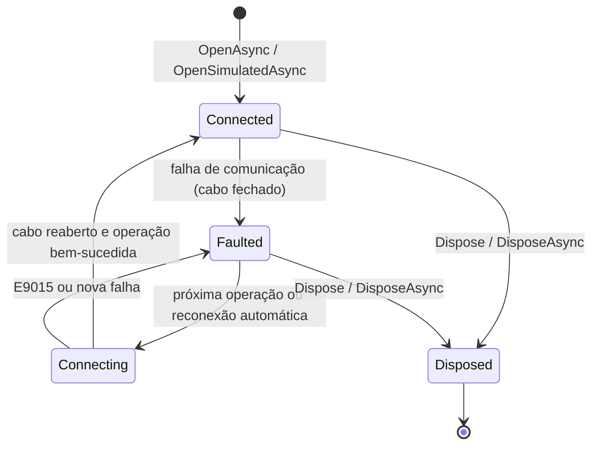

# Biblioteca Brymen.Dmm

Guia da biblioteca .NET para os multímetros Brymen das famílias **BM52x** (o **BM525s** = **Minipa ET-2615A**, com
datalogger) e **BM82x** (o **Minipa ET-2517A**, sem datalogger), pelo cabo óptico USB **BC-86X** (kit **BU-86X**, HID
VID `0820h`, PID `0001h`). É o mesmo código que a API REST deste repositório usa, empacotado para outros projetos .NET.
As mudanças de cada versão estão no [CHANGELOG](../CHANGELOG.md).

O [README do pacote](../src/Brymen.Dmm/README.md) traz os exemplos curtos; este guia cobre a API pública, o modelo de
threads, os erros, o ciclo de vida, trimming/AOT, as plataformas e o empacotamento.

## Conteúdo

- [Pacotes](#pacotes)
- [Instalação](#instalação)
- [Plataformas e alvos](#plataformas-e-alvos)
- [Início rápido](#início-rápido)
- [Famílias BM52x e BM82x](#famílias-bm52x-e-bm82x)
- [API pública](#api-pública)
- [Ciclo de vida e estados](#ciclo-de-vida-e-estados)
- [Threads, concorrência e eventos](#threads-concorrência-e-eventos)
- [Erros e códigos](#erros-e-códigos)
- [Tempos de espera e comportamento do hardware](#tempos-de-espera-e-comportamento-do-hardware)
- [Memória do datalogger](#memória-do-datalogger)
- [Integração com o Generic Host](#integração-com-o-generic-host)
- [Simulação e testes](#simulação-e-testes)
- [Trimming e Native AOT](#trimming-e-native-aot)
- [Linux (x64 e arm64)](#linux-x64-e-arm64)
- [Windows](#windows)
- [Empacotamento num único nupkg](#empacotamento-num-único-nupkg)
- [Exemplos](#exemplos)
- [Pendências](#pendências)

## Pacotes

| Pacote | Projeto | Conteúdo | Dependências |
|---|---|---|---|
| `Brymen.Dmm` | [`src/Brymen.Dmm`](../src/Brymen.Dmm) | `BrymenMeter`, `MeterConnection`, `LoggerMemoryReader`, opções e erros; dentro do mesmo pacote, `Brymen.Dmm.Protocol.dll` (decodificação dos quadros e da memória) e `Brymen.Dmm.Hid.dll` (transporte HID, `Bu86xLink` e o medidor simulado) | nenhuma |
| `Brymen.Dmm.Extensions.Hosting` | [`src/Brymen.Dmm.Extensions.Hosting`](../src/Brymen.Dmm.Extensions.Hosting) | `AddBrymenMeter`, o serviço hospedado e o `IBrymenMeterAccessor` (opcional) | `Brymen.Dmm` e `Microsoft.Extensions.Hosting.Abstractions`, `Options`, `Configuration.Binder` e `Logging.Abstractions` (a partir da 8.0.0 no alvo `net8.0` e da 10.0.0 no `net10.0`) |

Os dois têm a versão do [`Directory.Build.props`](../Directory.Build.props) (hoje `0.2.0`), documentação XML em todos os
membros públicos e símbolos num `.snupkg`.

| Namespace | Assembly | Tipos principais |
|---|---|---|
| `Brymen.Dmm` | `Brymen.Dmm.dll` | `BrymenMeter`, `IBrymenMeter`, `BrymenMeterOptions`, `MeterFamilySelection`, `LoggerReadOptions`, `MeterState`, `MeterStateChangedEventArgs`, `RealTimeStatistics`, `BrymenErrorCodes`, `BrymenMeterError`, `BrymenMeterException`, `MeterConnection`, `LoggerMemoryReader`, `ILoggerMemoryTransport`, `MeterCommandResult`, `LoggerReadProgress`, `LoggerMemoryImage` |
| `Brymen.Dmm.Protocol` | `Brymen.Dmm.Protocol.dll` | `DmmReading`, `DisplayReading`, `DmmFlags`, `DmmFlagNames`, `MeasurementMode`, `MeterFamily`, `MeterFamilies`, `LoggerMemory`, `LoggerSession`, `LoggerSample`, `LoggerValue`, `LoggerHeader`, `Bm52xRealtime`, `Bm52xMemory`, `Bm52xCommands`, `Bm52xFrameException` |
| `Brymen.Dmm.Hid` | `Brymen.Dmm.Hid.dll` | `HidDeviceInfo`, `IHidDevice`, `IHidDeviceProvider`, `IHidDevicePathProbe`, `HidDeviceProviders`, `HidException`, `Bu86xLink`, `Bu86xLinkOptions`, `Bu86xResendPolicy`, `Bu86xTimeoutException`, `Bu86xShortReportException`, `SimulatedBm52xMeter`, `SimulatedFault`, `SimulatedHidDevice`, `SimulatedHidWrite`, `SimulatedHidDeviceProvider`; os transportes `LinuxHidrawDeviceProvider`/`LinuxHidrawDevice` e `WindowsHidDeviceProvider`/`WindowsHidDevice` |
| `Brymen.Dmm.Extensions.Hosting` | `Brymen.Dmm.Extensions.Hosting.dll` | `BrymenMeterServiceCollectionExtensions`, `IBrymenMeterAccessor` |

O resto é interno: o parser do report descriptor (`HidReportDescriptor`, `HidReportLayout`) e os ganchos de teste do
`LinuxHidrawDeviceProvider` (a árvore sysfs falsa), que mudariam a superfície binária dos pacotes. As interfaces públicas
(`IBrymenMeter`, `IBrymenMeterAccessor`, `IHidDevice`, `IHidDeviceProvider`) ganham membros novos só com implementação
padrão, para não quebrar quem as implementa ou simula.

## Instalação

Os pacotes ainda não estão num feed público. Gere-os na raiz do repositório:

```bash
dotnet pack src/Brymen.Dmm -c Release -o artifacts/packages
dotnet pack src/Brymen.Dmm.Extensions.Hosting -c Release -o artifacts/packages   # opcional
```

e aponte o projeto consumidor para a pasta com um `nuget.config` (o de [`samples/nuget.config`](../samples/nuget.config)
é um modelo):

```xml
<configuration>
  <packageSources>
    <clear />
    <add key="brymen-local" value="C:\caminho\para\artifacts\packages" />
    <add key="nuget.org" value="https://api.nuget.org/v3/index.json" />
  </packageSources>
  <packageSourceMapping>
    <packageSource key="brymen-local"><package pattern="Brymen.Dmm" /><package pattern="Brymen.Dmm.*" /></packageSource>
    <packageSource key="nuget.org"><package pattern="*" /></packageSource>
  </packageSourceMapping>
</configuration>
```

```bash
dotnet add package Brymen.Dmm --version 0.2.0
dotnet add package Brymen.Dmm.Extensions.Hosting --version 0.2.0   # para o Generic Host
```

O mapeamento de origens garante que os pacotes `Brymen.Dmm*` venham só da pasta local, e evita o erro `NU1301` quando a
pasta ainda não existe num projeto que não a usa. O NuGet não extrai de novo uma versão que já está no cache global
(`~/.nuget/packages`): para testar uma mudança na biblioteca, gere outra versão (`-p:Version=0.2.0-dev.2`) ou apague a
pasta da versão no cache.

## Plataformas e alvos

| | Situação |
|---|---|
| Alvos | `net8.0` (LTS) e `net10.0`, com o mesmo comportamento. A única diferença é o `System.Threading.Lock`, que só existe a partir do .NET 9: no `net8.0`, `Lock` é um apelido de `object` (`Using` com `Alias` no `Directory.Build.props`), e o `lock` usa o `Monitor`. |
| C# do consumidor | Dois membros do simulador usam `params IEnumerable<T>` (C# 13): `new SimulatedHidDeviceProvider(params IEnumerable<SimulatedHidDevice> devices)` e `SimulatedBm52xMeter.SetRealTimeFrames(params IEnumerable<byte[]> frames)`. Num projeto `net8.0`, que usa o C# 12 por padrão, eles não aceitam a forma expandida: passe uma coleção, como `new SimulatedHidDeviceProvider([device])`. |
| Windows | `hid.dll`, sem driver. Validado no Windows 11 x64, nos dois alvos: com o BM525s real na versão 0.1.0 e com o ET-2517A real na 0.2.0 ([§11 do relatório de validação](validation-report.md#11-minipa-et-2517a-família-bm82x)). |
| Linux | `hidraw` pela libc, com glibc, em x64 e arm64 (Raspberry Pi com sistema de 64 bits). Validado com o BM525s real num Orange Pi 5 (Ubuntu 22.04, arm64), com o pacote 0.1.0 nos dois alvos ([§10.7 do relatório de validação](validation-report.md#107-biblioteca-nuget-no-arm)). Um Linux x64 real não foi testado; o transporte hidraw também é coberto pelos testes do `Brymen.Dmm.Hid`, inclusive com um cabo virtual pelo `/dev/uhid`. |
| Outros sistemas | Sem transporte HID: `BrymenMeter.OpenAsync` sem `DeviceProvider` lança `PlatformNotSupportedException`. O medidor simulado e um `IHidDeviceProvider` próprio funcionam. |
| Medidores | BM52x (BM525s = Minipa ET-2615A) e Minipa ET-2517A (Brymen BM827s, BM82x), com a família detectada na 1ª leitura ([Famílias BM52x e BM82x](#famílias-bm52x-e-bm82x)). A lista completa, com os modelos prováveis não validados, está em [Medidores suportados](../README.md#medidores-suportados). |

## Início rápido

```csharp
using Brymen.Dmm;
using Brymen.Dmm.Protocol;

await using var meter = await BrymenMeter.OpenAsync();          // ou OpenSimulatedAsync(), sem hardware

DmmReading reading = await meter.ReadAsync();                   // a 1ª consulta (82 66) já detecta a família
Console.WriteLine($"{meter.ModelDescription}: {reading.Main?.Text} {reading.Main?.UnitSymbol}");

int count = 0;
await foreach (var r in meter.ReadContinuouslyAsync(TimeSpan.FromMilliseconds(500)))
{
    Console.WriteLine(r.Main?.Text);
    if (++count == 10)
        break;                                                  // 10 leituras, a cada 500 ms
}

if (meter.SupportsDataLogger)                                   // false no BM82x, que não tem memória
{
    LoggerMemory memory = await meter.ReadLoggerMemoryAsync();  // a memória do datalogger do BM52x
}
```

Com um `CancellationToken` em `ReadContinuouslyAsync`, o cancelamento termina a enumeração com
`OperationCanceledException`: trate-o (`catch (OperationCanceledException) when (cts.IsCancellationRequested)`), senão o
código depois do `await foreach` não roda.

## Famílias BM52x e BM82x

O mesmo cabo BC-86X serve às duas famílias, com o mesmo quadro de tempo real de 27 bytes e o mesmo mapa de LCD. Os
bytes 20 a 23 do quadro (o Model ID, os quatro iguais) dizem a família, e não o modelo exato
([§8 da especificação](protocol/bm52x-usb-protocol.md#8-família-bm82x-model-id-0x82-e-o-minipa-et-2517a)):

| | BM52x | BM82x |
|---|---|---|
| Validado | Brymen BM525s = Minipa ET-2615A | Minipa ET-2517A |
| Model ID | `52h` | `82h` |
| Tempo real | `52 66`; também responde ao `82 66`, com o mesmo quadro | só `82 66`; o `52 66` fica sem resposta |
| Datalogger | sim: `52 88`, `52 89` e `52 8A` | não: `E9014`, sem comandos de memória |
| Pedidos de tempo real descartados | nunca observados | sim, tanto mais quanto maior o intervalo entre as consultas |
| Política de cada consulta | um envio, até `ReportTimeout` por relatório | reenvios a cada `RealTimeResendTimeout`, até `RealTimeResendBudget` |

A família fica em `BrymenMeter.Family` e em cada `DmmReading.Family`. `ModelDescription` a descreve
(`"Minipa ET-2615A (Brymen BM525s, BM52x)"` ou `"Minipa ET-2517A (Brymen BM827s, BM82x)"`), e `SupportsDataLogger` diz se a leitura da
memória faz sentido. Os outros modelos prováveis de cada família (BM521s; BM821s, BM822s, BM827s e BM829s) não foram
validados: veja [Medidores suportados](../README.md#medidores-suportados).

### Detecção

Com `BrymenMeterOptions.Family = MeterFamilySelection.Auto` (o padrão):

1. A abertura não faz consulta. `Family` fica `null` até a 1ª leitura.
2. A 1ª consulta de tempo real envia `82 66`, que as duas famílias aceitam, e já é uma leitura: o Model ID do quadro dá a
   família. Como é o 1º `66` da conexão, ela faz a espera longa: o prazo é `RealTimeAfterMemoryTimeout` (3 s), e o
   pedido é reenviado a cada `RealTimeResendTimeout` (300 ms) sem o 1º relatório, porque o ET-2517A pode descartar
   justamente esse pedido, o que vem depois do maior tempo ocioso (§8.5.4). Sem nenhum relatório até o prazo, um `52 66`
   de reserva (com `ReportTimeout`) cobre um BM52x que ignore o `82 66`, o que nunca foi observado.
3. Depois, o BM52x é lido com `52 66` (o comando validado no BM525s, no Windows e no Orange Pi 5) e o BM82x com `82 66`.
4. Um quadro válido com o Model ID da outra família troca a família na hora: um ET-2517A trocado pelo BM525s no cabo
   responde ao `82 66` com o Model ID `52h`.
5. Depois de `MeterConnection.FailuresBeforeRedetection` (3) consultas seguidas sem resposta, `Family` volta a `null`, e
   a consulta seguinte detecta de novo, com o `82 66` e os reenvios. É o caso de um BM525s trocado pelo ET-2517A, que
   não responde ao `52 66`: na leitura contínua, a 3ª falha é o `E9016`, e a consulta seguinte (depois de
   `ReconnectDelay`, com `AutoReconnect`) já detecta o ET-2517A.
6. A família continua depois de uma falha que fecha e reabre o cabo.

Com `Bm52x` ou `Bm82x`, a família é fixa: não há detecção, e um quadro com o Model ID da outra família vira `W8011`.
`Family = Bm52x` reproduz o tempo real da versão 0.1.0, com o `52 66` em todas as consultas e um envio por consulta.

### Pedidos descartados e reenvio

O ET-2517A **descarta** uma parte dos pedidos `82 66`: nenhum relatório chega, nem esperando mais. A taxa cresce com o
intervalo entre as consultas (40 pedidos por intervalo, com espera de 1 s pelo 1º relatório; latência normal de 36 a
237 ms):

| Intervalo entre consultas | 0 ms | 100 ms | 200 ms | 300 ms | 500 ms |
|---|---|---|---|---|---|
| Pedidos sem resposta | 0/40 | 2/40 | 11/40 | 11/40 | 19/40 |

Reenviando o mesmo pedido depois de 300 ms sem o 1º relatório, até 3 reenvios, 70 a 80 % das consultas saíram na 1ª
tentativa a 100 e 200 ms de intervalo, e quase todas em até cerca de 1,2 s; mesmo assim, 1 a 5 em 40 falharam depois
dos 3 reenvios. As perdas se agrupam em janelas de cerca de 1 s em que o medidor não atende
([§8.5](protocol/bm52x-usb-protocol.md#85-pedidos-descartados)). O BM525s nunca mostrou isso: 5 leituras/s, sem
lacunas, por minutos.

A política de cada consulta de tempo real do BM82x e da detecção:

- espera até `RealTimeResendTimeout` (300 ms, acima das latências normais) pelo 1º relatório;
- sem ele, envia o **mesmo pedido** de novo, sem fechar o cabo: fechar e reabrir não recupera nada e só aumenta o tempo
  ocioso, que piora a perda;
- aceita o 1º quadro completo de qualquer um dos envios; uma resposta incompleta é descartada e o pedido, reenviado;
- para quando `RealTimeResendBudget` (2 s, contado do 1º envio; 3 s na espera longa) acaba: só então a consulta falha
  com `W7012`;
- depois de um reenvio, o comando seguinte começa com o descarte de recuperação (`RecoveryDrainTimeout`, 100 ms), para
  que a resposta atrasada de um envio anterior não seja tomada pela dele. É o melhor esforço: um pedido descartado nunca
  é respondido (§8.5.2), e a resposta de um envio atendido chega dentro da janela de 300 ms, mas uma resposta que chegue
  depois do silêncio seria lida pelo comando seguinte (no BM82x, um quadro válido, só um pouco mais antigo). Uma consulta
  com reenvios que não termina com o quadro inteiro (cancelada, ou com o orçamento esgotado) deixa para o comando
  seguinte no mesmo cabo aberto um silêncio de pelo menos `RealTimeResendTimeout`, que cobre a latência do ET-2517A (até
  ≈ 260 ms). Depois de fechar e reabrir o cabo, vale o `RecoveryDrainTimeout`.

As perdas recuperadas não são falhas: não geram `W7012`, `LastError` nem `ErrorOccurred`, e não contam para as 3 falhas
seguidas da leitura contínua. Elas só aparecem em `RealTimeStatistics`:

```csharp
RealTimeStatistics s = meter.RealTimeStatistics;
Console.WriteLine($"{s.Queries} consultas, {s.Requests} pedidos, {s.Resends} reenvios, " +
                  $"{s.LostRequests} perdidos, {s.RecoveredQueries} recuperadas, {s.FailedQueries} sem resposta");
```

| Contador | O que conta |
|---|---|
| `Queries` | Consultas de tempo real terminadas, com ou sem resposta (as canceladas não contam). |
| `Requests` | Pedidos `66` enviados: o 1º de cada consulta, os reenvios e o `52 66` de reserva da detecção. |
| `Resends` | Reenvios depois da janela do 1º relatório. |
| `LostRequests` | Pedidos sem resposta: os reenviados e os das consultas que falharam. |
| `RecoveredQueries` | Consultas que só tiveram resposta depois de ao menos um reenvio. |
| `FailedQueries` | Consultas sem resposta completa (cada uma é um `W7012`). |

Os contadores são da conexão, desde a abertura do `BrymenMeter`, e são lidos um a um, sem um instantâneo atômico.

**Intervalo de polling.** Com o ET-2517A, um `PollInterval` menor perde menos pedidos (a 0 ms, nenhum em 40), mas não
dispensa os reenvios. O padrão continua 200 ms, com os reenvios cobrindo as perdas: conferido com o ET-2517A simulado e,
no ET-2517A real, numa sessão sem perdas reais e com descartes injetados no host
([§11.4 a §11.6 do relatório](validation-report.md#114-leitura-contínua-com-o-brymenmeter)). O original consulta sem
pausa nenhuma, o que equivale a `PollInterval = TimeSpan.Zero`.

**A espera longa.** O 1º `66` depois da abertura e depois de comandos de memória tem o prazo de
`RealTimeAfterMemoryTimeout` (3 s), como na §8.5.4 da especificação:

- com a família desconhecida (a detecção) ou BM82x, o pedido é reenviado a cada `RealTimeResendTimeout` até esse prazo:
  o 1º pedido depois da abertura vem depois do maior tempo ocioso, e é o que o ET-2517A mais descarta (60 % na 1ª
  tentativa com 1 s ou mais sem consulta, §8.5.1). Um pedido descartado custa 300 ms, e não um `W7012`;
- com a família BM52x conhecida, ou depois de um comando de memória respondido (só o BM52x tem memória), é um envio só,
  que espera o prazo inteiro pelo 1º relatório: no BM525s, o `66` seguinte ao último bloco da memória leva ≈ 2,06 s, e
  um reenvio no meio do preparo da resposta poderia gerar uma resposta duplicada (§6, questão 14 da especificação).

Na 1ª validação com o ET-2517A real, a espera longa ainda era um envio só, e nenhum descarte real caiu nela; o reenvio
na espera longa é coberto pelos testes com o ET-2517A simulado, com o 1º pedido descartado depois de um longo tempo
ocioso ([§11.10 do relatório](validation-report.md#1110-revisão)).

### Sem datalogger: `E9014`

Só o BM52x tem datalogger. Num BM82x, `ReadLoggerMemoryAsync` e `ReadLoggerImageAsync` lançam `BrymenMeterException`
com `E9014` (`BrymenErrorCodes.DataLoggerNotSupported`):

- com a família fixa (`BrymenMeterOptions.Family = Bm82x`) ou confirmada por um quadro de tempo real há menos de
  `MeterConnection.FamilyConfirmationWindow` (2 s; a leitura contínua rodando, por exemplo), na hora, sem esperar o cabo
  e sem nenhum comando;
- com a família desconhecida (logo depois da abertura), ou conhecida há mais tempo (o medidor pode ter sido trocado no
  cabo), pela conferência do modelo (`LoggerReadOptions.VerifyModel`): uma consulta de tempo real (`82 66` na detecção e
  no BM82x), que confirma a família, e nenhum `88`. Um BM525s posto no lugar do ET-2517A é lido normalmente;
- sem a conferência do modelo (`VerifyModel = false`), a família conhecida, mesmo antiga, recusa na hora;
- não é falha de comunicação: `State`, `LastError` e `ErrorOccurred` não mudam, e o cabo continua aberto.

O `E9014` é próprio da biblioteca. O original lê o tempo real de um BM82x, mas recusa a importação com o `E9017`
([§8.1](protocol/bm52x-usb-protocol.md#81-identificação-comando-82-66-e-ausência-de-memória)). Com `VerifyModel = false`
e a família desconhecida não há conferência: o `52 88` fica sem resposta, e a leitura termina em `E9016` depois das
tentativas do `88`.

## API pública

As assinaturas abaixo são as do código; os detalhes de cada membro estão na documentação XML, que o IntelliSense mostra.

### `BrymenMeter`

`public sealed class BrymenMeter : IBrymenMeter, IAsyncDisposable, IDisposable`, thread-safe. Representa um cabo aberto
e o medidor atrás dele, e é o dono dele: o descarte fecha o cabo. As operações assíncronas nunca fazem a E/S na thread de
quem chama ([Threads](#threads-concorrência-e-eventos)).

| Membro | Descrição |
|---|---|
| `static Task<BrymenMeter> OpenAsync(BrymenMeterOptions? options = null, CancellationToken cancellationToken = default)` | Procura o cabo (`DevicePath` ou o primeiro VID 0820h/PID 0001h) e o abre. A procura e a abertura são síncronas, e a tarefa já volta concluída. `E9015` sem o cabo; `ArgumentException` com uma opção fora da faixa; `PlatformNotSupportedException` sem transporte HID. As opções são copiadas. |
| `static Task<BrymenMeter> OpenSimulatedAsync(SimulatedBm52xMeter? meter = null, BrymenMeterOptions? options = null, CancellationToken cancellationToken = default)` | Abre um BC-86X simulado (`SimulatedLatency` por resposta) ligado a `meter` (padrão: `SimulatedBm52xMeter.FromCaptures()`, o BM525s; o ET-2517A é o `SimulatedBm52xMeter.FromEt2517aCaptures()`). `DeviceProvider` e `DevicePath` das opções são ignorados. |
| `static IReadOnlyList<HidDeviceInfo> FindDevices(IHidDeviceProvider? provider = null)` | Os cabos conectados, na ordem da enumeração. |
| `const int MaxConsecutiveFailures = 3` | Falhas seguidas toleradas na leitura contínua (a 3ª é persistente). |
| `static readonly TimeSpan SimulatedLatency` | 20 ms, a latência do cabo simulado de `OpenSimulatedAsync`. |
| `HidDeviceInfo Device` | O cabo aberto (atualizado a cada reabertura). |
| `MeterState State` | O estado atual ([Ciclo de vida](#ciclo-de-vida-e-estados)). |
| `BrymenMeterError? LastError` | A última falha; continua depois da recuperação. |
| `bool IsRunning` | Se o laço de `Start` está rodando. |
| `MeterFamily? Family` | A família: a de `BrymenMeterOptions.Family`, quando fixa, ou a detectada pela leitura mais recente. Com `Auto`, `null` logo depois da abertura, até a 1ª leitura, e depois de 3 consultas seguidas sem resposta, até a detecção seguinte ([Detecção](#detecção)). |
| `bool SupportsDataLogger` | `false` só com uma família conhecida sem datalogger (BM82x), em que a leitura da memória falha com `E9014`, sem comandos de memória ([Sem datalogger](#sem-datalogger-e9014)); `true` com a família desconhecida. |
| `string? ModelDescription` | `"Minipa ET-2615A (Brymen BM525s, BM52x)"` ou `"Minipa ET-2517A (Brymen BM827s, BM82x)"` (`MeterFamilies.Describe`); `null` com a família desconhecida. |
| `RealTimeStatistics RealTimeStatistics` | Os contadores do tempo real desde a abertura: consultas, pedidos, reenvios, perdas, consultas recuperadas e sem resposta ([Pedidos descartados](#pedidos-descartados-e-reenvio)). |
| `Task<DmmReading> ReadAsync(CancellationToken cancellationToken = default)` | Uma consulta de tempo real decodificada (`52 66` no BM52x; `82 66` no BM82x e na detecção), sem nova tentativa além dos reenvios do BM82x. |
| `IAsyncEnumerable<DmmReading> ReadContinuouslyAsync(TimeSpan? interval = null, CancellationToken cancellationToken = default)` | Uma consulta a cada `interval` (padrão: `PollInterval`), contado do início de uma ao início da seguinte; termina quando o medidor é descartado, e com `OperationCanceledException` no cancelamento. Cada enumeração faz as suas consultas, independentes do laço de `Start` e das outras: para vários consumidores, use `Start` e `ReadingReceived` (ou `IBrymenMeterAccessor.ReadingsAsync`). |
| `void Start()` e `Task StopAsync()` | O laço de leitura contínua em segundo plano, com as leituras em `ReadingReceived`. `Start` com o laço rodando não faz nada; `StopAsync` cancela a consulta em andamento e espera o laço. |
| `event EventHandler<DmmReading>? ReadingReceived` | Cada leitura do laço de `Start` (não as de `ReadAsync` nem as de `ReadContinuouslyAsync`). |
| `event EventHandler<MeterStateChangedEventArgs>? StateChanged` | Mudança de `State`, por qualquer operação. |
| `event EventHandler<BrymenMeterError>? ErrorOccurred` | Cada falha, a mesma de `LastError`, e as exceções de handlers (`EVENT_HANDLER`). |
| `Task<LoggerMemory> ReadLoggerMemoryAsync(IProgress<LoggerReadProgress>? progress = null, CancellationToken cancellationToken = default)` | Lê e decodifica a memória do datalogger (só BM52x; no BM82x, `E9014`). |
| `Task<LoggerMemoryImage> ReadLoggerImageAsync(IProgress<LoggerReadProgress>? progress = null, CancellationToken cancellationToken = default)` | A imagem bruta da memória, com os blocos, as retentativas e os recomeços (só BM52x; no BM82x, `E9014`). |
| `void Dispose()` e `ValueTask DisposeAsync()` | Fecha o cabo; as operações em andamento falham com `ObjectDisposedException` e as enumerações terminam. `DisposeAsync` também espera o laço de `Start`. |

### `IBrymenMeter`

`public interface IBrymenMeter`: as operações de um medidor aberto, sem o ciclo de vida (sem abertura, descarte nem o
laço de `Start`). O `BrymenMeter` a implementa; o `IBrymenMeterAccessor` do hosting devolve uma fachada dela, que não é o
`BrymenMeter` do serviço. Serve também para simular o medidor nos testes de quem o usa.

| Membro | Descrição |
|---|---|
| `HidDeviceInfo Device`, `MeterState State`, `BrymenMeterError? LastError` | Os do `BrymenMeter`. |
| `MeterFamily? Family`, `bool SupportsDataLogger`, `string? ModelDescription`, `RealTimeStatistics RealTimeStatistics` | Os do `BrymenMeter` (0.2.0), com implementação padrão para quem implementa a interface: `null`, `Family is not { } f \|\| f.HasDataLogger()`, `Family?.Describe()` e zeros. |
| `Task<DmmReading> ReadAsync(CancellationToken cancellationToken = default)` | Uma consulta de tempo real. |
| `Task<LoggerMemory> ReadLoggerMemoryAsync(IProgress<LoggerReadProgress>? progress = null, CancellationToken cancellationToken = default)` | A memória decodificada. |
| `Task<LoggerMemoryImage> ReadLoggerImageAsync(IProgress<LoggerReadProgress>? progress = null, CancellationToken cancellationToken = default)` | A imagem bruta da memória. |

### `BrymenMeterOptions` e `LoggerReadOptions`

`public sealed class BrymenMeterOptions`, copiada e validada na abertura: mudar a instância depois não afeta um medidor
aberto. Também é a opção do `MeterConnection`, que ignora `PollInterval`, `ReconnectDelay` e `AutoReconnect`.

| Propriedade | Padrão | Faixa | Descrição |
|---|---|---|---|
| `string? DevicePath` | `null` | — | Caminho do cabo; `null` ou vazio = o primeiro da enumeração. |
| `MeterFamilySelection Family` | `Auto` | um valor do enum | `Auto` detecta a família na 1ª leitura; `Bm52x` e `Bm82x` a fixam ([Detecção](#detecção)). |
| `TimeSpan PollInterval` | 200 ms | ≥ 0 | Intervalo da leitura contínua; `TimeSpan.Zero` consulta sem pausa, como o original. No BM82x, um intervalo menor perde menos pedidos. |
| `TimeSpan ReportTimeout` | 1 s | > 0 | Espera por cada relatório de entrada (no BM52x, também pelo 1º). |
| `TimeSpan RealTimeAfterMemoryTimeout` | 3 s (`MeterConnection.DefaultRealTimeAfterMemoryTimeout`) | > 0 | Prazo da espera longa do 1º `66` depois da abertura e de comandos de memória: um envio só no BM52x conhecido; com reenvios na detecção e no BM82x. |
| `TimeSpan RealTimeResendTimeout` | 300 ms (`MeterConnection.DefaultRealTimeResendTimeout`) | > 0 | BM82x e detecção: espera pelo 1º relatório de cada envio antes de reenviar o mesmo pedido, sem fechar o cabo. |
| `TimeSpan RealTimeResendBudget` | 2 s (`MeterConnection.DefaultRealTimeResendBudget`) | > 0 | BM82x e detecção: tempo total de uma consulta com os reenvios; só quando ele acaba a consulta é `W7012`. |
| `TimeSpan ReconnectDelay` | 2 s | ≥ 0 | Espera antes de reabrir o cabo depois de uma falha persistente. |
| `bool AutoReconnect` | `true` | — | Leitura contínua: reabre o cabo em vez de terminar. |
| `TimeSpan DrainTimeout` | 5 ms | ≥ 0 | Silêncio para descartar relatórios atrasados antes de cada comando. |
| `TimeSpan RecoveryDrainTimeout` | 100 ms | ≥ 0 | Silêncio exigido no descarte depois de abrir o cabo e depois de uma troca interrompida ou com reenvios; depois de uma consulta com reenvios interrompida, pelo menos `RealTimeResendTimeout`. |
| `IHidDeviceProvider? DeviceProvider` | `null` (= `HidDeviceProviders.CreateForCurrentPlatform()`) | — | Transporte HID. |
| `TimeProvider TimeProvider` | `TimeProvider.System` | não nulo | Relógio dos intervalos, das esperas e dos instantes das leituras. |
| `LoggerReadOptions LoggerRead` | padrões abaixo | não nulo | Leitura da memória. |

| `LoggerReadOptions` | Padrão | Faixa | Descrição |
|---|---|---|---|
| `bool VerifyModel` | `true` | — | Confere o modelo antes da leitura: uma consulta de tempo real (até 2 tentativas) com a família da conexão (o `82 66` da detecção, se ela ainda não é conhecida). Model ID `52h` segue; `82h` dá `E9014`; outro valor, ou nenhuma resposta, dá `E9017`. |
| `TimeSpan HeadSettleDelay` | 200 ms | ≥ 0 | Espera depois do `88`, antes do próximo comando (o `Sleep(200)` do original). |
| `TimeSpan RetryDelay` | 10 ms | ≥ 0 | Espera depois de reabrir o cabo, antes de uma nova tentativa. |
| `int MaxHeadAttempts` | 3 | ≥ 1 | Tentativas do `88`, sempre com outro `88`. |
| `int MaxBlockAttempts` | 4 | ≥ 1 | Tentativas por bloco: 1 × `89` + até N − 1 × `8A`. |
| `int MaxRestarts` | 3 | ≥ 0 | Recomeços a partir do `88` antes de desistir com `E9016`. |

Um valor fora da faixa dá `ArgumentOutOfRangeException` (um `ArgumentException`) na abertura.

### Estados, erros e leituras

| Tipo | Descrição |
|---|---|
| `enum MeterState { Closed, Connecting, Connected, Faulted, Disposed }` | Estado da comunicação ([Ciclo de vida](#ciclo-de-vida-e-estados)). |
| `sealed class MeterStateChangedEventArgs : EventArgs` | `MeterState Previous`, `MeterState Current`. |
| `static class BrymenErrorCodes` | As constantes dos códigos ([Erros e códigos](#erros-e-códigos)). |
| `sealed record BrymenMeterError(string Code, string Message, Exception? Exception, DateTimeOffset Timestamp)` | Uma falha registrada; o instante vem do `TimeProvider` das opções. |
| `sealed class BrymenMeterException(string code, string message, Exception? innerException = null) : Exception` | `string Code`; `BrymenMeterError ToError(DateTimeOffset timestamp)`. |
| `sealed record DmmReading` | `DateTimeOffset Timestamp`, `DisplayReading? Main`, `DisplayReading? Secondary`, `DmmFlags Flags`, `MeterFamily Family` (pelo Model ID; padrão `Bm52x`), `string RawHex` (os 27 bytes), `RealTimeDiagnostics? Diagnostics` (com `ModelBytes`: `52525252` ou `82828282`). |
| `sealed record DisplayReading` | `Digits`, `Text` (como no LCD), `Negative`, `Overload`, `double? Value`, `Prefix`, `Unit`, `MeasurementMode Mode`, `double? SiValue`, `UnitSymbol` (ex.: `mV`, `kΩ`). |
| `[Flags] enum DmmFlags` e `static class DmmFlagNames` | Os anunciadores do LCD (`Auto`, `HoldBox`, `LowBattery`...) e os nomes estáveis (`DmmFlagNames.ToNames`, `TryParse`). |
| `enum MeasurementMode { None, DC, AC, AcDc }` | Acoplamento indicado no display. |
| `enum MeterFamily : byte { Bm52x = 0x52, Bm82x = 0x82 }` e `static class MeterFamilies` | A família (Protocol). `MeterFamilies.TryFromModelId(byte modelId, out MeterFamily family)` e as extensões `Code()` (`52h`/`82h`), `HasDataLogger()` (só `Bm52x`), `Name()` (`"BM52x"`/`"BM82x"`) e `Describe()` (`"Minipa ET-2615A (Brymen BM525s, BM52x)"`/`"Minipa ET-2517A (Brymen BM827s, BM82x)"`). |
| `enum MeterFamilySelection { Auto = 0, Bm52x = 0x52, Bm82x = 0x82 }` | O valor de `BrymenMeterOptions.Family`: detectada ou fixa. |
| `readonly record struct RealTimeStatistics(long Queries, long Requests, long Resends, long LostRequests, long RecoveredQueries, long FailedQueries)` | Os contadores do tempo real ([Pedidos descartados](#pedidos-descartados-e-reenvio)). |

### Memória do datalogger

| Tipo | Descrição |
|---|---|
| `readonly record struct LoggerReadProgress(int BlocksRead, int BlocksTotal, int TotalBytes, int Retries, int Restarts)` | Progresso por bloco; `double Percent`. `BlocksTotal` e `TotalBytes` ficam em 0 até a resposta do `88`. |
| `sealed class LoggerMemoryImage` | `LoggerHeader Header`, `ReadOnlyMemory<byte> Image`, `int BlockCount`, `IReadOnlyList<ReadOnlyMemory<byte>> Blocks`, `ReadOnlyMemory<byte> GetBlock(int)`, `int Retries`, `int Restarts`, `IReadOnlyList<string> Warnings`, `byte[] ToArray()`, `LoggerMemory Decode()`. Construtor público: `(LoggerHeader header, ReadOnlySpan<byte> image, int retries = 0, int restarts = 0, IReadOnlyList<string>? warnings = null)`. |
| `sealed record LoggerMemory(LoggerHeader Header, IReadOnlyList<LoggerSession> Sessions, IReadOnlyList<string> Warnings)` | A memória decodificada. |
| `sealed record LoggerSession` | `Number`, `MainFunction`, `SecondaryFunction`, `IsDual`, `Interval`, `Samples` e os campos crus da sessão. |
| `sealed record LoggerSample(int Index, TimeSpan Elapsed, LoggerValue Main, LoggerValue? Secondary)` | Uma amostra. |
| `sealed record LoggerValue` | `Text`, `double? Value`, `Prefix`, `Unit`, `UnitSymbol`, `Mode`, `SiValue`, `Overload`, `LowBattery` etc. |

### Blocos de baixo nível

Para quem precisa de controle fino (a API REST usa estes blocos para não duplicar lógica):

| Tipo | Descrição |
|---|---|
| `sealed class MeterConnection : IDisposable` | Conexão com o cabo, que o `BrymenMeter` compõe. `MeterConnection(BrymenMeterOptions? options = null)`; `HidDeviceInfo Open()`, `HidDeviceInfo Reopen()`, `void Close()` (de qualquer thread, interrompe o comando em andamento); `Task<byte[]> ExecuteAsync(byte command, int reportCount, CancellationToken)` e `Task<MeterCommandResult> TryExecuteAsync(...)` (a falha volta no resultado), que enviam `00 52 cc`, e as sobrecargas com a família, `ExecuteAsync(byte family, byte command, int reportCount, CancellationToken)` e `TryExecuteAsync(byte family, ...)` (`00 family cc`), todas sem detecção nem reenvio, só com a espera longa do 1º `66`; `Task<byte[]> ExecuteRealTimeAsync(CancellationToken)` e `Task<DmmReading> ReadRealTimeAsync(CancellationToken)`, com a família da conexão, a detecção e os reenvios; `Task<LoggerMemoryImage> ReadLoggerImageAsync(IProgress<LoggerReadProgress>?, CancellationToken)` (`E9014` numa família sem datalogger: na hora com ela confirmada, senão depois da conferência do modelo); `IsOpen`, `Device`, `DeviceProvider`, `TimeProvider`, `Family`, `IsFamilyConfirmed` (fixa, ou confirmada por um quadro há menos de `FamilyConfirmationWindow`), `SupportsDataLogger`, `RealTimeStatistics`, `IsNextRealTimeSlow`, `LastCommandReportsReceived`; `static FindDevices(IHidDeviceProvider?)`; `DefaultRealTimeAfterMemoryTimeout` (3 s), `DefaultRealTimeResendTimeout` (300 ms), `DefaultRealTimeResendBudget` (2 s), `FamilyConfirmationWindow` (2 s) e `const int FailuresBeforeRedetection = 3`. Os comandos são serializados entre si e abrem o cabo se ele estiver fechado; uma falha não o fecha (quem chama decide). A família continua depois de `Close` e `Reopen`. |
| `sealed class LoggerMemoryReader` | O algoritmo da memória sobre qualquer transporte: `LoggerMemoryReader(ILoggerMemoryTransport transport, LoggerReadOptions? options = null, IProgress<LoggerReadProgress>? progress = null, TimeProvider? timeProvider = null)`, `Task<LoggerMemoryImage> ReadAsync(CancellationToken)`, `const int MaxTotalBytes = 0x20000`. Uma leitura por instância (a 2ª chamada lança `InvalidOperationException`). Um quadro da conferência do modelo com o Model ID `82h` dá `E9014`. |
| `interface ILoggerMemoryTransport` | `Task<MeterCommandResult> ExecuteAsync(byte command, int reportCount, CancellationToken)` (falha no resultado, não como exceção) e `Task ResetAsync(CancellationToken)` (fecha o cabo para uma nova tentativa). O transporte escolhe o “Command 2”: o do `MeterConnection` faz a conferência do modelo (`66`) com a família da conexão e os comandos de memória com `52`. |
| `readonly record struct MeterCommandResult(byte[]? Frame, Exception? Error, int ReportsReceived)` | `bool Succeeded`. Com `ReportsReceived` ≥ 1, o medidor certamente processou o comando. |
| `sealed class Bu86xLink : IDisposable` | O enquadramento do BC-86X sobre um `IHidDevice`: `00 fam cc` no relatório de saída (“Command 2” `fam`: `DefaultFamily` = `52h`, ou `82h` no tempo real do BM82x) e N relatórios de 8 bytes na resposta. `static FindDevice`, `static Open`, `ExecuteAsync(command, reportCount[, firstReportTimeout], ct)` (com `52`), `ExecuteAsync(family, command, reportCount[, firstReportTimeout], ct)` e `ExecuteAsync(family, command, reportCount, Bu86xResendPolicy resend, ct)` (reenvio sem fechar o cabo; vale o 1º quadro completo de qualquer envio); `LastCommandReportsReceived` (com reenvios, o maior número de relatórios de uma mesma resposta), `LastCommandAttempts`, `VendorId`, `ProductId`. |
| `sealed class Bu86xLinkOptions` e `sealed class Bu86xResendPolicy` | `ReportTimeout`, `DrainTimeout`, `RecoveryDrainTimeout` (depois de uma troca com reenvios que não terminou com o quadro inteiro, o silêncio é de pelo menos a `FirstReportWindow`) e `TimeProvider` (o relógio do orçamento dos reenvios). `Bu86xResendPolicy(TimeSpan firstReportWindow, TimeSpan budget)`, com `FirstReportWindow`, `Budget` e `static Default` (300 ms, 2 s). |
| `Bu86xTimeoutException` e `Bu86xShortReportException` | A resposta não chegou inteira, ou um relatório veio curto: `Family` (`52h`/`82h`), `Command`, `ReportsReceived`, `ReportsExpected` e, no timeout, `Attempts` (envios); no relatório curto, `ReportLength`. |
| `interface IHidDeviceProvider` e `interface IHidDevice` | O transporte HID: `Enumerate(vendorId, productId)` e `Open(HidDeviceInfo)`; `WriteReportAsync` e `ReadReportAsync`. `HidDeviceProviders.CreateForCurrentPlatform()` escolhe o hidraw ou a hid.dll. |
| `sealed record HidDeviceInfo(string Path, ushort VendorId, ushort ProductId, ushort? ReleaseNumber = null, string? Manufacturer = null, string? Product = null, string? SerialNumber = null)` | A identificação de um cabo. |
| `static class Bm52xRealtime` e `static class Bm52xMemory` | Decodificadores puros: `Bm52xRealtime.Decode(ReadOnlySpan<byte> frame, DateTimeOffset timestamp)` / `TryDecode`, que aceitam os Model IDs `52525252` e `82828282`; `Decode(frame, timestamp, MeterFamily expectedFamily)` / `TryDecode(frame, timestamp, expectedFamily, out reading, out error)`, que recusam também a outra família; `TryGetFamily(ReadOnlySpan<byte> frame, out MeterFamily family)`; e `Bm52xMemory.Decode(ReadOnlySpan<byte> image)`, `ParseBlock`, `ParseHeader`. Lançam `Bm52xFrameException`. |
| `static class Bm52xCommands` | As constantes do protocolo: `Family` (`52h`, mantida), `Bm52xFamily` (`52h`), `Bm82xFamily` (`82h`), `RealTime` (`66`), os comandos de memória e os tamanhos dos quadros. |

## Ciclo de vida e estados



- `OpenAsync` devolve o medidor já em `Connected`, sem evento. Um `BrymenMeter` nunca está em `Closed`: esse estado
  é o do `IBrymenMeterAccessor` antes da abertura e depois da parada do host.
- Uma falha de comunicação fecha o cabo, vai para `LastError` e `ErrorOccurred` e deixa o estado em `Faulted`. A
  operação seguinte reabre o cabo (`Connecting`); não é preciso abrir outro `BrymenMeter`.
- `LastError` continua depois da recuperação: `State` diz se a comunicação está boa agora.
- `Disposed` é terminal: toda operação lança `ObjectDisposedException`, inclusive as que estavam em andamento.
- `DisposeAsync` espera o laço de `Start`; `Dispose` não espera, e o laço termina logo depois, sem eventos.

## Threads, concorrência e eventos

- **Nenhuma E/S na thread de quem chama.** `ReadAsync`, `ReadLoggerMemoryAsync`, `ReadLoggerImageAsync` e cada
  `MoveNextAsync` de `ReadContinuouslyAsync` passam para o pool antes do 1º comando e voltam com a tarefa em andamento,
  mesmo com um transporte que bloqueia ou que conclui de forma síncrona (um `IHidDevice` próprio, o simulado sem
  latência, `ReadContinuouslyAsync(TimeSpan.Zero)`). Uma interface gráfica (Avalonia, WPF, MAUI) pode chamá-los da thread
  dela. `OpenAsync` é a exceção: a procura e a abertura do cabo são síncronas e curtas.
- **Transportes.** No Windows, a `hid.dll` é lida por um `FileStream` assíncrono (overlapped). No Linux, o
  `ReadReportAsync` do hidraw devolve na hora um relatório que já está na fila do kernel; senão, o `poll()` em fatias de
  50 ms ocupa uma thread do pool (não a de quem chama) até o relatório chegar ou o timeout acabar: até ≈ 3 s no 1º
  `66` depois da abertura ou da memória, e até o orçamento de 2 s numa consulta do BM82x com reenvios. O
  `MeterConnection` e o `Bu86xLink` não trocam de thread por conta própria; sobre esses dois transportes, são
  assíncronos de verdade.
- **Serialização.** Todas as operações no cabo passam por um semáforo: `ReadAsync` concorrentes, a leitura contínua e
  a importação da memória entram uma de cada vez. Uma importação pausa a leitura contínua (`Start` e
  `ReadContinuouslyAsync`), que volta sozinha no fim; nenhum `66` é enviado entre o `88` e o último `89`. Os reenvios
  de uma consulta do BM82x acontecem dentro dela, sem liberar o cabo.
- **Eventos fora dos locks.** Os eventos são disparados depois que a operação libera os locks internos, na thread da
  operação que os causou (a do laço de `Start`, no caso de `ReadingReceived`). Um handler lento atrasa a próxima
  consulta do laço.
- **Handlers isolados.** Cada handler é chamado à parte. A exceção de um handler de `ReadingReceived` ou de
  `StateChanged` não interrompe nada: ela vira `ErrorOccurred` com o código `EVENT_HANDLER`, sem mudar `State` nem
  `LastError`. As exceções dos handlers de `ErrorOccurred` são ignoradas.
- **Chamadas de dentro de um handler.** `StopAsync`, `Dispose` e `DisposeAsync` chamados de dentro de um handler do
  próprio medidor não travam (o laço termina quando o handler voltar). Não espere de forma bloqueante (`Wait()`,
  `.Result`) por uma operação do medidor dentro de um handler; `await` é seguro.
- **Ordem.** Com operações concorrentes de chamadores diferentes, os eventos de operações distintas podem chegar fora
  de ordem; `State` é sempre o atual.
- **Progresso.** `IProgress<T>.Report` é chamado de forma síncrona, na thread da leitura. Um `Progress<T>` posta os
  relatórios no `SynchronizationContext` capturado (ou no pool), então eles podem chegar depois de a tarefa terminar.
- **Cancelamento.** Todo método assíncrono aceita um `CancellationToken`; o cancelamento lança
  `OperationCanceledException`, e uma consulta de tempo real cancelada não conta para a política de tempos de espera nem
  como consulta em `RealTimeStatistics` (os pedidos já enviados contam). O descarte do medidor cancela tudo o que está
  em andamento.
- **`MeterConnection`.** Os comandos são serializados entre si; `Close` e `Dispose` podem ser chamados de qualquer
  thread e interrompem o comando em andamento.

## Erros e códigos

As falhas de comunicação são `BrymenMeterException`, com `Code` igual ao do software original da Brymen (Bs82-52x
V6.0.0.9), para facilitar o suporte cruzado:

| Código | Constante | Quando | O que fazer |
|---|---|---|---|
| `E9015` | `CableNotFound` | Cabo não encontrado, ou não pôde ser aberto (sem permissão no `/dev/hidrawN`: a mensagem traz o erro da abertura). Na leitura contínua, é persistente de imediato. | Conectar o cabo, conferir o `DevicePath` e, no Linux, a regra udev. |
| `E9016` | `TransmissionTimeout` | A 3ª falha seguida da leitura contínua (`W7012` três vezes), ou a leitura da memória que esgotou as tentativas. | Ligar o medidor e encaixar a porta óptica; com `AutoReconnect`, a leitura continua sozinha. |
| `E9017` | `NoDataLogger` | Antes da leitura da memória: o medidor não respondeu à consulta de tempo real ou o Model ID não é `52h` nem `82h` (desligado, desconectado ou sem a função DATA LOGGING). | Ligar o medidor; conferir o modelo. |
| `E9014` | `DataLoggerNotSupported` | Leitura da memória de um medidor da família BM82x (Model ID `82h`, como o ET-2517A), que não tem datalogger, sem nenhum comando de memória: na hora, com a família fixa ou confirmada há pouco, ou depois da conferência do modelo ([Sem datalogger](#sem-datalogger-e9014)). Código próprio da biblioteca. Não é falha de comunicação: `State`, `LastError` e `ErrorOccurred` não mudam. | Conferir `SupportsDataLogger` antes da leitura. |
| `W7012` | `NoDataReceived` | Uma consulta de tempo real sem resposta completa: timeout, relatório curto, falha de E/S ou cabo fechado durante o comando. No BM82x, só depois de esgotado `RealTimeResendBudget`: um pedido perdido e recuperado por reenvio não é falha. | Tentar de novo; a leitura contínua tolera 2 seguidas. |
| `W8011` | `InvalidFrame` | Quadro inválido ou inconsistente (tempo real, cabeçalho da memória ou memória ilegível), inclusive um Model ID que não seja `52525252` nem `82828282` e, com `Family` fixa, o Model ID da outra família. | Tentar de novo; persistente, indica outro modelo, a família fixa errada ou um defeito. |
| `EVENT_HANDLER` | `EventHandlerFailed` | Um handler de evento lançou uma exceção (só em `ErrorOccurred`, nunca como exceção). | Corrigir o handler. |
| `INTERNAL` | `Internal` | Falha inesperada: um defeito, ou uma exceção fora do contrato de um `IHidDeviceProvider` ou `IHidDevice` próprio (ou do `IProgress` da importação). Na leitura contínua, é persistente, para o laço não morrer em silêncio; em `ReadAsync` e na leitura da memória, é lançada como `BrymenMeterException`, com a original em `InnerException`. Como numa falha de comunicação, o cabo é fechado e o estado fica em `Faulted`. | Reportar, com `Exception`. |

**Política da leitura contínua** (`Start` e `ReadContinuouslyAsync`), como no original: as 2 primeiras falhas seguidas
(`W7012` ou `W8011`) só reabrem o cabo, depois de 10 ms; a 3ª (`MaxConsecutiveFailures`) é persistente e vira `E9016`
(ou continua `W8011`). Uma falha persistente, ou o `E9015`, termina a enumeração com `BrymenMeterException` (e termina o
laço de `Start`, com `IsRunning` = `false`); com `AutoReconnect`, o medidor espera `ReconnectDelay`, reabre o cabo e
continua. Toda falha vai para `LastError` e `ErrorOccurred`. No BM82x, as falhas contadas são as consultas com o
orçamento dos reenvios esgotado, e não os pedidos perdidos: com o orçamento de 2 s, o `E9016` sai depois de cerca de
6 s sem leitura. Com `Family = Auto`, a 3ª falha seguida também faz a família ser detectada de novo
([Detecção](#detecção)).

**Outras exceções:**

| Exceção | Quando |
|---|---|
| `ArgumentException` / `ArgumentOutOfRangeException` | Opção fora da faixa na abertura; `interval` negativo em `ReadContinuouslyAsync`. |
| `PlatformNotSupportedException` | Sem `DeviceProvider`, num sistema que não é Linux nem Windows. |
| `ObjectDisposedException` | Operação num medidor descartado, inclusive durante a operação. |
| `OperationCanceledException` | O token de quem chamou foi cancelado. |
| `InvalidOperationException` | Um `LoggerMemoryReader` reutilizado. |

## Tempos de espera e comportamento do hardware

Os padrões vêm do software original e dos testes com o BM525s e o ET-2517A reais (§2.7 e §8.5 de
[`docs/protocol/bm52x-usb-protocol.md`](protocol/bm52x-usb-protocol.md)):

- **1º `66` lento.** O 1º `66` depois da abertura e depois de comandos de memória (`88`, `89`, `8A`) tem o prazo de
  `RealTimeAfterMemoryTimeout` (3 s): um envio só no BM52x conhecido (ou depois de um comando de memória respondido), e
  com os reenvios de `RealTimeResendTimeout` na detecção e no BM82x ([A espera longa](#pedidos-descartados-e-reenvio));
  os demais seguem a política da família. No BM525s real, o `66` seguinte ao último bloco da memória levou ≈ 2,06 s. É
  uma espera longa só: o `66` que termina, com resposta ou sem ela, volta à política normal.
- **BM52x.** Cada consulta é um envio, com `ReportTimeout` (1 s) por relatório.
- **BM82x e detecção.** O mesmo pedido é reenviado a cada `RealTimeResendTimeout` (300 ms) sem o 1º relatório, até
  `RealTimeResendBudget` (2 s) ([Pedidos descartados e reenvio](#pedidos-descartados-e-reenvio)).
- **1º comando depois de muito tempo ocioso.** No BM525s, ficou sem resposta (`W7012`) uma vez, com os seguintes
  normais. `ReadAsync` faz uma consulta só e não tenta de novo (além dos reenvios do BM82x): trate o `W7012` com uma nova
  tentativa, ou use a leitura contínua.
- **`8A` logo depois do `88`.** No medidor real, um `8A` cerca de 15 ms depois do `88` avançou o ponteiro como um `89`
  (9 de 16 tentativas). Por isso o leitor espera `HeadSettleDelay` (200 ms) depois do `88` e nunca recupera o `88` com
  `8A`.
- **Descarte.** Antes de cada comando, os relatórios atrasados são descartados (`DrainTimeout`); depois de abrir o cabo
  e de uma troca interrompida ou com reenvios, o descarte exige `RecoveryDrainTimeout` de silêncio, e depois de uma
  consulta com reenvios interrompida, pelo menos `RealTimeResendTimeout`.

## Memória do datalogger

`ReadLoggerMemoryAsync` e `ReadLoggerImageAsync` usam o `LoggerMemoryReader`, o mesmo algoritmo da importação da API.
Só a família BM52x tem datalogger; com uma família BM82x fixa ou confirmada há pouco, a leitura falha na hora com
`E9014`, antes do passo 1 ([Sem datalogger](#sem-datalogger-e9014)).

1. Com `VerifyModel`, uma consulta de tempo real com a família da conexão (`52 66` no BM52x; o `82 66` da detecção com
   a família desconhecida), até 2 tentativas, confere o Model ID: `52h` segue; `82h` dá `E9014`; senão, `E9017`.
2. `52 88`: ponteiro no início e o 1º bloco, com o cabeçalho (`LoggerHeader`: modelo, TotalBytes e sessões). Uma falha do
   `88` é recuperada sempre com outro `88` (até `MaxHeadAttempts`), nunca com `8A`.
3. Espera de `HeadSettleDelay` (200 ms) depois do `88`.
4. `89` para cada bloco seguinte, com checksum de 16 bits por bloco. Um `89` que falhou é recuperado com `8A` (relê o
   bloco atual) só se o medidor certamente o processou (chegou ao menos 1 relatório, ou o checksum veio errado), até
   `MaxBlockAttempts` por bloco. Sem nenhum relatório não há como saber se o ponteiro andou, e a leitura recomeça do
   `88` (até `MaxRestarts`), conferindo byte a byte os blocos já lidos.
5. Tentativas esgotadas: `E9016`; cabeçalho inválido ou que mudou durante a leitura: `W8011`.

Com o simulado sem latência, a importação dos 95 blocos da captura real leva pouco mais que os 200 ms da espera depois
do `88`; no BM525s real, levou cerca de 10,8 s no Windows, com a imagem idêntica byte a byte a
[`memory-dump-1.txt`](protocol/captures/memory-dump-1.txt). A leitura não altera a memória do medidor.

## Integração com o Generic Host

O pacote `Brymen.Dmm.Extensions.Hosting` liga o medidor ao `IServiceCollection` de worker services, ASP.NET Core e
qualquer app com o Generic Host.

```csharp
using Brymen.Dmm;
using Brymen.Dmm.Extensions.Hosting;

var builder = Host.CreateApplicationBuilder(args);
builder.Services.AddBrymenMeter(builder.Configuration.GetSection("Brymen"));      // opções da configuração
builder.Services.AddBrymenMeter(o => o.PollInterval = TimeSpan.FromSeconds(1));   // e/ou por código
```

| Membro | Descrição |
|---|---|
| `static IServiceCollection AddBrymenMeter(this IServiceCollection services, Action<BrymenMeterOptions>? configure = null)` | Registra `IOptions<BrymenMeterOptions>`, o `IBrymenMeterAccessor` (singleton) e o serviço hospedado. |
| `static IServiceCollection AddBrymenMeter(this IServiceCollection services, IConfiguration configuration)` | Igual, com as opções da seção, por binding gerado em tempo de compilação. |
| `static IServiceCollection AddBrymenMeter(this IServiceCollection services, string name, Action<BrymenMeterOptions>? configure = null)` | Um medidor com nome: as opções nomeadas, o `IBrymenMeterAccessor` como serviço com a chave `name` e um serviço hospedado só dele. |
| `static IServiceCollection AddBrymenMeter(this IServiceCollection services, string name, IConfiguration configuration)` | Igual, com as opções da seção. |

Chamar de novo (com o mesmo nome, ou sem nome) só acrescenta configurações, aplicadas na ordem do registro: o serviço e o
acessor são registrados uma vez por nome. As opções são lidas na partida do host.

**Vários cabos.** Cada nome tem o seu medidor, o seu laço e a sua reconexão; dê a cada um o seu `DevicePath` (o padrão,
o primeiro cabo da enumeração, seria o mesmo para todos). O acessor vem por chave, e o log vai para a categoria do tipo
seguida de `.{nome}`, que os filtros da categoria do tipo também pegam:

```csharp
builder.Services.AddBrymenMeter("bancada1", builder.Configuration.GetSection("Brymen:Bancada1"));
builder.Services.AddBrymenMeter("bancada2", o => o.DevicePath = "/dev/hidraw1");

var bancada1 = app.Services.GetRequiredKeyedService<IBrymenMeterAccessor>("bancada1");
// ou, num construtor: [FromKeyedServices("bancada2")] IBrymenMeterAccessor bancada2
```

**Configuração.** As chaves aceitas, todas opcionais (as ausentes mantêm o valor atual), com os intervalos no formato
invariante do `TimeSpan`:

```json
{
  "Brymen": {
    "DevicePath": "/dev/brymen-bu86x",
    "Family": "Auto",
    "PollInterval": "00:00:00.200",
    "ReportTimeout": "00:00:01",
    "RealTimeAfterMemoryTimeout": "00:00:03",
    "RealTimeResendTimeout": "00:00:00.300",
    "RealTimeResendBudget": "00:00:02",
    "ReconnectDelay": "00:00:02",
    "AutoReconnect": true,
    "DrainTimeout": "00:00:00.005",
    "RecoveryDrainTimeout": "00:00:00.100",
    "LoggerRead": {
      "VerifyModel": true,
      "HeadSettleDelay": "00:00:00.200",
      "RetryDelay": "00:00:00.010",
      "MaxHeadAttempts": 3,
      "MaxBlockAttempts": 4,
      "MaxRestarts": 3
    }
  }
}
```

`Family` aceita `Auto`, `Bm52x` e `Bm82x` (os nomes do `MeterFamilySelection`). `DeviceProvider` e `TimeProvider` não
vêm da configuração (o gerador do binding não aceita interfaces nem classes abstratas): ajuste-os com a sobrecarga de
`Action`. Um valor que não converte (`"PollInterval": "rápido"`) lança `InvalidOperationException` quando as opções são
lidas, na partida do host.

**Serviço hospedado.**

- O serviço implementa `IHostedLifecycleService`. A 1ª abertura acontece no `StartingAsync`, que o host chama em todos
  os serviços antes de qualquer `StartAsync`; a leitura contínua (ou as novas tentativas de abertura) começa no
  `StartedAsync`, depois de todos os `StartAsync`. Assim, um serviço registrado antes ou depois do `AddBrymenMeter` pode
  esperar o medidor (`WaitForMeterAsync`) e assinar os eventos no próprio `StartAsync` sem travar a partida e sem perder
  a 1ª leitura. As mudanças de estado e o log da 1ª abertura acontecem no `StartingAsync`: quem assina `StateChanged` no
  `StartAsync` lê o `State` atual e recebe as mudanças seguintes. Sem o ciclo de vida (uma chamada direta ao
  `StartAsync`), as duas fases acontecem no `StartAsync`.
- Uma opção inválida ou um sistema sem transporte HID impedem a partida do host. Sem o cabo (`E9015`), a partida segue,
  e o serviço tenta de novo a cada `ReconnectDelay` (mínimo de 10 ms) com `AutoReconnect`; sem ela, desiste: não tenta
  de novo, e quem espera o medidor recebe a falha da abertura.
- Aberto o medidor, o serviço chama `Start`. Daí em diante, o próprio `BrymenMeter` reabre o cabo depois das falhas,
  sem trocar de instância. Sem `AutoReconnect`, uma falha persistente termina a leitura contínua, e o serviço não a
  reinicia; o medidor continua disponível para operações avulsas.
- Cada tentativa de abertura sem o cabo passa por `Connecting` e volta a `Faulted`, com um `ErrorOccurred` (`E9015`),
  como na reconexão do próprio `BrymenMeter`.
- Na parada, o medidor é descartado (o que interrompe a consulta em andamento). O descarte do contêiner sem a parada
  também o fecha.
- O log vai para a categoria `Brymen.Dmm.Extensions.Hosting.BrymenMeterHostedService`: abertura (Information, evento 1),
  falhas (Warning, evento 2; a mesma falha repetida vai para Debug, evento 3, até a comunicação voltar), recuperação
  (Information, evento 4), falhas inesperadas e de handlers (Error, evento 5), sem reconexão automática (Warning,
  evento 6), fechamento (Information, evento 7) e a família do medidor (Information, evento 8: “Família do multímetro:
  Minipa ET-2517A (Brymen BM827s, BM82x), sem datalogger.”), na 1ª leitura do medidor aberto pelo serviço e a cada troca de família.
  Os pedidos do BM82x
  recuperados por reenvio não são falhas e não vão para o log.

**`IBrymenMeterAccessor`.**

| Membro | Descrição |
|---|---|
| `IBrymenMeter? Meter` | As operações avulsas do medidor aberto (`ReadAsync`, `ReadLoggerMemoryAsync`, que pausa a leitura contínua, e `ReadLoggerImageAsync`), ou `null` antes da 1ª abertura e depois da parada. É uma fachada, e não o `BrymenMeter` do serviço: não há como descartá-lo nem parar o laço por ela (nem com `await using`). Depois da parada, as operações dela lançam `ObjectDisposedException`, e o `State` dela vai a `Disposed`. |
| `MeterState State` | O estado do medidor, quando aberto; senão, `Closed` (antes da partida ou com o serviço parado), `Connecting` (abrindo) ou `Faulted` (a abertura falhou). Nunca `Disposed`. |
| `DmmReading? LastReading` | A última leitura da leitura contínua do serviço; continua depois de uma falha e da parada. |
| `BrymenMeterError? LastError` | A última falha (da abertura ou do medidor), sem as de handlers. |
| `MeterFamily? Family` | A família do medidor aberto (`BrymenMeter.Family`); sem medidor aberto, ou antes da detecção, a da última leitura (`DmmReading.Family`), ou `null` se nenhuma chegou. Implementação padrão (0.2.0): `Meter?.Family`. `SupportsDataLogger`, `ModelDescription` e `RealTimeStatistics` ficam em `Meter`. |
| `event EventHandler<DmmReading>? ReadingReceived` | As leituras do laço do serviço. |
| `event EventHandler<MeterStateChangedEventArgs>? StateChanged` | As mudanças do medidor e as do serviço (`Closed → Connecting → Connected`, `Faulted` nas aberturas que falharam, `Closed` na parada). |
| `event EventHandler<BrymenMeterError>? ErrorOccurred` | As falhas da abertura e do medidor, e as de handlers (`EVENT_HANDLER`). |
| `Task<IBrymenMeter> WaitForMeterAsync(CancellationToken cancellationToken = default)` | Espera o medidor ficar disponível; antes da partida e enquanto o cabo não aparece, espera. Termina com falha quando o medidor não vai mais aparecer: `BrymenMeterException` (a falha da abertura) se o serviço desistir sem `AutoReconnect`, `InvalidOperationException` com o serviço parado, a exceção da partida que falhou (uma opção inválida, por exemplo) e `ObjectDisposedException` com o contêiner descartado. Depois disso, as chamadas falham na hora, até uma nova partida. |
| `IAsyncEnumerable<DmmReading> ReadingsAsync(CancellationToken cancellationToken = default)` | As leituras do laço do serviço (as mesmas de `ReadingReceived`), sem consultas próprias: várias enumerações dividem o mesmo laço. A inscrição acontece no 1º `MoveNextAsync`; antes da partida e sem o cabo, espera. Cada enumeração guarda até 64 leituras não consumidas (as mais antigas são descartadas). Termina normalmente na parada do serviço e no descarte do contêiner, com `BrymenMeterException` se o serviço desistir da abertura e com `OperationCanceledException` no cancelamento. |

Não use `ReadContinuouslyAsync` para as leituras do serviço: ele faz as suas próprias consultas, e o tráfego no cabo
dobra (por isso ele não está no `IBrymenMeter`).

Os eventos têm o acessor como `sender` e seguem as regras do `BrymenMeter`: fora dos locks, cada handler à parte, a
exceção de um handler de `ReadingReceived` ou `StateChanged` vira `ErrorOccurred` (`EVENT_HANDLER`), e a de um handler
de `ErrorOccurred` só vai para o log (categoria `Brymen.Dmm.Extensions.Hosting.BrymenMeterAccessor`, evento 20). A ordem
do registro não importa para as leituras: o laço só começa depois do `StartAsync` de todos os serviços, como no
[WorkerSample](../samples/Brymen.Dmm.WorkerSample/Program.cs).

## Simulação e testes

- `BrymenMeter.OpenSimulatedAsync()` abre o medidor simulado com as capturas reais do BM525s: os 14 quadros de
  [`rtd-acv.txt`](protocol/captures/rtd-acv.txt) (ACV + Hz, em rodízio) e a memória de
  [`memory-dump-1.txt`](protocol/captures/memory-dump-1.txt) (95 blocos, 1 sessão de 375 amostras). As capturas vão
  embutidas no `Brymen.Dmm.Hid.dll`.
- `SimulatedBm52xMeter` reproduz o medidor real, inclusive o `8A` que avança como um `89` logo depois do `88`
  (`CurrentAfterHeadWindow`), e injeta falhas por comando: `FaultInjector = (command, n) => SimulatedFault...`, com
  `None`, `Drop`, `DropAfterProcessing`, `CorruptChecksum`, `Truncate` e `CorruptModel`. `IsPoweredOn = false` desliga o
  medidor; `CommandCount` conta os comandos. O BM525s simulado responde ao `52 66` e ao `82 66`, com o mesmo rodízio de
  quadros, como o real.
- O **ET-2517A simulado** é o `SimulatedBm52xMeter.FromEt2517aCaptures(TimeProvider? timeProvider = null, int seed =
  DefaultDropSeed)`: os 43 quadros reais da varredura
  ([`et2517a-sweep-2026-10-23.txt`](protocol/captures/et2517a-sweep-2026-10-23.txt), em
  `CapturedEt2517aRealTimeFrames`: ACV + Hz, DCV + ACV, Hz + mV, continuidade, temperatura, diodo, faixa manual e REC), só
  com o `82 66` e sem memória, e o descarte de pedidos medido no hardware. `SimulatedBm52xMeter.CreateBm82x(IEnumerable<byte[]>?
  realTimeFrames = null, TimeProvider? timeProvider = null)` é o mesmo BM82x sem descarte. `FamilyCode` (`52h`/`82h`) e
  `HasDataLogger` dizem qual é o simulado.
- O descarte é o `RequestDropper` (`Func<TimeSpan, int, bool>`: o tempo desde a última resposta e as perdas seguidas;
  `true` descarta o pedido), injetável em qualquer simulado; `DroppedRequestCount` conta os descartados.
  `CreateEt2517aRequestDropper(int seed = 2517, int maxConsecutiveDrops = 3)` é determinístico pela semente e segue a curva
  medida, `Et2517aDropProbability(TimeSpan idle)`: 0 % a 0 ms, 5 % a 100 ms, 27,5 % a 200 e 300 ms, 47,5 % a 500 ms e
  60 % a partir de 1 s, com interpolação. O tempo é contado da última resposta, o que reproduz o agrupamento das perdas,
  e depois de `maxConsecutiveDrops` perdas seguidas o pedido é atendido: toda perda é recuperável dentro do orçamento de
  2 s.
- `SimulatedHidDevice` é o cabo: `ResponseLatency`, `InterReportDelay`, `Disconnect()` e `Reconnect()` (remoção a
  quente), `Writes` (os comandos recebidos) e um `TimeProvider`. `SimulatedHidDevice.CreateBm52x(meter)` liga um cabo sem
  latência a `meter` (padrão: `SimulatedBm52xMeter.FromCaptures()`, as capturas reais completas, com o `8A` logo depois
  do `88`), e `CreateTypicalBm52x(meter)`, com `TypicalResponseLatency` (20 ms) por resposta, é o cabo do
  `OpenSimulatedAsync`.
- `SimulatedHidDeviceProvider` expõe os cabos como `DeviceProvider`. `new SimulatedHidDeviceProvider()`, sem
  argumentos, traz o mesmo cabo do `OpenSimulatedAsync` (útil no Generic Host); para o cabo ausente (`E9015`), passe uma
  coleção vazia: `new SimulatedHidDeviceProvider([])`.
- Com um `FakeTimeProvider` (pacote `Microsoft.Extensions.TimeProvider.Testing`) em `BrymenMeterOptions.TimeProvider` e
  no `SimulatedHidDevice`, os tempos de espera ficam determinísticos.

```csharp
var device = new SimulatedHidDevice(SimulatedBm52xMeter.FromCaptures().Respond);
await using var meter = await BrymenMeter.OpenAsync(new BrymenMeterOptions
{
    DeviceProvider = new SimulatedHidDeviceProvider([device]),
    DrainTimeout = TimeSpan.Zero,
    RecoveryDrainTimeout = TimeSpan.Zero,
});
device.Disconnect();   // a próxima leitura dá W7012, e a seguinte, E9015
```

```csharp
// O ET-2517A simulado, com o descarte medido: os pedidos perdidos são recuperados pelos reenvios.
await using var et2517a = await BrymenMeter.OpenSimulatedAsync(SimulatedBm52xMeter.FromEt2517aCaptures());
var first = await et2517a.ReadAsync();                  // Family = Bm82x, SupportsDataLogger = false
Console.WriteLine($"{et2517a.ModelDescription}: {first.Main?.Text} {first.Main?.UnitSymbol}");
```

Os testes da biblioteca estão em [`tests/Brymen.Dmm.Tests`](../tests/Brymen.Dmm.Tests) e os do hosting em
[`tests/Brymen.Dmm.Extensions.Hosting.Tests`](../tests/Brymen.Dmm.Extensions.Hosting.Tests), os dois em `net10.0` e
`net8.0`:

```bash
dotnet test tests/Brymen.Dmm.Tests
dotnet test tests/Brymen.Dmm.Extensions.Hosting.Tests
```

Os testes com o cabo real (`BRYMEN_HW_TESTS=1`) estão na seção [Testes](../README.md#testes) do README.

## Trimming e Native AOT

- As bibliotecas de `src/` (o `Brymen.Dmm`, o Protocol, o Hid e o hosting) são `IsAotCompatible` (pelo
  `Directory.Build.props`, com a condição pelo caminho relativo): os analisadores de trimming, AOT e single-file rodam em
  todo build, e com `TreatWarningsAsErrors` um aviso novo quebra a compilação.
- Nada usa reflexão. Os P/Invokes da libc e da `hid.dll` usam `[LibraryImport]`, com o marshalling gerado em tempo de
  compilação; as capturas do simulado são recursos embutidos.
- No hosting, o binding da configuração é gerado pelo source generator (`EnableConfigurationBindingGenerator`), sobre
  uma classe interna só com tipos suportados, e o log usa `[LoggerMessage]`.
- Num app consumidor, basta publicar com `-p:PublishTrimmed=true` ou `-p:PublishAot=true`. Se o app fizer o próprio
  binding de configuração, ative também o `EnableConfigurationBindingGenerator` nele.
- Validado: o publish trimmed da API (linux-arm64, linux-x64 e win-x64) e do WorkerSample e do ConsoleSample
  (linux-arm64, linux-x64 e win-x64) sem avisos; o WorkerSample trimmed rodou no Windows com o simulado, com o binding
  funcionando. Não validado: a ligação do Native AOT (a máquina de validação não tem o MSVC).

## Linux (x64 e arm64)

**Requisitos.** glibc e o kernel com `hidraw` (`CONFIG_HIDRAW`). No Raspberry Pi, use um sistema de 64 bits:
`dpkg --print-architecture` deve mostrar `arm64`.

**Permissão.** O usuário precisa de leitura e escrita no `/dev/hidrawN` do cabo; sem isso, a abertura dá `E9015`, com o
erro da abertura na mensagem. Uma regra udev resolve, por exemplo em `/etc/udev/rules.d/70-brymen-bu86x.rules`:

```text
SUBSYSTEM=="hidraw", ATTRS{idVendor}=="0820", ATTRS{idProduct}=="0001", MODE="0660", GROUP="plugdev", TAG+="uaccess", SYMLINK+="brymen-bu86x"
```

```bash
sudo udevadm control --reload
# reaplica as regras só ao hidraw do cabo (ou desligue e religue o cabo), e não a todos os hidraw da máquina
for n in /sys/class/hidraw/hidraw*; do
    grep -qix 'HID_ID=0003:00000820:00000001' "$n/device/uevent" &&
        sudo udevadm trigger --action=change --subsystem-match=hidraw --sysname-match="${n##*/}"
done
sudo usermod -aG plugdev "$USER"     # e entre de novo na sessão
ls -lL /dev/brymen-bu86x             # crw-rw---- root plugdev
```

- `TAG+="uaccess"` dá acesso ao usuário da sessão local; o nome do arquivo começa com `70-` para vir antes do
  `73-seat-late.rules` do systemd, que aplica o `uaccess`.
- O grupo cobre serviços e sessões remotas. O `plugdev` existe no Debian, no Ubuntu e no Raspberry Pi OS; em outras
  distribuições, use um grupo próprio. A regra da API, [`deploy/linux/99-brymen-bu86x.rules`](../deploy/linux/99-brymen-bu86x.rules),
  usa o grupo `brymen-dmm` e chama o `uaccess` ela mesma, por ser `99-`.
- O `SYMLINK` cria o caminho fixo `/dev/brymen-bu86x`, que pode ir em `DevicePath`; com mais de um cabo, ele aponta para
  o último enumerado, e o `/dev/hidrawN` resolve.

**Caminho do cabo.** A enumeração lê o sysfs (`/sys/class/hidraw`). Com `DevicePath`, o caminho é comparado com os da
enumeração, também depois de resolver links; um caminho que não aparece nela é aberto e identificado pelo próprio nó
(`HIDIOCGRAWINFO`), sem o sysfs, e só é aceito com o VID/PID do BC-86X. É o caso de um contêiner:

```bash
docker run --device /dev/hidraw3:/dev/bu86x --group-add "$(stat -c %g /dev/hidraw3)" ... # DevicePath=/dev/bu86x
```

**Publicação.**

```bash
dotnet publish -c Release -r linux-arm64 --self-contained -p:PublishTrimmed=true   # Raspberry Pi
dotnet publish -c Release -r linux-x64 --self-contained -p:PublishTrimmed=true
```

O pacote 0.1.0 rodou com o BM525s real num Orange Pi 5 (Ubuntu 22.04, arm64), nos alvos `net10.0` e `net8.0`: 25
leituras em 5 s e a importação de 95 blocos idêntica ao dump
([§10.7 do relatório de validação](validation-report.md#107-biblioteca-nuget-no-arm)). Um Linux x64 real e a versão
0.2.0 num Linux real não foram testados; o transporte hidraw é o mesmo da API e tem os testes do `Brymen.Dmm.Hid`,
inclusive com um BC-86X virtual pelo `/dev/uhid` (`BRYMEN_UHID_TESTS=1`).

## Windows

- Sem driver: o BC-86X é um HID genérico, aberto pela `hid.dll`. `BrymenMeter.FindDevices()` devolve caminhos como
  `\\?\hid#vid_0820&pid_0001#...`, que servem como `DevicePath`.
- Um programa de cada vez: feche o software original da Brymen e a API REST deste repositório, que disputariam o cabo.
- Validado com o BM525s real em `net10.0` e `net8.0` (versão 0.1.0): 1ª leitura em 213 a 334 ms, 14 a 15 leituras em
  3 s de leitura contínua e importação de 95 blocos em cerca de 10,8 s, com o 1º `52 66` seguinte em ≈ 2,06 s.
- O ET-2517A foi caracterizado no Windows, com os scripts de [`docs/protocol/tools/`](protocol/tools/) e o cabo real:
  identificação, `82 66`, a varredura de todas as funções e as medições dos pedidos descartados. A biblioteca 0.2.0
  rodou com ele em `net10.0` e `net8.0` ([§11 do relatório de validação](validation-report.md#11-minipa-et-2517a-família-bm82x)):
  testes de hardware, 3 min de leitura contínua a 200 ms e 1 min a 500 ms sem `W7012`, `E9016` nem reabertura do cabo,
  `E9014` na memória, a API e o pacote num consumidor isolado. Nenhum pedido se perdeu naquela sessão: o reenvio foi
  exercitado no hardware com descartes injetados no host.
- A importação real leva cerca de 15 ms a mais por bloco do que o necessário: o descarte de 5 ms antes de cada comando
  esbarra na granularidade do timer do Windows (≈ 15,6 ms).

## Empacotamento num único nupkg

O `Brymen.Dmm` é um pacote só, sem dependências, com o Protocol e o Hid dentro:

```text
Brymen.Dmm.0.2.0.nupkg
├── Brymen.Dmm.nuspec          dependências: grupos vazios para net8.0 e net10.0
├── README.md                  src/Brymen.Dmm/README.md
├── lib/net8.0/                Brymen.Dmm.dll, Brymen.Dmm.Protocol.dll, Brymen.Dmm.Hid.dll e os 3 .xml
└── lib/net10.0/               os mesmos 6 arquivos
Brymen.Dmm.0.2.0.snupkg        os 3 .pdb de cada alvo
```

Como isso é feito, em [`src/Brymen.Dmm/Brymen.Dmm.csproj`](../src/Brymen.Dmm/Brymen.Dmm.csproj):

- Os `ProjectReference` para o Protocol e o Hid têm `PrivateAssets="all"`: não viram dependências de pacote no nuspec.
- O target `IncludeReferencedProjectsInPackage`, em `TargetsForTfmSpecificBuildOutput`, põe em `BuildOutputInPackage`
  os `@(ReferenceCopyLocalPaths)` que vieram de `ProjectReference` (DLL, XML e PDB). O pack separa pelas extensões: DLL
  e XML vão para o `.nupkg`, e o PDB para o `.snupkg`.
- `PackageReadmeFile`, descrição, tags, `IncludeSymbols` com `snupkg` e `Deterministic`; `ContinuousIntegrationBuild`
  quando a variável `CI` ou `TF_BUILD` existe.
- Caminhos normalizados: no Release, o `Directory.Build.props` mapeia a raiz do repositório para `/_/` (`PathMap`) nas
  bibliotecas de `src/`, também sem git. Sem isso, o caminho da máquina do build ia no caminho do PDB de cada DLL e, no
  `net8.0` do hosting, no `[InterceptsLocation]` que o gerador do `Configuration.Binder` 8.0 grava; o
  `ContinuousIntegrationBuild` sozinho só mapeia as raízes do `SourceRoot`, que ficam vazias fora de um clone git. O
  Debug continua com os caminhos reais, para o depurador achar os fontes.
- Source Link: num clone git, o SDK grava no PDB o mapeamento dos fontes para o `raw.githubusercontent.com`, no commit
  do `HEAD`. O `Directory.Build.props` liga o `DeterministicSourcePaths` no Release de `src/` quando existe `.git`: o
  `SourceRoot` da raiz ganha o `MappedPath` `/_/`, e a chave do Source Link fica `/_/*`, a mesma dos documentos. Sem
  isso (os pacotes 0.2.0 da 1ª validação), a chave era o caminho local: nenhum documento casava, o depurador não achava
  os fontes, e o caminho da máquina ia no PDB. Conferido nos 8 PDBs dos dois `.snupkg` e nas DLLs dos dois `.nupkg`
  ([§11.10 do relatório](validation-report.md#1110-revisão)).
- O commit gravado no nuspec (`<repository commit>`), na `InformationalVersion` das DLLs (`0.2.0+<commit>`) e nas URLs
  do Source Link é o do `HEAD` no momento do pack. Faça o pack depois do commit da versão: um pack com mudanças não
  versionadas aponta para fontes que não estão naquele commit.
- Só o `Brymen.Dmm` e o hosting são empacotáveis: o `Directory.Build.props` põe `IsPackable=false` em todo o resto, e um
  `dotnet pack` da solução não gera pacotes `Brymen.Dmm.Protocol` e `Brymen.Dmm.Hid` com as mesmas DLLs do `Brymen.Dmm`.
- As DLLs têm o `Product` do pacote (`Brymen.Dmm`; o hosting, o dele) e o `Company` explícito do `Directory.Build.props`,
  o autor (`Sidinei Santos Sousa`), e não o padrão do SDK, o nome do assembly, que parecia uma empresa Brymen nas
  propriedades do arquivo no Windows.
- A versão, a licença (MIT), a autoria e o `RepositoryUrl` vêm do `Directory.Build.props`.

Dentro do repositório, um projeto que referencia o `src/Brymen.Dmm` por `ProjectReference` não recebe o Protocol e o
Hid (o `PrivateAssets` impede): ele precisa referenciá-los também, como a API e os testes fazem.

O `Brymen.Dmm.Extensions.Hosting` é um pacote comum: o `ProjectReference` para o `Brymen.Dmm` vira a dependência
`Brymen.Dmm` (≥ a versão do build), e os do Protocol e do Hid, com `PrivateAssets="all"`, servem só para compilar, já
que as duas DLLs vêm no pacote `Brymen.Dmm`. As dependências `Microsoft.Extensions.*` são as da linha de cada alvo, na
menor versão dela (8.0.0 no `net8.0`, 10.0.0 no `net10.0`): um app .NET 8 não é levado às abstrações 10.0, e um app que
referencia um patch mais antigo que o mais recente (o runtime instalado, por exemplo) não cai no `NU1605` (downgrade) nem
leva cópias locais das DLLs por cima do framework compartilhado.

Para conferir o conteúdo:

```bash
dotnet pack src/Brymen.Dmm -c Release -o artifacts/packages
unzip -l artifacts/packages/Brymen.Dmm.0.2.0.nupkg
unzip -p artifacts/packages/Brymen.Dmm.0.2.0.nupkg Brymen.Dmm.nuspec
```

## Exemplos

| Exemplo | O que mostra |
|---|---|
| [`samples/Brymen.Dmm.ConsoleSample`](../samples/Brymen.Dmm.ConsoleSample/README.md) | Console que consome o pacote `Brymen.Dmm`: leituras ao vivo, `--simulated` (BM525s ou ET-2517A), `--device`, `--family`, `--count`, a família e as estatísticas do tempo real no fim, e a importação do datalogger para CSV (`--import`). |
| [`samples/Brymen.Dmm.WorkerSample`](../samples/Brymen.Dmm.WorkerSample/README.md) | Worker service com `AddBrymenMeter`, que registra cada leitura no `ILogger`; `--simulated` aceita o BM525s ou o ET-2517A. |

Os dois ficam fora da solução e restauram os pacotes do feed local `artifacts/packages`
([`samples/nuget.config`](../samples/nuget.config)): primeiro o `dotnet pack`, depois o `dotnet run`.

## Pendências

- **Licença e autoria**: MIT, Sidinei Santos Sousa (no `Directory.Build.props`).
- **Versão 0.2.0 no hardware**: validada com o ET-2517A real no Windows
  ([§11 do relatório](validation-report.md#11-minipa-et-2517a-família-bm82x)): polling de 200 ms por 3 min e de 500 ms
  por 1 min sem `W7012`, `E9016` nem reabertura do cabo, e `E9014` na memória. O medidor não descartou pedidos nessa
  sessão, então o reenvio só foi exercitado com descartes injetados no host, e o efeito do orçamento de 2 s com perdas
  reais continua sem medição (§6, questão 13 da especificação). Faltam o BM525s real com o `82 66` da detecção e a 0.2.0
  num Linux real.
- **Diferenças da §8 da especificação**, escolhidas para manter o comportamento validado do BM525s: a família continua
  depois de fechar e reabrir o cabo, em vez de ser detectada de novo a cada abertura (§8.6); o BM52x conhecido não usa a
  janela de 300 ms (§8.5.3); e a memória de um BM82x dá `E9014` (409 na API), e não o `E9017` do original (§8.6).
- **Descarte real na espera longa**: a espera longa do 1º `66` reenvia o pedido com a família desconhecida e no BM82x
  (§8.5.4), mas nenhum descarte real caiu nela na validação com o ET-2517A; o caso só foi exercitado com o simulado.
- **Commit antes da publicação**: os pacotes 0.2.0 de `artifacts/packages` foram feitos sem o commit da versão e
  apontam para o commit da 0.1.0 (nuspec, `InformationalVersion` e Source Link). Faça o commit e o pack de novo antes de
  publicar ([§11.10.4 do relatório](validation-report.md#11104-pacotes)).
- **Linux x64 real** e **Native AOT ligado**: não validados com a biblioteca (veja acima).
- **`ReadAsync` sem nova tentativa**: o `W7012` isolado do 1º comando depois de muito tempo ocioso fica a cargo de quem
  chama.
